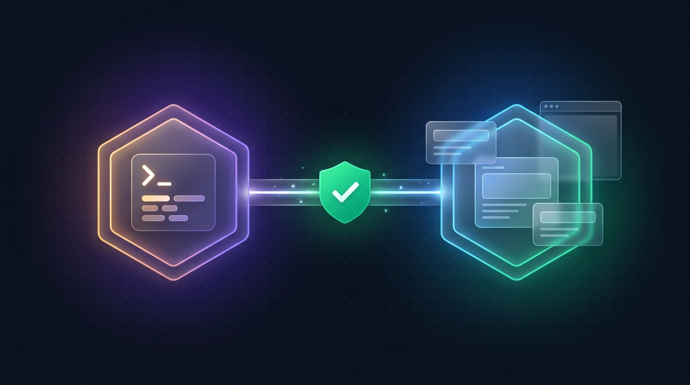
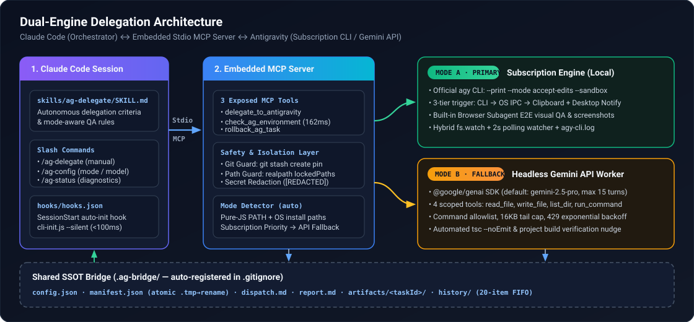
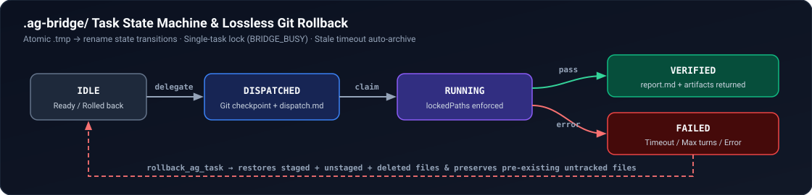

<div align="center">



# `claude-antigravity-plugin`

**Claude Code에서 프론트엔드 UI 구현 · 다중 파일 리팩토링 · 브라우저 E2E 시각적 QA를 Antigravity로 안전하게 위임하는 듀얼 엔진 MCP 플러그인**

[](https://github.com/xzawed/claude-antigravity-plugin/actions/workflows/ci.yml)
[](https://nodejs.org/)
[](https://www.typescriptlang.org/)
[](https://modelcontextprotocol.io/)
[](#듀얼-실행-모드)
[](./docs/05-verification/verification-report.md)
[](#보안-및-안전장치)
[](./LICENSE)
[](./.claude-plugin/plugin.json)

🌐 **언어:** [English (README.md)](./README.md) · **한국어**

[개요](#개요) · [Claude Code 설치 방법](#claude-code-플러그인-설치-방법) · [사용법 및 실전 예시](#claude-code에서-사용하는-방법) · [아키텍처](#시스템-아키텍처) · [실측 벤치마크](#실측-벤치마크) · [보안 및 안전장치](#보안-및-안전장치) · [문제 해결](#문제-해결-troubleshooting)

</div>

---

## 한눈에 보는 핵심 수치

| ⚡ 환경 진단 속도 | 🛡️ 자동화 검증 | 🌍 크로스플랫폼 CI | 🔒 의존성 보안 |
| :---: | :---: | :---: | :---: |
| 평균 **`149.9 ms`** | **`35 / 35`** 통과 | **`7 / 7`** 잡 통과 | 취약점 **`0`건** |
| `check_ag_environment` (`4.3×` 고속화) | 단위 · 보안 · 라이브 Stdio MCP | Ubuntu · macOS · Windows (Node 20/22) | `vitest 5.1` · `zod 4.6` · `MCP 1.27` |

---

## 개요

`claude-antigravity-plugin`(Claude Code 플러그인 · 내장 MCP 서버명: **`antigravity-delegate`**)은 **Claude Code**(메인 오케스트레이터 · 백엔드 · 아키텍처 총괄)와 **Antigravity**(프론트엔드 UI 구현 · 다중 파일 리팩토링 · 실제 브라우저 E2E 시각적 QA 전담)를 내장 **Stdio MCP 서버**와 투명한 `.ag-bridge/` 파일 프로토콜로 연결합니다.

- **수동 복사·붙여넣기 제거:** Claude가 작업 목표, TypeScript 타입, `lockedPaths`, `verifyUrl`, 완료 조건을 구조화해 Antigravity로 직접 전달하고 검증 리포트와 스크린샷을 자동 회수합니다.
- **구독자 추가 API 과금 없음:** 로컬에 설치된 Antigravity CLI(`agy`, `antigravity`, `ag`) 또는 데스크톱 앱을 최우선 감지하며, 미설치/헤드리스 환경에서만 `GEMINI_API_KEY` API 모드로 자동 폴백합니다.
- **미커밋 작업 손실 방지:** 모든 위임 직전 Git Guard가 현재 작업 트리(staged · unstaged · 기존 untracked 파일 포함)를 무손실 스냅샷으로 고정해 언제든 원클릭 롤백이 가능합니다.

---

## Claude Code 플러그인 설치 방법

### 사전 요구사항

- **Node.js** `>= 20.0.0` 및 **npm**
- **Git** (Git Guard 자동 체크포인트 및 롤백에 필요)
- **Claude Code CLI** (`claude`)
- **Antigravity 실행 환경 중 1가지 이상:**
  - **구독 모드 (권장):** 로컬 Antigravity CLI(`agy`) 또는 Antigravity 데스크톱 앱 로그인 완료
  - **API 폴백 모드:** Google AI Studio에서 발급한 `GEMINI_API_KEY`

### 1단계 — 클론 · 빌드 · 헬스체크 (복사해서 바로 실행)

사용 중인 OS 블록을 **수정 없이 그대로 복사·붙여넣기** 하세요(`~/.claude/plugins/claude-antigravity-plugin` 경로에 자동 설치됩니다):

**macOS / Linux:**

```bash
git clone https://github.com/xzawed/claude-antigravity-plugin.git "$HOME/.claude/plugins/claude-antigravity-plugin" \
  && npm --prefix "$HOME/.claude/plugins/claude-antigravity-plugin/server" install \
  && npm --prefix "$HOME/.claude/plugins/claude-antigravity-plugin/server" run build \
  && npm --prefix "$HOME/.claude/plugins/claude-antigravity-plugin/server" run verify
```

**Windows PowerShell:**

```powershell
git clone https://github.com/xzawed/claude-antigravity-plugin.git "$env:USERPROFILE\.claude\plugins\claude-antigravity-plugin"
npm --prefix "$env:USERPROFILE\.claude\plugins\claude-antigravity-plugin\server" install
npm --prefix "$env:USERPROFILE\.claude\plugins\claude-antigravity-plugin\server" run build
npm --prefix "$env:USERPROFILE\.claude\plugins\claude-antigravity-plugin\server" run verify
```

> **참고:** Claude Code는 `server/dist/index.js`와 `server/dist/cli-init.js`를 실행합니다. 최신 변경을 pull한 뒤에는 `npm run build`를 다시 실행하세요.

### 2단계 — Claude Code에 플러그인 연결 (복사해서 바로 실행)

아래 **3가지 공식 방법 중 하나**를 선택해 그대로 복사·붙여넣기 하세요(1단계 설치 경로와 100% 일치합니다):

#### 방법 A — Claude Code 마켓플레이스 영구 설치 *(권장)*

`claude` 실행 후 세션 안에서 아래 두 줄을 그대로 입력합니다:

```text
/plugin marketplace add ~/.claude/plugins/claude-antigravity-plugin
/plugin install antigravity-delegate@claude-antigravity-plugin
```

*(로컬 클론 없이 GitHub에서 바로 등록할 경우: `/plugin marketplace add xzawed/claude-antigravity-plugin` → `/plugin install antigravity-delegate@claude-antigravity-plugin`)*

#### 방법 B — `--plugin-dir`로 즉시 실행 *(로컬 사용 · 개발 테스트에 가장 빠름)*

**macOS / Linux:**

```bash
claude plugin validate "$HOME/.claude/plugins/claude-antigravity-plugin"
claude --plugin-dir "$HOME/.claude/plugins/claude-antigravity-plugin"
```

**Windows PowerShell:**

```powershell
claude plugin validate "$env:USERPROFILE\.claude\plugins\claude-antigravity-plugin"
claude --plugin-dir "$env:USERPROFILE\.claude\plugins\claude-antigravity-plugin"
```

> **팁:** 플러그인 파일을 수정했다면 Claude Code를 재시작하지 않고 세션 안에서 `/reload-plugins`만 입력하면 즉시 반영됩니다.

#### 방법 C — MCP 서버만 단독 등록 *(훅 · 스킬 · 슬래시 커맨드 없이 Tool 3종만 필요할 때)*

**macOS / Linux:**

```bash
claude mcp add antigravity-delegate -- node "$HOME/.claude/plugins/claude-antigravity-plugin/server/dist/index.js"
```

**Windows PowerShell:**

```powershell
claude mcp add antigravity-delegate -- node "$env:USERPROFILE\.claude\plugins\claude-antigravity-plugin\server\dist\index.js"
```

### 3단계 — 실행 프로바이더 설정

- **구독 모드 (Antigravity 앱/CLI 설치 시):** 별도 설정이 필요 없습니다. MCP 호스트가 `PATH`를 축소한 환경에서도 OS 표준 설치 경로에서 `agy` / `antigravity`를 자동 감지합니다.
- **API 폴백 모드 (비구독자 · 원격 SSH · 헤드리스 환경):** Claude Code 실행 전 `GEMINI_API_KEY` 환경변수를 설정하세요.

```bash
# macOS / Linux (~/.bashrc 또는 ~/.zshrc)
export GEMINI_API_KEY="your-gemini-api-key"
```

```powershell
# Windows PowerShell (현재 세션)
$env:GEMINI_API_KEY = "your-gemini-api-key"

# Windows PowerShell (영구 등록)
setx GEMINI_API_KEY "your-gemini-api-key"
```

### 세션 시작 시 자동으로 수행되는 초기화 (`SessionStart` 훅)

플러그인(방법 A 또는 B)으로 로드되면 대상 프로젝트에서 Claude Code 세션을 열 때마다 `hooks/hooks.json`이 `cli-init.js --silent`(`< 90ms`)를 실행하여 아래 작업을 자동 처리합니다.
1. 대상 프로젝트에 `.ag-bridge/` (`config.json`, `artifacts/`, `history/`) 생성
2. 대상 프로젝트 `.gitignore`에 `.ag-bridge/` 자동 등록 (중복 방지 멱등 처리)
3. `.agent/workflows/claude-handoff.md` 최신 템플릿 동기화 (프로젝트에 `.agents/` 폴더가 있으면 `.agents/workflows/claude-handoff.md`도 동시 미러링, 사용자가 직접 수정한 파일은 보존)

---

## Claude Code에서 사용하는 방법

### 1. 연결 상태 및 감지 모드 진단 (`/ag-status`)

작업할 프로젝트에서 Claude Code를 열고 다음 명령을 입력합니다:

```text
/ag-status
```

Claude가 `check_ag_environment({})`를 호출해 현재 환경을 표로 출력합니다:

| 점검 항목 | 상태 / 값 | 세부 정보 |
| :--- | :--- | :--- |
| **Execution Mode** | `auto` → **`subscription`** | 현재 해석된 실행 엔진 |
| **Subscription App/CLI** | `Detected` | `agy` (`C:\Users\...\agy\bin\agy.exe`), `cli_or_ipc` |
| **Gemini API Key** | `Not set` / `Configured (env)` | 환경변수 `GEMINI_API_KEY`, 모델 `gemini-2.5-pro`, 최대 턴 `15` |
| **Bridge (`.ag-bridge/`)** | `IDLE` | 초기화: `yes`, `.gitignore`: `protected`, 최근 작업: `none` |
| **Git Guard** | `Ready` | 브랜치 `main`, 작업 트리 `clean` |

### 2. 실행 모드 · 모델 · 타임아웃 설정 (`/ag-config`)

프로젝트별 설정은 `.ag-bridge/config.json`에 저장됩니다:

```text
/ag-config                                # 현재 설정 조회
/ag-config mode auto                      # 구독 우선 감지 -> API 자동 폴백 (기본값)
/ag-config mode subscription              # 로컬 Antigravity 구독 모드 고정
/ag-config mode api                       # 헤드리스 Gemini API 모드 고정
/ag-config model gemini-2.5-flash         # API 모드 사용 모델 변경
/ag-config timeout 600                    # 구독 모드 타임아웃(초) 변경 (30~1800)
/ag-config max-turns 20                   # API 워커 최대 턴 수 변경 (1~50)
/ag-config git-guard required             # Git 저장소 필수 정책 설정 (best_effort | required)
```

### 3. 자율 위임 사용 (자연어로 요청하기)

`skills/ag-delegate/SKILL.md`가 자동 로드되어 있으므로, 프론트엔드 UI 구현·다중 파일 생성·브라우저 시각적 QA가 필요한 작업을 자연어로 요청하면 Claude가 자동으로 위임을 판단합니다.

> *"백엔드 `/api/checkout` 스펙(`src/server/checkout.ts`)에 맞춰 `src/components/checkout/`와 `src/pages/CheckoutPage.tsx`에 반응형 결제 화면과 장바구니 드로어를 구현하고, `http://localhost:3000/checkout`에서 실제 렌더링과 폼 제출에 콘솔 에러가 없는지 검증해 줘."*

**내부 자동 실행 흐름:**
1. Claude가 `check_ag_environment`로 현재 활성 엔진(`subscription` 또는 `api`)을 확인합니다.
2. 최소 권한 `lockedPaths`(`["src/components/checkout/", "src/pages/CheckoutPage.tsx"]`), API 타입, `verifyUrl`, 모드별 완료 조건을 담아 `delegate_to_antigravity`를 호출합니다.
3. MCP 서버가 무손실 Git Guard 체크포인트를 생성하고 `.ag-bridge/dispatch.md`와 `manifest.json`을 기록한 뒤 Antigravity(`agy --print --mode accept-edits --sandbox --output-format stream-json`) 또는 Gemini API 워커를 실행합니다.
4. `agy` 실행 중 수신되는 NDJSON 스트림 이벤트로 `manifest.json` 하트비트가 자동 갱신되며 마스킹된 로그가 `.ag-bridge/artifacts/<taskId>/agy-cli.log`에 저장됩니다.
5. 완료(`VERIFIED`) 시 Claude가 `.ag-bridge/report.md`, `changedFiles`, 스크린샷 경로를 회수해 `git diff` 검수 후 결과를 보고합니다.

### 4. 수동 명시적 위임 (`/ag-delegate`)

직접 위임 범위와 검증 URL을 지정해 실행하고 싶을 때 사용합니다:

```text
# 구독 모드: 로컬 개발 서버 브라우저 E2E 및 스크린샷 검증 포함
/ag-delegate 대시보드 KPI 카드와 필터 테이블 구현 --paths src/components/analytics/,src/pages/Analytics.tsx --url http://localhost:3000/analytics

# API 모드 강제 지정: 헤드리스 코드 리팩토링 및 tsc/빌드 검증
/ag-delegate FormField와 SelectInput 컴포넌트를 Tailwind v4 토큰으로 리팩토링 --paths src/components/forms/ --mode api
```

### 5. 결과 검수 및 원클릭 롤백 (`rollback_ag_task`)

위임 완료 후 Claude의 요약, `.ag-bridge/report.md`, `.ag-bridge/artifacts/<taskId>/` 스크린샷을 확인하세요. 결과가 마음에 들지 않으면 Claude에게 바로 요청하면 됩니다:

> *"방금 Antigravity에 위임했던 작업 롤백해 줘."*

Claude가 `rollback_ag_task({ taskId })`를 호출하여:
- 위임 중 수정·삭제된 추적 파일 및 staged/unstaged 상태를 `gitCheckpointRef` 시점으로 정확히 복원합니다.
- 위임 중 **새로 생성된 untracked 파일만 선별 삭제**하며, 위임 전부터 갖고 있던 사용자의 untracked 파일은 100% 보존합니다.
- `.ag-bridge/manifest.json` 상태를 `IDLE`로 되돌립니다.

---

## 시스템 아키텍처

<p align="center">
  
</p>

### 듀얼 실행 모드

기본값 `execution_mode: "auto"`는 로컬 환경에 맞는 최적 엔진을 자동 선택합니다:

| 모드 | 감지 우선순위 | 실행 엔진 | 검증 범위 | 과금 방식 |
| :--- | :---: | :--- | :--- | :--- |
| **`subscription`** | **1순위** *(기본)* | 공식 `agy --print --mode accept-edits --sandbox --output-format stream-json --print-timeout` CLI → OS IPC → 클립보드 폴백 | 실제 브라우저 렌더링 · 콘솔/네트워크 에러 · `.ag-bridge/artifacts/` 스크린샷 | 기존 Antigravity 구독 쿼터 사용 (추가 API 과금 `0원`) |
| **`api`** | **2순위** *(폴백)* | 내장 `@google/genai` 자율 4-Tool 루프 (`read_file`, `write_file`, `list_dir`, `run_command`) | `npx tsc --noEmit` 및 프로젝트 빌드 통과 검증 | `GEMINI_API_KEY` 종량 과금 |

---

## MCP Tools & 슬래시 커맨드 레퍼런스

| MCP Tool | 입력 파라미터 | 역할 |
| :--- | :--- | :--- |
| **`delegate_to_antigravity`** | `title`, `instructions`, `lockedPaths`, `acceptanceCriteria`, `verifyUrl?`, `modeOverride?`, `workspaceRoot?` | Git 체크포인트 생성 → `.ag-bridge/dispatch.md` 기록 → 구독/API 엔진 실행 → `reportMarkdown` · `changedFiles` · `artifacts` 반환 |
| **`check_ag_environment`** | `workspaceRoot?` | 해석된 실행 모드, 감지된 Antigravity CLI/앱 경로(축소된 MCP `PATH` 대응), 마스킹된 API 키 상태, Git/Bridge 상태 진단 |
| **`rollback_ag_task`** | `taskId?`, `workspaceRoot?` | `gitCheckpointRef`로 추적·staged·unstaged·삭제 파일 원복 (현재 작업 및 `history/` 아카이브 작업 모두 지원, 기존 untracked 보존) |

| 슬래시 커맨드 | 문법 |
| :--- | :--- |
| **`/ag-delegate`** | `/ag-delegate <작업 설명> [--paths p1,p2] [--url http://localhost:3000] [--mode auto\|subscription\|api]` |
| **`/ag-config`** | `/ag-config [mode\|model\|timeout\|max-turns\|git-guard <값>]` |
| **`/ag-status`** | `/ag-status` |

---

## 실측 벤치마크

모든 성능 목표(`NFR-005`)와 크로스플랫폼 경계 조건은 실환경 및 GitHub Actions CI에서 실측 검증되었습니다([상세 리포트: `VER-002`](./docs/05-verification/verification-report.md)):

<p align="center">
  
</p>

| 측정 지표 | 목표 (`NFR-005`) | 최적화 전 실측 | 최적화 후 실측 | 판정 |
| :--- | :---: | :---: | :---: | :---: |
| `check_ag_environment` (라이브 Stdio MCP) | `< 500 ms` | 평균 `652.9 ms` | 평균 **`149.9 ms`** (`4.3×` 고속화) | ✅ **PASS** |
| `cli-init.js --silent` (`SessionStart` 훅) | `< 300 ms` | 평균 `99.1 ms` | 평균 **`90.3 ms`** (`3.3×` 여유) | ✅ **PASS** |
| 자동화 TDD 스위트 (`vitest run`) | 핵심 경로 `>= 80%` | 27개 테스트 | **`35 / 35` 테스트 (6 스위트)** | ✅ **PASS** |
| Windows `.cmd` CLI 스폰 (Node 20.12+/24) | `EINVAL` 크래시 없음 | `spawn EINVAL` | `buildCliSpawnSpec` 안전 래핑 | ✅ **PASS** |

---

## 보안 및 안전장치

<p align="center">
  
</p>

| 보호 계층 | 강제 메커니즘 | 차단하는 위험 |
| :--- | :--- | :--- |
| **Path Guard (`path-guard.ts`)** | `path.resolve` + `fs.realpathSync` 정규화 + Fail-Closed `lockedPaths` | `../` 경로 탈출, Symlink 탈출, `.git/` · `.env*` · `node_modules/` · `.ag-bridge/config.json` 수정 |
| **Git Guard (`git-guard.ts`)** | `git stash create` → `refs/ag-bridge/checkpoints/<taskId>` 핀 고정 + `untrackedBaseline` | `rollback_ag_task` 시 위임 전 사용자의 staged/unstaged 수정 및 기존 untracked 파일 유실 |
| **Atomic Bridge (`bridge-fs.ts`)** | `.tmp` 쓰기 후 원자적 `rename`, 단일 작업 잠금(`BRIDGE_BUSY`), Stale Lock 자동 아카이브 | `manifest.json` JSON 파손, 동시 위임 충돌, `.ag-bridge/` 오커밋(`.gitignore` 자동 등록) |
| **Command & Secret Guard** | 빌드/타입체크/린트/테스트 허용목록 + 자식 프로세스 비밀 환경변수 제거 + `[REDACTED]` 마스킹 | 셸 인젝션(`&&`, `\|`, `;`), 파괴적 명령(`rm`, `git push`), API 키 노출 |

---

## 문제 해결 (Troubleshooting)

| 증상 / 에러 코드 | 원인 | 해결 방법 |
| :--- | :--- | :--- |
| **`NO_ANTIGRAVITY_PROVIDER`** | 로컬 Antigravity(`agy`/앱)와 `GEMINI_API_KEY` 모두 미감지 | Antigravity(`agy`)를 설치·로그인하거나 `GEMINI_API_KEY` 환경변수를 설정한 뒤 `/ag-status`로 재확인하세요. |
| **`SUBSCRIPTION_UNAVAILABLE`** | `mode: subscription` 강제 지정했으나 비표준 경로에 설치됨 | `.ag-bridge/config.json`의 `subscription.app_path`에 실행 파일 경로를 지정하세요(`agy` 바이너리 자동 추론). 또는 `/ag-config mode api`로 전환하세요. |
| **`BRIDGE_BUSY`** | 이전 위임 작업이 `timeout_sec` 내에서 `DISPATCHED`/`RUNNING` 중 | 완료를 기다리거나 `.ag-bridge/artifacts/<taskId>/agy-cli.log`를 확인하세요. 타임아웃 초과 시 Stale Lock이 자동 복구됩니다. |
| **Claude Code에서 MCP 서버 기동 실패** | `server/dist/index.js` 미빌드 | `cd server && npm install && npm run build && npm run verify` 실행 후 Claude Code에서 `/reload-plugins`를 입력하세요. |
| **Windows 공백 포함 경로 오류** | CLI 인자 경로 따옴표 누락 | 공백이 포함된 경로는 반드시 큰따옴표로 감싸세요(`claude --plugin-dir "C:\My Plugins\claude-antigravity-plugin"`). `hooks/hooks.json`은 이미 큰따옴표 처리되어 있습니다. |

---

<details>
<summary><strong>📁 저장소 구조 및 기본 설정 레퍼런스 (클릭하여 펼치기)</strong></summary>

### 디렉터리 구조

```text
claude-antigravity-plugin/
├── assets/                        # README 히어로 배너 및 벡터 아키텍처·벤치마크·상태머신 도식
├── .claude-plugin/
│   ├── plugin.json                # Claude Code 플러그인 매니페스트
│   └── marketplace.json           # `/plugin install`용 마켓플레이스 카탈로그
├── .mcp.json                      # 내장 Stdio MCP 서버 실행 정의
├── .github/workflows/ci.yml       # 크로스플랫폼 CI (Ubuntu/Windows/macOS × Node 20/22)
├── hooks/hooks.json               # SessionStart 자동 초기화 훅
├── skills/ag-delegate/SKILL.md    # 자율 위임 판단 및 검수 스킬
├── commands/                      # /ag-delegate, /ag-config, /ag-status
├── templates/claude-handoff.md    # Antigravity 핸드오프 워크플로우 템플릿
├── server/                        # TypeScript MCP 서버, 듀얼 엔진, 검증 스크립트 및 테스트
│   ├── src/
│   │   ├── index.ts               # MCP Stdio 서버 엔트리포인트 (3 Tools)
│   │   ├── cli-init.ts            # SessionStart 초기화 CLI
│   │   ├── types.ts               # 상태 머신 · 설정 · 에러 코드 타입
│   │   ├── config.ts              # 설정 우선순위 · Zod 검증 · 비밀 마스킹
│   │   ├── path-guard.ts          # lockedPaths 정규화 및 Path Traversal 차단
│   │   ├── bridge-fs.ts           # 원자적 .ag-bridge/ I/O · 잠금 · 히스토리 아카이브
│   │   ├── git-guard.ts           # 무손실 Git 체크포인트 및 롤백
│   │   ├── detector.ts            # 순수 JS 크로스플랫폼 agy/antigravity 및 API 키 감지기
│   │   └── engines/
│   │       ├── base.ts            # ExecutionEngine 전략 인터페이스
│   │       ├── subscription.ts    # 로컬 Antigravity CLI/IPC + stream-json 하트비트 감시
│   │       └── api-worker.ts      # @google/genai 4-Tool 자율 루프 엔진
│   ├── scripts/verify-plugin.mjs  # 라이브 헬스체크 및 Stdio MCP 스모크 검증 스크립트
│   └── tests/                     # 6 스위트 / 35개 자동화 테스트 (단위·보안·E2E)
├── AGENTS.md                      # Antigravity 워크스페이스 규칙 및 PR 단위 협업 원칙
├── CONTRIBUTING.md                # 기여 가이드 및 PR 워크플로우
├── SECURITY.md                    # 보안 취약점 제보 및 보안 경계 정책
├── LICENSE                        # Apache License 2.0
├── README.md                      # 영문 공식 문서
├── README.ko.md                   # 한글 공식 문서 (현재 파일)
└── docs/                          # 안티그래비티 개발 표준 문서 허브 (00~06)
```

### 기본 `.ag-bridge/config.json`

```json
{
  "execution_mode": "auto",
  "git_guard": "best_effort",
  "subscription": {
    "app_path": "auto",
    "trigger_method": "cli_or_ipc",
    "timeout_sec": 300,
    "poll_interval_ms": 2000,
    "agy_mode": "accept-edits",
    "agy_sandbox": true,
    "agy_stream_heartbeat": true
  },
  "api": {
    "api_key_env": "GEMINI_API_KEY",
    "model": "gemini-2.5-pro",
    "max_turns": 15,
    "command_timeout_sec": 60
  }
}
```

</details>

---

## 개발 문서 허브 (Antigravity 표준)

모든 개발 문서는 [안티그래비티 개발 표준 문서 작성안](./docs/00-standards/documentation-standard.md)을 따릅니다 — 전체 목차: [docs/README.md](./docs/README.md)

| 단계 | 문서 |
| :--- | :--- |
| **01. 기획** | [PRD](./docs/01-planning/PRD.md) · [사용자/에이전트 플로우](./docs/01-planning/user-flows.md) |
| **02. 아키텍처** | [시스템 아키텍처](./docs/02-architecture/system-architecture.md) · [브릿지 프로토콜](./docs/02-architecture/bridge-protocol.md) · [보안 & Git Guard](./docs/02-architecture/security-and-git-guard.md) |
| **03. 상세 명세** | [MCP Tools API](./docs/03-specs/mcp-tools-api.md) · [듀얼 실행 엔진](./docs/03-specs/execution-engines.md) · [프롬프트 & 커맨드](./docs/03-specs/prompts-and-commands.md) |
| **04–06. 구현 · 검증 · ADR** | [구현 마스터 플랜](./docs/04-implementation/implementation-plan.md) · [작업 체크리스트](./docs/04-implementation/task-checklist.md) · [테스트 & QA 계획](./docs/05-verification/test-and-qa-plan.md) · [실측 검증 리포트 (`VER-002`)](./docs/05-verification/verification-report.md) · [ADR 목록](./docs/06-adr/README.md) |

---

## 기여 · 보안 · 라이선스

- **기여 가이드:** 로컬 개발 환경, PR 전용 워크플로우, 코딩 불변 규칙은 [CONTRIBUTING.md](./CONTRIBUTING.md)를 참고하세요.
- **보안 정책:** 지원 버전 및 비공개 취약점 제보 절차는 [SECURITY.md](./SECURITY.md)를 참고하세요.
- **라이선스:** 본 프로젝트는 [Apache License 2.0](./LICENSE) 하에 배포됩니다.
