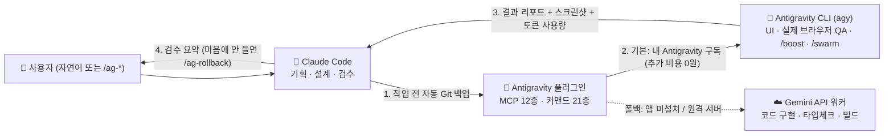

<div align="center">


# `claude-antigravity-plugin`

**Claude Code 안에서 복사·붙여넣기 없이 Google Antigravity의 모든 성능을 100% 끌어내는 공식 협업 플러그인**

[](https://github.com/xzawed/claude-antigravity-plugin/actions/workflows/ci.yml)
[](https://github.com/xzawed/claude-antigravity-plugin/releases/tag/v1.4.0)
[](#전체-커맨드--mcp-상세-레퍼런스)
[](#한눈에-보는-21개-슬래시-커맨드-지도)
[](./docs/05-verification/verification-report.md)
[](#자동-안전장치--원클릭-되돌리기)
[](./LICENSE)

🌐 **언어:** [English (README.md)](./README.md) · **한국어 공식 가이드**

[30초 요약](#-30초-요약--이-플러그인은-무엇인가요) · [설치(복사·붙여넣기)](#-3분-설치-가이드-그대로-복사해서-실행) · [업데이트](#-업데이트-방법-복사해서-바로-실행) · [상황별 커맨드 찾기](#-상황별-추천-커맨드-무엇을-입력할까요) · [실전 사용 레시피](#-복사해서-바로-쓰는-실전-사용-레시피) · [작동 원리 & 안전장치](#-작동-원리-및-자동-안전장치) · [문제 해결](#-문제-해결-troubleshooting)

</div>

---

## 💡 30초 요약 — 이 플러그인은 무엇인가요?

비개발자도 한눈에 이해할 수 있도록 **2명의 AI 전문가 팀**으로 비유하면 아주 간단합니다.

| 역할 | 담당 AI | 가장 잘하는 일 |
| :--- | :--- | :--- |
| **총괄 기획자 & 아키텍트** | **Claude Code** | 전체 프로젝트 구조를 이해하고, 백엔드·로직 설계와 최종 품질 검수를 총괄합니다. |
| **UI 제작 & 실제 브라우저 테스터** | **Google Antigravity (`agy`)** | 화면(UI)을 만들고, **직접 웹 브라우저를 열어 버튼을 클릭·검사하고 스크린샷을 찍으며**, 여러 워커로 대규모 작업을 병렬 처리합니다. |
| **자동 연결 다리 (본 플러그인)** | **`claude-antigravity-plugin`** | Claude Code 창을 떠나지 않고 **로그인(`/ag-login`), 작업 위임(`/ag-delegate`), 백그라운드 병렬 실행(`/ag-start`), 토큰 확인(`/ag-usage`), 1클릭 되돌리기(`/ag-rollback`)**를 자동으로 처리합니다. |



### 이 플러그인이 편리한 4가지 이유

- **창을 오가는 복사·붙여넣기 제로:** Claude에서 기획서나 코드를 복사해 Antigravity에 붙여넣을 필요가 전혀 없습니다.
- **구독자 추가 요금 0원:** 로컬에 설치된 Antigravity 구독(`agy`)을 최우선으로 사용합니다. 미설치·원격 서버 환경에서만 `GEMINI_API_KEY` API 모드로 자동 전환됩니다.
- **실수해도 1초 만에 원상복구:** Antigravity가 파일을 건드리기 직전 자동으로 현재 상태를 무손실 스냅샷으로 저장합니다. 결과가 마음에 안 들면 `/ag-rollback` 한 줄로 완벽하게 되돌립니다.
- **실제 브라우저로 눈으로 검증:** 코드만 작성하고 끝내는 것이 아니라, Antigravity가 실제 브라우저를 띄워 화면 깨짐·콘솔 에러·버튼 동작을 검사하고 스크린샷까지 회수합니다.

---

## 📊 한눈에 보는 핵심 지표 (`v1.4.0`)

| ⚡ 빠른 반응 속도 | 🧩 완벽한 기능 커버리지 | 🛡️ 자동화 품질 검증 | 🔒 빈틈없는 보안 |
| :---: | :---: | :---: | :---: |
| 환경 진단 **`149.9 ms`** | 슬래시 커맨드 **`21`종** | 테스트 **`55 / 55`** 통과 | 보안 취약점 **`0`건** |
| 백그라운드 착수 **`397 ms`** | 내장 MCP Tool **`12`종** | 3개 OS CI **`7 / 7`** 통과 | 자동 Git 백업 · 비밀 자동 가림 |

---

## 🚀 3분 설치 가이드 (그대로 복사해서 실행)

<p align="center">
  
</p>

### 설치 전 준비물

- **Node.js** `20` 이상 ([Node.js 다운로드](https://nodejs.org/))
- **Git** ([Git 다운로드](https://git-scm.com/))
- **Claude Code CLI** (`claude` 설치 완료)
- **Antigravity CLI (`agy`)** ([Antigravity 설치 가이드](https://antigravity.google/docs/getting-started)) — *또는 API 모드만 쓰실 경우 [Google AI Studio](https://aistudio.google.com/app/api-keys)의 `GEMINI_API_KEY`*

---

### 1단계 — 다운로드 · 빌드 · 자동 점검 (수정 없이 통째로 복사)

사용 중인 컴퓨터(OS)의 명령어 블록을 **그대로 복사해 터미널에 붙여넣고 Enter**를 누르세요. `~/.claude/plugins/claude-antigravity-plugin` 경로에 자동으로 설치됩니다.

#### 🍎 macOS / 🐧 Linux (터미널)

```bash
git clone https://github.com/xzawed/claude-antigravity-plugin.git "$HOME/.claude/plugins/claude-antigravity-plugin" \
  && npm --prefix "$HOME/.claude/plugins/claude-antigravity-plugin/server" install \
  && npm --prefix "$HOME/.claude/plugins/claude-antigravity-plugin/server" run build \
  && npm --prefix "$HOME/.claude/plugins/claude-antigravity-plugin/server" run verify
```

#### 🪟 Windows (PowerShell)

```powershell
git clone https://github.com/xzawed/claude-antigravity-plugin.git "$env:USERPROFILE\.claude\plugins\claude-antigravity-plugin"
npm --prefix "$env:USERPROFILE\.claude\plugins\claude-antigravity-plugin\server" install
npm --prefix "$env:USERPROFILE\.claude\plugins\claude-antigravity-plugin\server" run build
npm --prefix "$env:USERPROFILE\.claude\plugins\claude-antigravity-plugin\server" run verify
```

> ✅ **성공 확인:** 마지막 줄에 `[verify] ALL LIVE VERIFICATION CHECKS PASSED.`와 함께 12개 MCP Tool이 출력되면 준비 끝입니다!

---

### 2단계 — Claude Code에 플러그인 등록 (아래 3가지 중 1개 선택)

#### 방법 A — 마켓플레이스로 영구 설치 *(가장 추천)*

`claude`를 실행한 뒤 채팅 입력창에 아래 두 줄을 차례로 붙여넣으세요:

```text
/plugin marketplace add ~/.claude/plugins/claude-antigravity-plugin
/plugin install antigravity-delegate@claude-antigravity-plugin
```

> 💡 **로컬 클론 없이 GitHub에서 바로 등록할 경우:**
> `/plugin marketplace add xzawed/claude-antigravity-plugin` → `/plugin install antigravity-delegate@claude-antigravity-plugin`

#### 방법 B — `--plugin-dir`로 즉시 실행 *(빠른 체험 · 개발용)*

**macOS / Linux:**

```bash
claude --plugin-dir "$HOME/.claude/plugins/claude-antigravity-plugin"
```

**Windows PowerShell:**

```powershell
claude --plugin-dir "$env:USERPROFILE\.claude\plugins\claude-antigravity-plugin"
```

#### 방법 C — MCP 서버만 단독 연결 *(슬래시 커맨드 없이 MCP Tool 12종만 사용)*

**macOS / Linux:**

```bash
claude mcp add antigravity-delegate -- node "$HOME/.claude/plugins/claude-antigravity-plugin/server/dist/index.js"
```

**Windows PowerShell:**

```powershell
claude mcp add antigravity-delegate -- node "$env:USERPROFILE\.claude\plugins\claude-antigravity-plugin\server\dist\index.js"
```

---

### 3단계 — Claude Code 안에서 바로 Antigravity 로그인 (`/ag-login`)

따로 터미널을 열 필요가 없습니다! Claude Code 채팅창에 아래 한 단어만 입력하세요:

```text
/ag-login
```

- **내 PC(Windows / macOS / Linux 데스크톱):** 자동으로 웹 브라우저가 열리며 Google 계정으로 1클릭 로그인됩니다. 로그인 정보는 OS 보안 키링(Windows 자격 증명 관리자 · macOS 키체인 · Linux Secret Service)에 안전하게 저장됩니다.
- **원격 서버 / SSH 환경:** 브라우저 대신 채팅창에 클릭 가능한 Google 로그인 링크를 자동으로 띄워줍니다. 링크에서 로그인 후 표시된 코드를 복사해 `/ag-login complete <복사한코드>`만 입력하면 완료됩니다.
- **구독 앱 없이 Gemini API 키로만 쓰고 싶다면?** Claude Code 실행 전 환경변수를 설정하세요:
  - **macOS / Linux:** `export GEMINI_API_KEY="발급받은-API-키"`
  - **Windows PowerShell:** `$env:GEMINI_API_KEY = "발급받은-API-키"` *(영구 저장: `setx GEMINI_API_KEY "발급받은-API-키"`)*

### 4단계 — 정상 연결 확인

Claude Code 채팅창에 입력합니다:

```text
/ag-status
```

현재 활성 엔진(`subscription` 또는 `api`), 감지된 `agy` 경로, 권한 설정, Git 백업 준비 상태가 표로 깔끔하게 출력되면 **모든 설치가 끝났습니다!**

---

## 🔄 업데이트 방법 (복사해서 바로 실행)

새 버전이 나오면 아래 블록을 그대로 복사·실행하는 것만으로 30초 안에 최신 기능을 받을 수 있습니다.

### 1. 플러그인(`claude-antigravity-plugin`) 최신 버전 업데이트

**macOS / Linux:**

```bash
git -C "$HOME/.claude/plugins/claude-antigravity-plugin" pull --ff-only \
  && npm --prefix "$HOME/.claude/plugins/claude-antigravity-plugin/server" install \
  && npm --prefix "$HOME/.claude/plugins/claude-antigravity-plugin/server" run build \
  && npm --prefix "$HOME/.claude/plugins/claude-antigravity-plugin/server" run verify
```

**Windows PowerShell:**

```powershell
git -C "$env:USERPROFILE\.claude\plugins\claude-antigravity-plugin" pull --ff-only
npm --prefix "$env:USERPROFILE\.claude\plugins\claude-antigravity-plugin\server" install
npm --prefix "$env:USERPROFILE\.claude\plugins\claude-antigravity-plugin\server" run build
npm --prefix "$env:USERPROFILE\.claude\plugins\claude-antigravity-plugin\server" run verify
```

실행 중인 Claude Code를 끌 필요 없이 채팅창에 아래 명령만 입력하면 즉시 반영됩니다:

```text
/reload-plugins
```

### 2. Antigravity CLI (`agy`) 자체 업데이트 (Claude Code 안에서 바로!)

```text
/ag-update            # 최신 Antigravity CLI 변경사항(Release Notes) 먼저 확인
/ag-update apply      # 로컬 agy CLI 바이너리 최신 버전으로 업그레이드
```

---

## 🧭 상황별 추천 커맨드 (무엇을 입력할까요?)

21개 커맨드를 외울 필요 없습니다. **내가 하고 싶은 일**을 찾고 오른쪽 명령어를 그대로 복사해 보세요!

| 내가 하고 싶은 일 | 그대로 복사해서 입력할 명령어 |
| :--- | :--- |
| **Antigravity 로그인** (또는 로그인 여부 확인) | `/ag-login` *(상태만 확인: `/ag-login status`)* |
| **사용 가능한 최신 AI 모델 목록 보기** | `/ag-models` |
| **UI 화면 제작 + 브라우저 검증까지 맡기기** | `/ag-delegate 반응형 요금제 페이지 만들어 줘 --paths src/pages/Pricing.tsx --url http://localhost:3000/pricing` |
| **코드 수정 없이 내 웹사이트만 실제 브라우저로 검사하기** | `/ag-browser http://localhost:3000/checkout 장바구니 수량 변경 및 결제 버튼 동작·콘솔 에러 검사` |
| **큰 작업을 백그라운드로 돌려놓고 나는 다른 작업 계속하기** | `/ag-start 대시보드 차트 전체 리팩토링 --paths src/components/charts/` → 진행 확인: `/ag-jobs` |
| **같은 대화 맥락을 유지하며 빠르게 여러 번 주고받기 (토큰 절약)** | `/ag-session start 설정 페이지 설계해 줘` → `/ag-session send 다크모드 추가해 줘` → `/ag-session close` |
| **정말 까다로운 버그·아키텍처 문제 깊이 파헤치기** | `/ag-boost WebSocket 재연결 시 인증 상태가 풀리는 원인 분석해 줘 --effort max` |
| **대규모 작업을 여러 AI 워커로 동시에 병렬 처리하기** | `/ag-swarm src/forms/ 하위 폼 전체를 React Hook Form으로 전환 --paths src/forms/ --bg` |
| **테스트와 빌드가 모두 통과할 때까지 자율 반복시키기** | `/ag-goal 결제 화면 실패 테스트 전부 수정하고 빌드 통과 확인 --paths src/checkout/` |
| **다른 계열 AI 모델에게 내 코드 객관적 리뷰·보안 감사 받기** | `/ag-review branch --model gemini-4-neon-xhigh` |
| **권한 확인 팝업 없이 완전 자율 실행 켜기** | `/ag-config skip-permissions on` *(또는 1회성 `--dangerously-skip-permissions`)* |
| **지금까지 사용한 토큰량 한눈에 보기** | `/ag-usage` |
| **브라우저 스크린샷·리포트·로그 파일 모아 보기** | `/ag-artifacts` |
| **방금 Antigravity가 수정한 내용 1초 만에 원상복구하기** | `/ag-rollback` |

### 한눈에 보는 21개 슬래시 커맨드 지도

<p align="center">
  
</p>

---

## 📖 복사해서 바로 쓰는 실전 사용 레시피

아래 예시를 그대로 복사한 뒤 폴더 경로(`src/...`)나 URL만 내 프로젝트에 맞게 바꾸면 바로 동작합니다.

### 레시피 1 — 로그인 · 환경 진단 · 모델 선택

```text
/ag-login                  # Google OAuth 로그인 (로컬은 브라우저, SSH는 링크+코드 자동 전환)
/ag-login --manual         # 채팅창에 링크를 띄우고 코드를 직접 붙여넣는 방식
/ag-login complete <코드>  # 수동 로그인 완료
/ag-status                 # 활성 엔진, 권한 정책, Git 백업 상태, 최근 사용량 확인
/ag-models                 # 현재 사용 가능한 20개+ Antigravity 모델 및 커스텀 에이전트 조회
```

### 레시피 2 — 자연어로 요청하거나 `/ag-delegate` · `/ag-browser`로 직접 실행

평소처럼 **자연어**로만 말해도 Claude Code가 UI·브라우저 작업을 알아서 Antigravity에 위임합니다:

> *"결제 API 스펙에 맞춰 `src/pages/CheckoutPage.tsx`에 반응형 결제 화면을 만들고, `http://localhost:3000/checkout`에서 콘솔 에러 없이 렌더링되는지 스크린샷과 함께 검증해 줘."*

직접 세밀하게 옵션을 지정하고 싶을 때는 아래처럼 복사해 실행하세요:

```text
# UI 구현 + 로컬 개발 서버 실제 브라우저 시각적 QA
/ag-delegate 대시보드 KPI 카드와 필터 테이블 구현 --paths src/components/analytics/,src/pages/Analytics.tsx --url http://localhost:3000/analytics

# 실제 브라우저 QA만 단독 실행 (소스코드 절대 수정 안 함 — 렌더링·클릭·에러·스크린샷만 검사)
/ag-browser http://localhost:3000/login 잘못된 비밀번호 오류 토스트, 모바일 레이아웃, 콘솔 에러 0건 확인

# 특정 고성능 모델 + 높은 추론 강도 + 권한 확인 생략(--dangerously-skip-permissions)
/ag-delegate 대시보드 차트 리팩토링 및 tsc 빌드 검증 --paths src/components/charts/ --model gemini-4-neon-high --effort high --dangerously-skip-permissions

# 로컬 앱 없이 헤드리스 Gemini API 모드로 강제 실행
/ag-delegate FormField 컴포넌트를 Tailwind v4 토큰으로 마이그레이션 --paths src/components/forms/ --mode api
```

### 레시피 3 — 백그라운드 병렬 실행으로 시간 2배 아끼기 (`/ag-start`, `/ag-jobs`, `/ag-cancel`)

Antigravity가 5분짜리 프론트엔드 작업을 처리하는 동안 기다리지 마세요! `/ag-start`는 **`0.4초` 만에 `jobId`를 돌려주고 백그라운드로 실행**되므로, Claude Code에서 백엔드·문서 작업을 동시에 계속할 수 있습니다.

```text
# 1. 백그라운드 작업 시작 (즉시 jobId 반환)
/ag-start 설정 페이지 4개 탭 UI 전체 구현 --paths src/pages/settings/ --model gemini-4-neon-high

# 2. 기다리는 동안 Claude Code에서 다른 작업 자유롭게 진행...

# 3. 진행 상황·실시간 토큰 확인 및 완료 리포트 회수
/ag-jobs
/ag-jobs ag-20261123-133015-a57f

# 4. 중간에 멈추고 싶다면 즉시 안전 종료
/ag-cancel ag-20261123-133015-a57f
```

### 레시피 4 — 초고속 멀티턴 지속 세션으로 캐시 토큰 절약 (`/ag-session`, `/ag-resume`)

후속 지시를 여러 번 주고받을 때 매번 `agy`를 새로 띄우지 않고, **살아있는 세션 1개에 대화를 이어가면** 기동 대기 시간이 사라지고 프롬프트 캐시 히트(`cacheReadTokens`)가 크게 높아집니다.

```text
# 지속 세션 시작 (시작 시 Git 자동 백업 생성)
/ag-session start src/components/Table.tsx를 분석하고 UX 개선안 3가지를 제안해 줘 --model gemini-4-neon-high

# 같은 상주 세션에 초고속 후속 지시 전송 (문맥 100% 유지 + 캐시 절감!)
/ag-session send 1번과 2번 개선안을 키보드 접근성 포함해서 구현해 줘
/ag-session send 정렬 기능과 빈 화면 상태 단위 테스트도 추가해 줘

# 활성 세션 확인 및 완료 후 깔끔하게 종료
/ag-session list
/ag-session close
```

이전에 끝낸 작업을 이어서 진행하고 싶을 때는 `/ag-resume`을 쓰세요:

```text
/ag-resume                                          # 대화 ID가 기록된 최근 작업 목록 보기
/ag-resume 방금 만든 컴포넌트에 다크모드 지원 추가해 줘   # 가장 최근 대화 바로 이어가기
/ag-resume ag-20261123-133015-a57f 모바일 여백 수정해 줘
```

### 레시피 5 — Antigravity 고유 초능력 & 이종 모델 교차 리뷰 (`/ag-boost`, `/ag-swarm`, `/ag-goal`, `/ag-review`)

```text
# 다중 관점 심층 추론으로 고난도 버그·설계 문제 해결
/ag-boost 느린 3G 환경에서 장바구니 낙관적 업데이트가 꼬이는 근본 원인 분석 --effort max

# 다중 워커 + 검증자 스웜 병렬 처리 (--bg를 붙이면 백그라운드 실행)
/ag-swarm 마케팅 랜딩 페이지 6개 섹션을 통일된 애니메이션으로 리디자인 --paths src/landing/ --bg

# 빌드·테스트가 전부 통과할 때까지 자율 반복 달성 루프
/ag-goal src/ui/ 하위 TypeScript 에러와 실패한 Vitest 테스트 모두 해결 --paths src/ui/ --dangerously-skip-permissions --bg

# 다른 계열 AI 모델로 읽기 전용 코드·보안 교차 감사 (심각도별 구조화 JSON 표 반환!)
/ag-review staged
/ag-review branch --model gemini-4-neon-xhigh --effort high
```

### 레시피 6 — 권한 설정(`--dangerously-skip-permissions`) 및 프로젝트 기본값 (`/ag-config`)

기본값은 안전 모드(`agy_mode: "accept-edits"`, `agy_sandbox: true`, `agy_dangerously_skip_permissions: false`)입니다. 프로젝트별로 언제든 바꿀 수 있습니다:

```text
/ag-config                              # 현재 프로젝트 설정 보기
/ag-config mode auto                    # 구독 우선 -> API 자동 폴백 (기본값)
/ag-config agy-mode accept-edits        # 권한 정책: accept-edits | auto | plan
/ag-config skip-permissions on          # --dangerously-skip-permissions (always-proceed) 기본 켜기
/ag-config skip-permissions off         # 안전 기본값으로 되돌리기
/ag-config agy-model gemini-4-neon-high # 구독 모드 기본 모델 고정 (해제: clear)
/ag-config effort high                  # 기본 추론 강도: low | medium | high | xhigh | max | clear
/ag-config sandbox off                  # 터미널 샌드박스 전환 (on | off)
/ag-config timeout 600                  # 타임아웃(초) 변경 (30~1800)
/ag-config git-guard required           # Git 저장소가 아니면 위임 차단
```

> 🔐 **1회성 터미널 환경변수로 켜기:** `export AG_DANGEROUSLY_SKIP_PERMISSIONS=1` (macOS/Linux) 또는 `$env:AG_DANGEROUSLY_SKIP_PERMISSIONS="1"` (Windows PowerShell). 이 경우에도 작업 직전 Git Guard가 자동 백업을 생성하므로 언제든 `/ag-rollback`이 가능합니다.

### 레시피 7 — 토큰 사용량 확인 · 스크린샷 보기 · 1클릭 되돌리기 (`/ag-usage`, `/ag-artifacts`, `/ag-rollback`)

```text
/ag-usage             # 프로젝트 누적 및 작업별 토큰 사용량 (input · output · thinking · cacheRead · total)
/ag-usage 50          # 최근 최대 50건 조회
/ag-artifacts         # 최근 작업의 브라우저 스크린샷, report.md, 마스킹 로그 확인
/ag-rollback          # 가장 최근 위임 작업 완벽 원상복구 (내가 원래 갖고 있던 untracked 파일은 100% 보존!)
/ag-rollback <taskId> # 특정 과거 작업 ID 시점으로 복구
```

### 레시피 8 — Antigravity MCP 동기화 · 원격 데몬 · 업데이트 (`/ag-mcp`, `/ag-remote`, `/ag-update`)

```text
/ag-mcp list                                              # Antigravity에 등록된 MCP 서버 목록
/ag-mcp sync                                              # 현재 프로젝트 .mcp.json을 Antigravity로 동기화 미리보기
/ag-mcp sync --apply                                      # 실제 동기화 실행 (자기 자신은 무한루프 방지를 위해 자동 제외)
/ag-mcp add fs npx -y @modelcontextprotocol/server-filesystem /work
/ag-remote status                                         # Antigravity 원격 제어 데몬 상태 확인
/ag-update                                                # 최신 agy 릴리즈 노트 확인
/ag-update apply                                          # 로컬 agy CLI 업데이트 실행
```

---

## 🏗️ 작동 원리 및 자동 안전장치

### 듀얼 엔진 아키텍처

<p align="center">
  
</p>

| 실행 모드 | 우선순위 | 동작 방식 | 가장 잘 맞는 상황 | 추가 비용 |
| :--- | :---: | :--- | :--- | :--- |
| **`subscription`** | **1순위** *(자동 기본)* | 로컬 `agy` CLI 전체 기능 (`/browser`, `/boost`, `/swarm`, `/goal`, 지속 `stream-json` 세션) | UI 구현, 실제 브라우저 QA·스크린샷, 멀티턴 세션, 병렬 스웜 | **`0원`** *(기존 Antigravity 구독 사용)* |
| **`api`** | **2순위** *(자동 폴백)* | 내장 `@google/genai` 4-Tool 자율 루프 (`read_file`, `write_file`, `list_dir`, `run_command`) | Antigravity 미설치 PC, 헤드리스 원격 서버, CI 환경 | `GEMINI_API_KEY` 종량 과금 |

### 자동 안전장치 & 원클릭 되돌리기

<p align="center">
  
</p>

| 안전 계층 | 비개발자도 안심할 수 있는 이유 |
| :--- | :--- |
| **무손실 Git Guard** | 작업 시작 직전 수정 중이던 파일과 원래 있던 새 파일(untracked) 목록을 자동 기록합니다. `/ag-rollback` 실행 시 Antigravity가 만든 파일만 골라 지우고 내 파일은 100% 살려둡니다. |
| **경로 잠금 (Path Guard)** | `.git/`, `.env*`(비밀번호 파일), `node_modules/`, `.ag-bridge/config.json` 수정은 어떤 경우에도 원천 차단하며 `lockedPaths` 밖의 파일 탈출도 막습니다. |
| **`.gitignore` 자동 보호** | 임시 작업 폴더인 `.ag-bridge/`를 프로젝트 `.gitignore`에 자동 등록해 실수로 GitHub에 올라가는 일을 방지합니다. |
| **비밀 정보 자동 마스킹** | API 키, OAuth 인가 코드, 인증 토큰은 로그·리포트·에러 메시지에서 자동으로 `[REDACTED]`로 가려집니다. |

---

## 📈 실측 벤치마크

실제 Windows 11 + Node.js `v24.14.1` + 라이브 `agy.exe` 환경 및 GitHub Actions 3-OS 매트릭스에서 실측 검증했습니다([상세 검증 리포트: `VER-002`](./docs/05-verification/verification-report.md)):

<p align="center">
  
</p>

| 측정 항목 | 목표 기준 | 실제 측정값 | 판정 |
| :--- | :---: | :---: | :---: |
| `check_ag_environment` (라이브 Stdio MCP) | `< 500 ms` | 평균 **`149.9 ms`** (`4.3×` 고속화) | ✅ 통과 |
| `cli-init.js --silent` (세션 시작 자동 초기화) | `< 300 ms` | 평균 **`90.3 ms`** | ✅ 통과 |
| `start_ag_task` 비동기 백그라운드 착수 (실제 `agy`) | 즉시 반환 | **`397 ms`** (백그라운드 병렬 수행) | ✅ 통과 |
| `ag_session` 2턴 지속 세션 (실제 `agy`) | 프롬프트 캐시 재사용 | 2턴 **`7,691` `cacheReadTokens`** 히트 | ✅ 통과 |
| 자동화 테스트 스위트 (`vitest run`) | 핵심 경로 검증 | **`55 / 55` 테스트 통과 (9 스위트)** | ✅ 통과 |
| 크로스플랫폼 CI (Ubuntu · macOS · Windows × Node 20/22) | 전체 통과 | **`7 / 7` 잡 전체 통과** | ✅ 통과 |

---

## 🛠️ 문제 해결 (Troubleshooting)

| 자주 겪는 문제 | 원인 | 그대로 따라 할 해결 방법 |
| :--- | :--- | :--- |
| **`NO_ANTIGRAVITY_PROVIDER`** | 로컬 Antigravity(`agy`)와 `GEMINI_API_KEY`가 모두 없음 | `agy` 설치 후 `/ag-login` 실행 **또는** `GEMINI_API_KEY` 설정 후 `/ag-status` 확인 |
| **로그인 안 됨 / 모델 0개 표시** | `agy`는 설치됐지만 Google 계정 로그인이 아직 안 됨 | Claude Code에서 `/ag-login` 실행 (SSH 환경은 `/ag-login --manual`) |
| **업데이트했는데 새 커맨드가 안 보임** | `server/dist/` 재빌드 또는 플러그인 리로드 누락 | 위 [업데이트 블록](#-업데이트-방법-복사해서-바로-실행) 실행 후 Claude Code에서 `/reload-plugins` 입력 |
| **`BRIDGE_BUSY`** | 현재 폴더에서 이전 위임 작업이 아직 `RUNNING` 중 | `/ag-jobs`로 진행 상황 확인하거나 `/ag-cancel`로 안전 중단 |
| **Windows 공백 포함 폴더 경로 오류** | 경로에 큰따옴표 누락 | 경로 전체를 큰따옴표로 감싸세요: `claude --plugin-dir "C:\My Plugins\claude-antigravity-plugin"` |

---

## 📚 전체 커맨드 & MCP 상세 레퍼런스

<details>
<summary><strong>🔌 클릭하여 펼치기: 12종 MCP Tool 명세 · 프로젝트 폴더 구조 · 기본 <code>config.json</code></strong></summary>

### 노출 MCP Tools 12종 (`antigravity-delegate` v1.4.0)

| MCP Tool | 주요 입력 파라미터 | 역할 |
| :--- | :--- | :--- |
| **`ag_auth`** | `action?` (`status\|login\|complete\|cancel\|logout`), `flow?`, `force?`, `code?`, `sessionId?` | `agy acp --login` Google OAuth 로그인(브라우저/수동 링크+코드), 실시간 상태 점검, 취소 및 안전 로그아웃 안내 |
| **`delegate_to_antigravity`** | `title`, `instructions`, `lockedPaths?`, `verifyUrl?`, `model?`, `effort?`, `agent?`, `agyMode?`, `sandbox?`, `dangerouslySkipPermissions?`, `addDirs?`, `continueConversation?`, `conversationId?`, `project?`, `remoteAgent?`, `jsonSchema?`, `rawPrompt?`, `timeoutSec?` | 동기 전체 패리티 위임 실행 → `reportMarkdown`, `structuredOutput`, `changedFiles`, `artifacts`, 토큰 `metrics` 반환 |
| **`start_ag_task`** | `delegate_to_antigravity`와 동일 | 비동기 백그라운드 위임 착수 → 즉시 `jobId` 반환(병렬 작업) |
| **`get_ag_job`** | `jobId?`, `includeLogTail?`, `limit?` | 백그라운드 작업 실시간 상태·마스킹 로그·토큰·리포트·구조화 출력 조회 또는 목록 반환 |
| **`cancel_ag_job`** | `jobId?` | 실행 중인 백그라운드 작업 프로세스 트리 안전 종료 및 롤백용 `gitCheckpointRef` 반환 |
| **`ag_session`** | `action` (`start\|send\|list\|close`), `sessionId?`, `prompt?`, `model?`, `effort?`, `dangerouslySkipPermissions?` | 상주 `agy --input-format stream-json --output-format stream-json` 멀티턴 세션 관리 |
| **`list_ag_artifacts`** | `taskId?`, `includeReport?`, `includeLogTail?`, `logTailLines?` | `.ag-bridge/artifacts/` 스크린샷·로그·리포트·JSON 분류 및 마스킹 미리보기 |
| **`ag_cli_admin`** | `action` (`mcp_*\|remote_*\|changelog\|update`), `name?`, `commandOrUrl?`, `args?`, `dryRun?` | `agy mcp`, `.mcp.json` 동기화, `agy remote-control`, `agy changelog`, `agy update` 안전 실행 |
| **`check_ag_environment`** | `workspaceRoot?` | 해석 모드, `agy`/앱 경로, 활성 `agyConfig`, 마스킹된 API 키 상태, Git/Bridge 상태 진단 |
| **`list_ag_capabilities`** | `workspaceRoot?` | `agy models` · `agy agents` 병렬 실시간 조회 및 지원 권한·추론 강도·플래그 반환 |
| **`get_ag_usage`** | `workspaceRoot?`, `limit?` | 현재 + `history/*.json` 누적/작업별 토큰 사용량 및 소요 시간 집계 |
| **`rollback_ag_task`** | `taskId?`, `workspaceRoot?` | `gitCheckpointRef`로 무손실 원복 (기존 untracked 파일 보존) |

### 저장소 디렉터리 구조

```text
claude-antigravity-plugin/
├── assets/                        # 히어로 배너 및 5종 벡터 도식(여정·커맨드지도·아키텍처·벤치마크·상태머신)
├── .claude-plugin/                # plugin.json (v1.4.0) & marketplace.json
├── .mcp.json                      # 내장 Stdio MCP 서버 실행 정의
├── hooks/hooks.json               # SessionStart 자동 초기화 훅
├── skills/ag-delegate/SKILL.md    # 자율 위임 및 검수 스킬
├── commands/                      # 21종 슬래시 커맨드 (/ag-login .. /ag-update)
├── templates/claude-handoff.md    # Antigravity 핸드오프 워크플로우 템플릿
├── server/
│   ├── src/                       # index.ts, auth.ts, jobs.ts, sessions.ts, artifacts.ts, cli-admin.ts,
│   │                              # bridge-fs.ts, git-guard.ts, path-guard.ts, config.ts, detector.ts, engines/
│   ├── scripts/verify-plugin.mjs  # 라이브 헬스체크 및 12-Tool Stdio MCP 검증 스크립트
│   └── tests/                     # 9 스위트 / 55개 자동화 테스트
├── README.md                      # 영문 공식 가이드
├── README.ko.md                   # 한글 공식 가이드 (현재 파일)
└── docs/                          # 안티그래비티 개발 표준 문서 허브 (00~06)
```

### 기본 `.ag-bridge/config.json`

```json
{
  "execution_mode": "auto",
  "git_guard": "best_effort",
  "subscription": {
    "app_path": "auto",
    "trigger_method": "cli_or_ipc",
    "timeout_sec": 300,
    "poll_interval_ms": 2000,
    "agy_mode": "accept-edits",
    "agy_sandbox": true,
    "agy_dangerously_skip_permissions": false,
    "agy_stream_heartbeat": true
  },
  "api": {
    "api_key_env": "GEMINI_API_KEY",
    "model": "gemini-2.5-pro",
    "max_turns": 15,
    "command_timeout_sec": 60
  }
}
```

</details>

---

## 📂 개발 문서 허브 · 기여 · 보안 · 라이선스

- **개발 문서 허브 ([docs/README.md](./docs/README.md)):** [PRD](./docs/01-planning/PRD.md) · [사용자 플로우](./docs/01-planning/user-flows.md) · [시스템 아키텍처](./docs/02-architecture/system-architecture.md) · [브릿지 프로토콜](./docs/02-architecture/bridge-protocol.md) · [보안 & Git Guard](./docs/02-architecture/security-and-git-guard.md) · [MCP Tools API](./docs/03-specs/mcp-tools-api.md) · [듀얼 엔진](./docs/03-specs/execution-engines.md) · [프롬프트 & 커맨드](./docs/03-specs/prompts-and-commands.md) · [실측 검증 리포트](./docs/05-verification/verification-report.md)
- **기여 가이드:** [CONTRIBUTING.md](./CONTRIBUTING.md) · **보안 정책:** [SECURITY.md](./SECURITY.md) · **라이선스:** [Apache License 2.0](./LICENSE)
