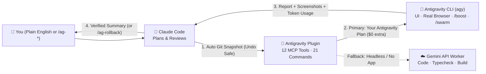
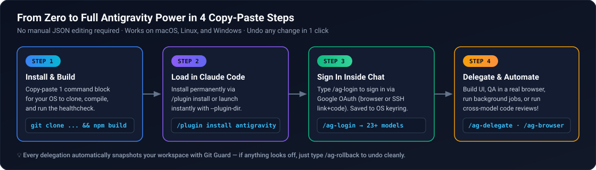
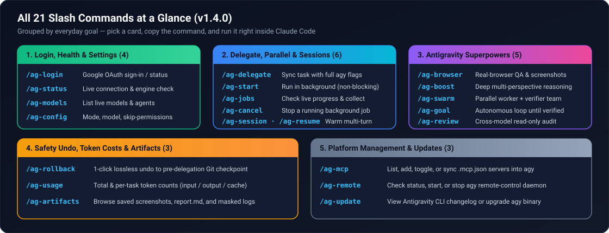

<div align="center">


# `claude-antigravity-plugin`

**Use 100% of Google Antigravity's Superpowers Right Inside Claude Code — With Zero Manual Copy-Paste**

[](https://github.com/xzawed/claude-antigravity-plugin/actions/workflows/ci.yml)
[](https://github.com/xzawed/claude-antigravity-plugin/releases/latest)
[](#full-command--mcp-reference)
[](#visual-map-of-all-21-commands)
[](./LICENSE)

🌐 **Language:** **English** · [한국어 공식 가이드 (README.ko.md)](./README.ko.md)

[What Is This?](#-what-is-this-in-30-seconds) · [Install (Copy & Paste)](#-install-in-3-minutes-copy--paste) · [Update](#-how-to-update-copy--paste) · [Which Command?](#-which-command-should-i-use) · [Usage Recipes](#-copy-paste-usage-recipes) · [How It Works](#-how-it-works--safety-net) · [Troubleshooting](#-troubleshooting)

</div>

---

## 💡 What Is This? (In 30 Seconds)

Think of building software like running a two-person dream team:

| Team Member | Best At | Everyday Role |
| :--- | :--- | :--- |
| **Claude Code** *(Your Lead Architect)* | Planning, backend logic, APIs, code review, decision-making | Understands your whole project and decides *what* needs to be built. |
| **Google Antigravity (`agy`)** *(Your UI & QA Specialist)* | Building UI pages, **opening a real web browser to test clicks & take screenshots**, parallel multi-worker swarms, deep multi-model reasoning | Executes heavy visual, multi-file, or browser-verified tasks at full speed. |
| **`claude-antigravity-plugin`** *(This Plugin)* | **Connecting both automatically** | Lets you sign in (`/ag-login`), delegate tasks (`/ag-delegate`), run jobs in the background (`/ag-start`), check token usage (`/ag-usage`), and undo anything in 1 click (`/ag-rollback`) — **without ever leaving Claude Code**. |



### Why People Love Using It

- **Zero Copy-Paste Between Tools:** Never manually copy specs, errors, or file contents from Claude into Antigravity and back.
- **Zero Extra API Cost for Subscribers:** Uses your existing Antigravity subscription (`agy`) first. Falls back to `GEMINI_API_KEY` only if Antigravity isn't installed.
- **1-Click Safety Net:** Before Antigravity touches a single file, the plugin takes a lossless Git snapshot. Not happy with the result? Type `/ag-rollback` and your project returns to the exact second before delegation.
- **Real Browser Visual QA:** Unlike text-only AI coding tools, Antigravity actually opens your local web app, clicks buttons, checks for console/network errors, and hands screenshots back to Claude.

---

## 📊 At a Glance

| ⚡ Fast Diagnostics | 🧩 Complete Coverage | 🛡️ Automated Quality | 🔒 Zero-Risk Security |
| :---: | :---: | :---: | :---: |
| **`149.9 ms`** env check | **`21`** Slash Commands | `vitest` suite on every PR | Programs launched by absolute path |
| **`397 ms`** async job launch | **`12`** MCP Tools | Ubuntu · macOS · Windows × Node 20/22 CI | Auto Git Guard + Path Guard |

<sub>Latencies are recorded measurements ([`VER-002`](./docs/05-verification/verification-report.md), [v1.4.0 release notes](https://github.com/xzawed/claude-antigravity-plugin/releases/tag/v1.4.0)). CI checks the command and tool counts against the source.</sub>

---

## 🚀 Install in 3 Minutes (Copy & Paste)

<p align="center">
  
</p>

### What You Need First

- **Node.js** `20` or newer ([Download Node.js](https://nodejs.org/))
- **Git** ([Download Git](https://git-scm.com/))
- **Claude Code CLI** (`claude` installed)
- **Antigravity CLI (`agy`)** ([Install Antigravity](https://antigravity.google/docs/getting-started)) — *or a `GEMINI_API_KEY` from [Google AI Studio](https://aistudio.google.com/app/api-keys) if you prefer API-only mode*

---

### Step 1 — Download, Build & Self-Test (Copy & Paste As-Is)

Open your terminal and paste the block for your computer. It installs cleanly into `~/.claude/plugins/claude-antigravity-plugin`:

#### 🍎 macOS / 🐧 Linux (Terminal)

```bash
git clone https://github.com/xzawed/claude-antigravity-plugin.git "$HOME/.claude/plugins/claude-antigravity-plugin" \
  && npm --prefix "$HOME/.claude/plugins/claude-antigravity-plugin/server" install \
  && npm --prefix "$HOME/.claude/plugins/claude-antigravity-plugin/server" run build \
  && npm --prefix "$HOME/.claude/plugins/claude-antigravity-plugin/server" run verify
```

#### 🪟 Windows (PowerShell)

```powershell
git clone https://github.com/xzawed/claude-antigravity-plugin.git "$env:USERPROFILE\.claude\plugins\claude-antigravity-plugin"
npm --prefix "$env:USERPROFILE\.claude\plugins\claude-antigravity-plugin\server" install
npm --prefix "$env:USERPROFILE\.claude\plugins\claude-antigravity-plugin\server" run build
npm --prefix "$env:USERPROFILE\.claude\plugins\claude-antigravity-plugin\server" run verify
```

> ✅ **Success check:** The last line prints `[verify] ALL LIVE VERIFICATION CHECKS PASSED.` with all 12 MCP tools listed.

---

### Step 2 — Connect the Plugin to Claude Code (Pick ONE Option)

#### Option A — Permanent Install via Claude Code Marketplace *(Recommended)*

Start `claude` and paste these two lines right inside Claude Code:

```text
/plugin marketplace add ~/.claude/plugins/claude-antigravity-plugin
/plugin install antigravity-delegate@claude-antigravity-plugin
```

> 💡 **Direct from GitHub (no `git clone`, no build):** the repository ships a prebuilt, self-contained server bundle (`server/dist/index.js`), so a marketplace install runs as-is:
> `/plugin marketplace add xzawed/claude-antigravity-plugin` → `/plugin install antigravity-delegate@claude-antigravity-plugin`

#### Option B — Instant Launch with `--plugin-dir` *(Great for Quick Testing)*

**macOS / Linux:**

```bash
claude --plugin-dir "$HOME/.claude/plugins/claude-antigravity-plugin"
```

**Windows PowerShell:**

```powershell
claude --plugin-dir "$env:USERPROFILE\.claude\plugins\claude-antigravity-plugin"
```

#### Option C — MCP Tools Only *(Without Slash Commands or Auto-Hooks)*

**macOS / Linux:**

```bash
claude mcp add antigravity-delegate -- node "$HOME/.claude/plugins/claude-antigravity-plugin/server/dist/index.js"
```

**Windows PowerShell:**

```powershell
claude mcp add antigravity-delegate -- node "$env:USERPROFILE\.claude\plugins\claude-antigravity-plugin\server\dist\index.js"
```

---

### Step 3 — Sign In to Antigravity Inside Claude Code (`/ag-login`)

You don't need to open another terminal to sign in! Inside Claude Code, just type:

```text
/ag-login
```

- **On a desktop/laptop:** Opens Google sign-in in your web browser, saves your token safely in your OS keyring (Windows Credential Manager / macOS Keychain / Linux Secret Service), and verifies your available models automatically.
- **Over SSH or a remote server:** Automatically prints a clickable Google login link right in chat. Open it in any browser, copy the code, and reply with `/ag-login complete <your-code>`.
- **Using API-Only Mode instead of Subscription?** Set your key in your shell before opening Claude Code:
  - **macOS / Linux:** `export GEMINI_API_KEY="your-gemini-api-key"`
  - **Windows PowerShell:** `$env:GEMINI_API_KEY = "your-gemini-api-key"` *(or `setx GEMINI_API_KEY "your-gemini-api-key"` to save permanently)*

### Step 4 — Verify Everything Is Green

Inside Claude Code, paste:

```text
/ag-status
```

You'll see a clean status table confirming your active engine (`subscription` or `api`), detected `agy` path, permissions policy, and Git Guard readiness. You're ready to go!

---

## 🔄 How to Update (Copy & Paste)

Keeping both the plugin and Antigravity CLI up to date takes less than 30 seconds.

### 1. Update `claude-antigravity-plugin` to the Latest Version

**Installed directly from GitHub** (`/plugin marketplace add xzawed/claude-antigravity-plugin`)? There is nothing to build — refresh the marketplace, update the plugin, then restart Claude Code:

```bash
claude plugin marketplace update claude-antigravity-plugin
claude plugin update antigravity-delegate@claude-antigravity-plugin
```

**Installed from a local clone (Step 1)?** Pull and self-test the clone:

**macOS / Linux:**

```bash
git -C "$HOME/.claude/plugins/claude-antigravity-plugin" pull --ff-only \
  && npm --prefix "$HOME/.claude/plugins/claude-antigravity-plugin/server" install \
  && npm --prefix "$HOME/.claude/plugins/claude-antigravity-plugin/server" run build \
  && npm --prefix "$HOME/.claude/plugins/claude-antigravity-plugin/server" run verify
```

**Windows PowerShell:**

```powershell
git -C "$env:USERPROFILE\.claude\plugins\claude-antigravity-plugin" pull --ff-only
npm --prefix "$env:USERPROFILE\.claude\plugins\claude-antigravity-plugin\server" install
npm --prefix "$env:USERPROFILE\.claude\plugins\claude-antigravity-plugin\server" run build
npm --prefix "$env:USERPROFILE\.claude\plugins\claude-antigravity-plugin\server" run verify
```

Then inside your running Claude Code session, reload immediately without even restarting:

```text
/reload-plugins
```

### 2. Update Antigravity CLI (`agy`) Right Inside Claude Code

```text
/ag-update            # Read the latest Antigravity CLI release notes first
/ag-update apply      # Upgrade your local agy CLI binary
```

---

## 🧭 Which Command Should I Use?

Don't want to memorize 21 commands? Just find what you want to do below and copy-paste it:

| I Want To... | Copy & Paste This Command |
| :--- | :--- |
| **Sign in to Antigravity** (or check if I'm logged in) | `/ag-login` *(or `/ag-login status`)* |
| **Check what models & agents I can use** | `/ag-models` |
| **Have Antigravity build a UI page & test it** | `/ag-delegate Build a responsive pricing page --paths src/pages/Pricing.tsx --url http://localhost:3000/pricing` |
| **Test my running website in a real browser** (no code edits) | `/ag-browser http://localhost:3000/checkout Test cart quantity update and checkout button` |
| **Run a big task in the background** while I keep working in Claude | `/ag-start Refactor all dashboard charts --paths src/components/charts/` → check later with `/ag-jobs` |
| **Chat back-and-forth fast** with lower token costs (cache reuse) | `/ag-session start Let's design the settings page` → `/ag-session send Add dark mode` → `/ag-session close` |
| **Solve a really hard bug or architecture problem** | `/ag-boost Find why WebSocket reconnect drops auth state --effort max` |
| **Split a huge refactor across parallel AI workers** | `/ag-swarm Migrate all forms under src/forms/ to React Hook Form --paths src/forms/ --bg` |
| **Let Antigravity loop autonomously until tests pass** | `/ag-goal Fix all failing checkout UI tests and verify build passes --paths src/checkout/` |
| **Get a second opinion (cross-model code review)** | `/ag-review branch --model gemini-4-neon-xhigh` |
| **Skip all permission popups** (full autonomy) | `/ag-config skip-permissions on` *(or add `--dangerously-skip-permissions` to one command)* |
| **See how many tokens I've used** | `/ag-usage` |
| **View saved screenshots & execution logs** | `/ag-artifacts` |
| **Undo the last Antigravity task completely** | `/ag-rollback` |

### Visual Map of All 21 Commands

<p align="center">
  
</p>

---

## 📖 Copy-Paste Usage Recipes

Every example below works as-is inside Claude Code — just swap in your own folder path or URL.

### Recipe 1 — First Login, Diagnostics & Choosing Models

```text
/ag-login                  # Sign in via Google OAuth (opens browser, or link+code over SSH)
/ag-login --manual         # Prefer clicking a link inside chat and pasting the code
/ag-login complete <code>  # Finish manual sign-in
/ag-status                 # Inspect active engine, permissions, Git Guard & last usage
/ag-models                 # Live list of all 20+ available Antigravity models & custom agents
```

### Recipe 2 — Natural Language OR Explicit UI Delegation (`/ag-delegate`, `/ag-browser`)

You can simply ask Claude in plain English — the embedded skill automatically delegates UI & browser tasks:

> *"Build the responsive Checkout page under `src/pages/CheckoutPage.tsx`, verify it on `http://localhost:3000/checkout` with zero console errors, and save screenshots."*

Or run `/ag-delegate` and `/ag-browser` explicitly with any `agy` option:

```text
# Build UI + real-browser visual QA on your local dev server
/ag-delegate Build analytics KPI cards and filterable table --paths src/components/analytics/,src/pages/Analytics.tsx --url http://localhost:3000/analytics

# Real-browser QA only (never edits your code — inspects layout, clicks, console/network errors & screenshots)
/ag-browser http://localhost:3000/login Verify invalid password error toast, mobile layout, and 0 console errors

# Use a specific model + high effort + full unattended permissions
/ag-delegate Refactor dashboard charts and verify tsc build --paths src/components/charts/ --model gemini-4-neon-high --effort high --dangerously-skip-permissions

# Force headless Gemini API mode (works even without local Antigravity installed)
/ag-delegate Migrate FormField components to Tailwind v4 tokens --paths src/components/forms/ --mode api
```

### Recipe 3 — Run Tasks in the Background in Parallel (`/ag-start`, `/ag-jobs`, `/ag-cancel`)

Don't sit waiting for a 5-minute frontend refactor! Launch Antigravity in the background (`~400ms` return) and keep building backend APIs in Claude Code at the same time:

```text
# 1. Start in background (returns jobId immediately)
/ag-start Build the full Settings section with 4 tabs --paths src/pages/settings/ --model gemini-4-neon-high

# 2. Keep chatting with Claude Code on other tasks...

# 3. Check live progress, token usage, or collect the finished report
/ag-jobs
/ag-jobs ag-20261123-133015-a57f

# 4. Need to stop it early?
/ag-cancel ag-20261123-133015-a57f
```

### Recipe 4 — Persistent Multi-Turn Sessions for Speed & Cache Savings (`/ag-session`, `/ag-resume`)

Instead of restarting `agy` on every follow-up, keep one warm Antigravity session alive (`--input-format stream-json --output-format stream-json`) so subsequent turns skip startup overhead and reuse the prompt cache:

```text
# Start a warm session (with automatic Git checkpoint)
/ag-session start Analyze src/components/Table.tsx and propose 3 UX improvements --model gemini-4-neon-high

# Send fast follow-ups to the SAME warm process (high cacheReadTokens!)
/ag-session send Implement improvement #1 and #2 with accessible keyboard navigation
/ag-session send Now add unit tests for sorting and empty states

# Inspect active sessions or close cleanly when done
/ag-session list
/ag-session close
```

Want to continue an older task from earlier today?

```text
/ag-resume                                          # Show recent tasks & conversation IDs
/ag-resume Add dark-mode support to the last build  # Continues latest conversation
/ag-resume ag-20261123-133015-a57f Fix mobile padding
```

### Recipe 5 — Antigravity Superpowers & Cross-Model Code Review (`/ag-boost`, `/ag-swarm`, `/ag-goal`, `/ag-review`)

```text
# Deep multi-perspective reasoning for tough bugs or architecture
/ag-boost Diagnose why optimistic cart updates race on slow 3G networks --effort max

# Parallel multi-worker + verifier swarm (add --bg to run in background)
/ag-swarm Redesign all 6 marketing landing sections with cohesive animations --paths src/landing/ --bg

# Autonomous loop that iterates until build & tests pass
/ag-goal Fix every TypeScript error and failing Vitest spec under src/ui/ --paths src/ui/ --dangerously-skip-permissions --bg

# Independent read-only code & security review by another model family (returns structured JSON table!)
/ag-review staged
/ag-review branch --model gemini-4-neon-xhigh --effort high
```

### Recipe 6 — Permission Modes (`--dangerously-skip-permissions`) & Settings (`/ag-config`)

By default, the plugin runs safely (`agy_mode: "accept-edits"`, `agy_sandbox: true`, `agy_dangerously_skip_permissions: false`). You can customize defaults per project anytime:

```text
/ag-config                              # View current workspace settings
/ag-config mode auto                    # Subscription first -> API fallback (default)
/ag-config agy-mode accept-edits        # Permission mode: accept-edits | auto | plan
/ag-config skip-permissions on          # Enable --dangerously-skip-permissions (always-proceed) by default
/ag-config skip-permissions off         # Return to safe default
/ag-config agy-model gemini-4-neon-high # Pin default Subscription model (or `clear`)
/ag-config effort high                  # Default effort: low | medium | high | xhigh | max | clear
/ag-config sandbox off                  # Toggle terminal sandbox (on | off)
/ag-config timeout 600                  # Timeout in seconds (30–1800)
/ag-config git-guard required           # Block delegation if folder is not a Git repo
```

> 🔐 **Session-only environment toggle:** Run `export AG_DANGEROUSLY_SKIP_PERMISSIONS=1` (macOS/Linux) or `$env:AG_DANGEROUSLY_SKIP_PERMISSIONS="1"` (Windows PowerShell) to enable `--dangerously-skip-permissions` for a single terminal session. Git Guard still snapshots your files beforehand so `/ag-rollback` always works.

### Recipe 7 — Track Token Usage, Browse Screenshots & Undo in 1 Click (`/ag-usage`, `/ag-artifacts`, `/ag-rollback`)

```text
/ag-usage             # Cumulative & per-task tokens (input, output, thinking, cacheRead, total)
/ag-usage 50          # Up to 50 recent tasks
/ag-artifacts         # List screenshots, report.md & masked logs for the latest task
/ag-rollback          # Undo the most recent delegation cleanly (preserves your own untracked files!)
/ag-rollback <taskId> # Undo any specific archived task by ID
```

### Recipe 8 — Manage Antigravity MCP Servers, Remote Daemon & Updates (`/ag-mcp`, `/ag-remote`, `/ag-update`)

```text
/ag-mcp list                                              # List MCP servers configured in agy
/ag-mcp sync                                              # Dry-run preview syncing workspace .mcp.json into agy
/ag-mcp sync --apply                                      # Apply sync (auto-skips self to prevent loops)
/ag-mcp add fs npx -y @modelcontextprotocol/server-filesystem /work
/ag-remote status                                         # Check agy remote-control daemon status
/ag-update                                                # Read latest agy release notes
/ag-update apply                                          # Upgrade local agy binary
```

---

## 🏗️ How It Works & Safety Net

### Dual-Engine Architecture

<p align="center">
  
</p>

| Execution Mode | Priority | What Powers It | Best For | Extra Cost |
| :--- | :---: | :--- | :--- | :--- |
| **`subscription`** | **1st** *(Auto Default)* | Local `agy` CLI (full flags, `/browser`, `/boost`, `/swarm`, `/goal`, persistent `stream-json`) | UI building, real-browser QA, screenshots, multi-turn sessions, parallel swarms | **`$0` extra** *(uses your Antigravity plan)* |
| **`api`** | **2nd** *(Auto Fallback)* | Embedded `@google/genai` 4-tool autonomous loop (`read_file`, `write_file`, `list_dir`, `run_command`) | Headless servers, CI pipelines, or machines without Antigravity installed | `GEMINI_API_KEY` pay-per-token |

### Built-In Safety Net

<p align="center">
  
</p>

| Protection Layer | Plain-English Guarantee |
| :--- | :--- |
| **Lossless Git Guard** | Before Antigravity starts, it snapshots every modified, staged, and unstaged tracked file and records which untracked files already exist. `/ag-rollback` restores the tracked files and removes only the untracked files that appeared during the task, so your own notes and drafts stay even if the agent staged or committed them. Their content is not snapshotted, though: an agent's edit inside one of them stays. |
| **Fail-Closed Path Guard** | Even before checking providers, blocks edits to `.git/`, `.env*`, `node_modules/`, and `.ag-bridge/config.json`, and stops `../` or symlink escapes outside `lockedPaths`. |
| **Atomic Bridge, Never Committed** | Keeps `.ag-bridge/` and the handoff workflow file out of git *without editing your tracked files*: inside a repository they are listed in the local-only `.git/info/exclude`; outside one, `.ag-bridge/` goes to `.gitignore`. |
| **Secret Redaction** | API keys, OAuth authorization codes, and tokens are automatically replaced with `[REDACTED]` in logs, reports, and error responses. |

---

## 📈 Empirical Benchmarks

Recorded on real hardware (Windows 11 · Node.js `v24.14.1` · live `agy.exe`). The two latency rows come from [`VER-002`](./docs/05-verification/verification-report.md); the two live `agy` rows come from the [v1.4.0 release notes](https://github.com/xzawed/claude-antigravity-plugin/releases/tag/v1.4.0). The CI badge above shows current test status.

<p align="center">
  
</p>

| Metric | Target | Real-World Measurement | Status |
| :--- | :---: | :---: | :---: |
| `check_ag_environment` (Live Stdio MCP) | `< 500 ms` | **`149.9 ms` avg** (`4.3×` speedup) | ✅ PASS |
| `cli-init.js --silent` (`SessionStart` hook) | `< 300 ms` | **`90.3 ms` avg** | ✅ PASS |
| `start_ag_task` non-blocking dispatch (Live `agy`) | Instant return | **`397 ms`** (while task runs in background) | ✅ PASS |
| `ag_session` 2-turn persistent session (Live `agy`) | Cache reuse | Turn 2 **`7,691` `cacheReadTokens`** hit | ✅ PASS |

---

## 🛠️ Troubleshooting

| Problem | Why It Happens | Copy-Paste Fix |
| :--- | :--- | :--- |
| **`NO_ANTIGRAVITY_PROVIDER`** | Neither Antigravity (`agy`) nor `GEMINI_API_KEY` was found | Install `agy` and run `/ag-login`, **or** export `GEMINI_API_KEY` and run `/ag-status`. |
| **Not logged in / 0 models returned** | `agy` is installed, but your Google account isn't signed in yet | Run `/ag-login` (or `/ag-login --manual` over SSH). |
| **MCP server fails to connect: `Cannot find module …/server/dist/index.js`** | Installed from GitHub before v1.4.1, which did not ship the built server (marketplace installs run no build) | Update the plugin as shown in [How to Update](#-how-to-update-copy--paste) — v1.4.1+ ships a prebuilt bundle. |
| **`git status` shows ` M .gitignore` and `?? .agent/` after a session** | v1.4.0 and earlier appended an `# Antigravity Claude Bridge` block to your tracked `.gitignore` and left `.agent/workflows/claude-handoff.md` untracked | Update to v1.4.1+: it uses the local `.git/info/exclude`, so `.agent/` disappears on the next session start. Then delete the 3-line `# Antigravity Claude Bridge` block from `.gitignore` (or `git restore .gitignore` if that was your only change there). |
| **Plugin doesn't show new commands after updating** | `server/dist/` wasn't rebuilt or Claude Code hasn't reloaded plugins | Run the [Update block](#-how-to-update-copy--paste), then type `/reload-plugins` in Claude Code. |
| **`BRIDGE_BUSY`** | Another delegation is currently `RUNNING` in this folder | Check `/ag-jobs` to monitor it, or stop it with `/ag-cancel`. |
| **`/ag-status` says settings from `.ag-bridge/config.json` were ignored** | The file is tracked by git or reached through a link, so the repository may have supplied it. The plugin then ignores settings that pick a program or a secret, or weaken a safety default ([SECURITY.md](./SECURITY.md)). | Keep your config out of git: `git rm --cached .ag-bridge/config.json`. Point `app_path` at an `agy` outside the project, or pass the option per call. |
| **Windows path with spaces fails** | Folder path wasn't wrapped in quotes | Always wrap paths with spaces in quotes: `claude --plugin-dir "C:\My Plugins\claude-antigravity-plugin"`. |

---

## 📚 Full Command & MCP Reference

<details>
<summary><strong>🔌 Click to expand: All 12 MCP Tools, Directory Layout & Default <code>config.json</code></strong></summary>

### 12 Exposed MCP Tools (`antigravity-delegate` v1.4.0)

| MCP Tool | Key Inputs | Purpose |
| :--- | :--- | :--- |
| **`ag_auth`** | `action?` (`status\|login\|complete\|cancel\|logout`), `flow?`, `force?`, `code?`, `sessionId?` | Google OAuth sign-in via `agy acp --login` (local browser or manual link+code), live status check, cancel & safe logout guidance. |
| **`delegate_to_antigravity`** | `title`, `instructions`, `lockedPaths?`, `verifyUrl?`, `model?`, `effort?`, `agent?`, `agyMode?`, `sandbox?`, `dangerouslySkipPermissions?`, `addDirs?`, `continueConversation?`, `conversationId?`, `project?`, `remoteAgent?`, `jsonSchema?`, `rawPrompt?`, `timeoutSec?` | Synchronous full-parity delegation returning `reportMarkdown`, `structuredOutput`, `changedFiles`, `artifacts`, and `metrics`. |
| **`start_ag_task`** | Same as `delegate_to_antigravity` | Non-blocking background delegation; returns `jobId` immediately for parallel work. |
| **`get_ag_job`** | `jobId?`, `includeLogTail?`, `limit?` | Inspects live status, masked log tail, token usage, `reportMarkdown`, and `structuredOutput`, or lists active/recent jobs. |
| **`cancel_ag_job`** | `jobId?` | Gracefully terminates a running background job process tree and returns `gitCheckpointRef`. |
| **`ag_session`** | `action` (`start\|send\|list\|close`), `sessionId?`, `prompt?`, `model?`, `effort?`, `dangerouslySkipPermissions?` | Warm persistent `agy --input-format stream-json --output-format stream-json` multi-turn session. |
| **`list_ag_artifacts`** | `taskId?`, `includeReport?`, `includeLogTail?`, `logTailLines?` | Lists screenshots, logs, reports, and JSON artifacts under `.ag-bridge/artifacts/` with masked previews. |
| **`ag_cli_admin`** | `action` (`mcp_*\|remote_*\|changelog\|update`), `name?`, `commandOrUrl?`, `args?`, `dryRun?` | Safe `shell: false` wrapper for `agy mcp`, `.mcp.json` sync, `agy remote-control`, `agy changelog`, and `agy update`. |
| **`check_ag_environment`** | `workspaceRoot?` | Diagnoses resolved mode, `agy`/app paths, active `agyConfig`, redacted API key status, Git Guard, and latest bridge/usage state. |
| **`list_ag_capabilities`** | `workspaceRoot?` | Queries live `agy` models and agents (including the workspace's own) in parallel and reports supported permission modes, effort levels, and flags. |
| **`get_ag_usage`** | `workspaceRoot?`, `limit?` | Aggregates cumulative and per-task token usage & duration across current + `history/*.json`. |
| **`rollback_ag_task`** | `taskId?`, `workspaceRoot?` | Restores tracked, staged, unstaged, and deleted files to `gitCheckpointRef` while preserving pre-existing untracked files. |

### Repository Layout

```text
claude-antigravity-plugin/
├── assets/                        # Hero banner & 5 vector architecture/journey/command/benchmark diagrams
├── .claude-plugin/                # plugin.json (v1.4.1) & marketplace.json
├── .mcp.json                      # Embedded Stdio MCP server definition
├── hooks/hooks.json               # SessionStart auto-initialization hook
├── skills/ag-delegate/SKILL.md    # Autonomous delegation & review skill
├── commands/                      # 21 slash commands (/ag-login .. /ag-update)
├── templates/claude-handoff.md    # Antigravity handoff workflow template
├── server/
│   ├── src/                       # index.ts, auth.ts, jobs.ts, sessions.ts, artifacts.ts, cli-admin.ts,
│   │                              # bridge-fs.ts, git-guard.ts, path-guard.ts, exec-path.ts, config.ts, detector.ts, engines/
│   ├── scripts/verify-plugin.mjs  # Live healthcheck & Stdio MCP verifier (all 12 MCP tools)
│   └── tests/                     # vitest suites (`npm --prefix server test`)
├── README.md                      # English guide (this file)
├── README.ko.md                   # Complete Korean guide
└── docs/                          # Engineering standards & specs (00~06)
```

### Default `.ag-bridge/config.json`

```json
{
  "execution_mode": "auto",
  "git_guard": "best_effort",
  "subscription": {
    "app_path": "auto",
    "trigger_method": "cli_or_ipc",
    "timeout_sec": 300,
    "poll_interval_ms": 2000,
    "agy_mode": "accept-edits",
    "agy_sandbox": true,
    "agy_dangerously_skip_permissions": false,
    "agy_stream_heartbeat": true
  },
  "api": {
    "api_key_env": "GEMINI_API_KEY",
    "model": "gemini-2.5-pro",
    "max_turns": 15,
    "command_timeout_sec": 60
  }
}
```

</details>

---

## 📂 Engineering Docs, Contributing & License

- **Documentation Hub ([docs/README.md](./docs/README.md)):** [PRD](./docs/01-planning/PRD.md) · [User Flows](./docs/01-planning/user-flows.md) · [Architecture](./docs/02-architecture/system-architecture.md) · [Bridge Protocol](./docs/02-architecture/bridge-protocol.md) · [Security & Git Guard](./docs/02-architecture/security-and-git-guard.md) · [MCP API](./docs/03-specs/mcp-tools-api.md) · [Execution Engines](./docs/03-specs/execution-engines.md) · [Prompts & Commands](./docs/03-specs/prompts-and-commands.md) · [Verification Report](./docs/05-verification/verification-report.md)
- **Contributing:** [CONTRIBUTING.md](./CONTRIBUTING.md) · **Security:** [SECURITY.md](./SECURITY.md) · **License:** [Apache License 2.0](./LICENSE)
