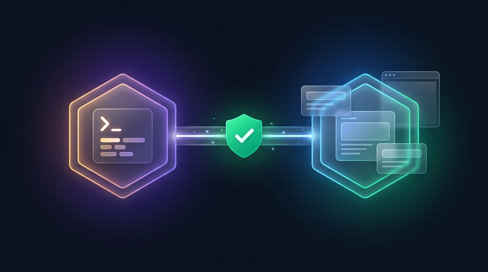

<div align="center">



# `claude-antigravity-plugin`

**Delegate Frontend UI, Multi-File Refactoring & Browser E2E Visual QA from Claude Code to Antigravity**

[](https://github.com/xzawed/claude-antigravity-plugin/actions/workflows/ci.yml)
[](https://nodejs.org/)
[](https://www.typescriptlang.org/)
[](https://modelcontextprotocol.io/)
[](#dual-execution-modes)
[](./docs/05-verification/verification-report.md)
[](#security--safety-guarantees)
[](./LICENSE)
[](./.claude-plugin/plugin.json)

🌐 **Language:** **English** · [한국어 (README.ko.md)](./README.ko.md)

[Overview](#overview) · [Installation](#installation-in-claude-code) · [Usage Guide](#how-to-use-in-claude-code) · [Architecture](#architecture) · [Benchmarks](#empirical-benchmarks) · [Security](#security--safety-guarantees) · [Troubleshooting](#troubleshooting)

</div>

---

## At a Glance

| ⚡ Diagnostics Speed | 🛡️ Automated Verification | 🌍 Cross-Platform CI | 🔒 Dependency Security |
| :---: | :---: | :---: | :---: |
| **`149.9 ms`** avg | **`39 / 39`** tests | **`7 / 7`** matrix jobs | **`0`** vulnerabilities |
| `check_ag_environment` (`4.3×` speedup) | Unit · Security · Live Stdio MCP | Ubuntu · macOS · Windows (Node 20/22) | `vitest 5.1` · `zod 4.6` · `MCP 1.27` |

---

## Overview

`claude-antigravity-plugin` (Claude Code plugin & MCP server: **`antigravity-delegate`**) connects **Claude Code** (main orchestrator, backend & architecture lead) with **Antigravity** (frontend UI builder, multi-file refactoring & real-browser visual QA specialist) through an embedded **Stdio MCP server** and a transparent `.ag-bridge/` file protocol.

- **Zero Manual Copy-Paste & Full `agy` CLI Parity:** Claude dispatches any task — frontend UI, multi-file refactors, browser QA, custom models/effort/agents, conversation resume (`--continue` / `--conversation`), or `--dangerously-skip-permissions` (`always-proceed`) — and receives a verified report, screenshots, and real-time token usage metrics.
- **Zero Extra Billing for Subscribers & Full Token Visibility:** Automatically detects your local Antigravity CLI (`agy`, `antigravity`, `ag`) or desktop app first, falling back to `GEMINI_API_KEY` only when no local subscription provider is installed. Both engines track `input`, `output`, `thinking`, `cacheRead`, and `total` tokens via `get_ag_usage` (`/ag-usage`).
- **Zero Risk to Uncommitted Work:** Automatically snapshots dirty trees (staged, unstaged, and pre-existing untracked files) via Git Guard before every delegation so you can roll back cleanly at any time.

---

## Installation in Claude Code

### Prerequisites

- **Node.js** `>= 20.0.0` & **npm**
- **Git** (required for automatic Git Guard checkpoints & rollbacks)
- **Claude Code CLI** (`claude`)
- **At least one Antigravity provider:**
  - **Subscription Mode (Recommended):** Local Antigravity CLI (`agy`) or Antigravity Desktop App signed in with your account
  - **API Fallback Mode:** A `GEMINI_API_KEY` from Google AI Studio

### Step 1 — Clone, Build & Verify (Copy & Paste)

Run the block for your OS **as-is** (installs into `~/.claude/plugins/claude-antigravity-plugin`):

**macOS / Linux:**

```bash
git clone https://github.com/xzawed/claude-antigravity-plugin.git "$HOME/.claude/plugins/claude-antigravity-plugin" \
  && npm --prefix "$HOME/.claude/plugins/claude-antigravity-plugin/server" install \
  && npm --prefix "$HOME/.claude/plugins/claude-antigravity-plugin/server" run build \
  && npm --prefix "$HOME/.claude/plugins/claude-antigravity-plugin/server" run verify
```

**Windows PowerShell:**

```powershell
git clone https://github.com/xzawed/claude-antigravity-plugin.git "$env:USERPROFILE\.claude\plugins\claude-antigravity-plugin"
npm --prefix "$env:USERPROFILE\.claude\plugins\claude-antigravity-plugin\server" install
npm --prefix "$env:USERPROFILE\.claude\plugins\claude-antigravity-plugin\server" run build
npm --prefix "$env:USERPROFILE\.claude\plugins\claude-antigravity-plugin\server" run verify
```

> **Note:** Claude Code executes `server/dist/index.js` and `server/dist/cli-init.js`. Re-run `npm run build` after pulling updates.

### Step 2 — Load the Plugin into Claude Code (Copy & Paste)

Pick **one** of the three official Claude Code methods below — every command works verbatim with Step 1:

#### Option A — Persistent Plugin Install via Claude Code Marketplace *(Recommended)*

Open `claude` and paste these two commands inside your session:

```text
/plugin marketplace add ~/.claude/plugins/claude-antigravity-plugin
/plugin install antigravity-delegate@claude-antigravity-plugin
```

*(Or directly from GitHub without cloning first: `/plugin marketplace add xzawed/claude-antigravity-plugin` → `/plugin install antigravity-delegate@claude-antigravity-plugin`)*

#### Option B — Instant Per-Session Launch with `--plugin-dir` *(Fastest for Local Use & Dev)*

**macOS / Linux:**

```bash
claude plugin validate "$HOME/.claude/plugins/claude-antigravity-plugin"
claude --plugin-dir "$HOME/.claude/plugins/claude-antigravity-plugin"
```

**Windows PowerShell:**

```powershell
claude plugin validate "$env:USERPROFILE\.claude\plugins\claude-antigravity-plugin"
claude --plugin-dir "$env:USERPROFILE\.claude\plugins\claude-antigravity-plugin"
```

> **Tip:** After local plugin edits, run `/reload-plugins` inside Claude Code to reload without restarting.

#### Option C — Standalone MCP Server Only *(Without Slash Commands / Hooks)*

**macOS / Linux:**

```bash
claude mcp add antigravity-delegate -- node "$HOME/.claude/plugins/claude-antigravity-plugin/server/dist/index.js"
```

**Windows PowerShell:**

```powershell
claude mcp add antigravity-delegate -- node "$env:USERPROFILE\.claude\plugins\claude-antigravity-plugin\server\dist\index.js"
```

### Step 3 — Configure Your Execution Provider

- **If you have Antigravity installed (Subscription Mode):** No extra setup is required. The plugin automatically detects `agy`, `antigravity`, `ag`, or the desktop app even when the MCP host strips `PATH`.
- **If you want API Fallback Mode (No local app / Headless SSH / CI):** Set `GEMINI_API_KEY` in your shell environment before starting Claude Code:

```bash
# macOS / Linux (~/.bashrc or ~/.zshrc)
export GEMINI_API_KEY="your-gemini-api-key"
```

```powershell
# Windows PowerShell (current session)
$env:GEMINI_API_KEY = "your-gemini-api-key"

# Windows PowerShell (persist for future sessions)
setx GEMINI_API_KEY "your-gemini-api-key"
```

### What Activates Automatically on Session Start

When loaded as a Claude Code plugin (Options A or B), the `SessionStart` hook (`hooks/hooks.json`) runs `cli-init.js --silent` (`< 90ms`) in your target project workspace and automatically:
1. Creates `.ag-bridge/` (`config.json`, `artifacts/`, `history/`)
2. Appends `.ag-bridge/` to your project's `.gitignore` (idempotently — never duplicates)
3. Syncs `templates/claude-handoff.md` into `.agent/workflows/claude-handoff.md` (and mirrors to `.agents/workflows/claude-handoff.md` if `.agents/` exists), without overwriting user-customized files

---

## How to Use in Claude Code

### 1. Check Connection & Active Engine (`/ag-status`)

Inside any project opened in Claude Code, run:

```text
/ag-status
```

Claude calls `check_ag_environment({})` and prints a live diagnostic summary:

| Check | Status / Value | Details |
| :--- | :--- | :--- |
| **Execution Mode** | `auto` → **`subscription`** | Active provider resolution |
| **Subscription App/CLI** | `Detected` | `agy` (`C:\Users\...\agy\bin\agy.exe`), `cli_or_ipc` |
| **`agy` CLI Defaults** | `mode: accept-edits` | `sandbox: on`, `skipPermissions: off`, `model: default`, `effort: default` |
| **Gemini API Key** | `Not set` / `Configured (env)` | Env `GEMINI_API_KEY`, model `gemini-2.5-pro`, max turns `15` |
| **Bridge (`.ag-bridge/`)** | `IDLE` | Initialized: `yes`, `.gitignore`: `protected`, Last Task / Conversation / Tokens |
| **Git Guard** | `Ready` | Branch `main`, Working tree `clean` |

### 2. Discover Live Models & Capabilities (`/ag-models`)

Query your local `agy` installation for live available models (`agy models`), custom agents (`agy agents`), supported permission modes, and CLI flags:

```text
/ag-models
```

### 3. Configure Mode, Permissions (`--dangerously-skip-permissions`), Model, or Guardrails (`/ag-config`)

Settings are stored per workspace in `.ag-bridge/config.json`:

```text
/ag-config                                # Inspect current settings
/ag-config mode auto                      # Subscription first, API fallback (default)
/ag-config mode subscription              # Force local Antigravity subscription mode
/ag-config mode api                       # Force headless Gemini API mode
/ag-config agy-mode accept-edits          # Subscription permission mode (accept-edits | auto | plan)
/ag-config skip-permissions on            # Enable --dangerously-skip-permissions (always-proceed) by default
/ag-config skip-permissions off           # Disable --dangerously-skip-permissions (default)
/ag-config agy-model gemini-4-neon-high   # Default model for agy Subscription mode (or `clear`)
/ag-config effort high                    # Default effort level (low | medium | high | xhigh | max | clear)
/ag-config agent my-frontend-agent        # Default custom agy agent (or `clear`)
/ag-config sandbox off                    # Toggle agy --sandbox / --no-sandbox (on | off)
/ag-config model gemini-2.5-flash         # Change Gemini model for API mode
/ag-config timeout 600                    # Set Subscription timeout in seconds (30–1800)
/ag-config max-turns 20                   # Set API worker turn budget (1–50)
/ag-config git-guard required             # Require a Git repo before delegating (best_effort | required)
```

> **Environment variable override:** You can also enable `--dangerously-skip-permissions` per shell session via `AG_DANGEROUSLY_SKIP_PERMISSIONS=1` (`true`/`yes`). Git Guard still snapshots your repository before execution so you can roll back with `rollback_ag_task`.

### 4. Autonomous Delegation (Just Prompt Claude Naturally)

Because `skills/ag-delegate/SKILL.md` is loaded automatically, Claude Code recognizes frontend UI, multi-file scaffolding, real-browser E2E tasks, and explicit Antigravity CLI requests on its own. For example:

> *"We finalized `/api/checkout` in `src/server/checkout.ts`. Please build the responsive Checkout page and CartDrawer under `src/components/checkout/` and `src/pages/CheckoutPage.tsx`, then verify the rendered UI and form submission on `http://localhost:3000/checkout` with zero console errors."*

**What happens behind the scenes:**
1. Claude calls `check_ag_environment` to verify the active engine (`subscription` or `api`).
2. Claude calls `delegate_to_antigravity` with least-privilege `lockedPaths` (`["src/components/checkout/", "src/pages/CheckoutPage.tsx"]`), full API types, `verifyUrl`, optional `agy` flags (`model`, `effort`, `dangerouslySkipPermissions`, etc.), and mode-appropriate `acceptanceCriteria`.
3. The MCP server creates a lossless Git Guard checkpoint, writes `.ag-bridge/dispatch.md` & `manifest.json`, and runs Antigravity (`agy --print ... --output-format stream-json`) or the Gemini API worker.
4. While `agy` works, real-time NDJSON events refresh `manifest.json` heartbeats, capture `conversationId`, `permissionMode`, and token `usage`, and save redacted logs to `.ag-bridge/artifacts/<taskId>/agy-cli.log`.
5. On completion (`VERIFIED`), Claude receives `.ag-bridge/report.md`, `changedFiles`, `artifacts`, and `metrics` (tokens, duration, conversation ID), reviews `git diff`, and summarizes the verified results for you.

### 5. Explicit Manual Delegation (`/ag-delegate`)

Use `/ag-delegate` with any Antigravity CLI flag:

```text
# Subscription mode with real-browser visual QA on a local dev server
/ag-delegate Build the analytics KPI cards and filterable data table --paths src/components/analytics/,src/pages/Analytics.tsx --url http://localhost:3000/analytics

# Full-autonomy delegation with --dangerously-skip-permissions, custom model & high effort
/ag-delegate Refactor dashboard charts and run full build verification --paths src/components/charts/ --model gemini-4-neon-high --effort high --dangerously-skip-permissions

# Resume the previous Antigravity conversation or a specific conversation ID
/ag-delegate Add dark-mode support to the cards you just created --continue
/ag-delegate Fix the remaining responsive breakpoint on mobile --conversation 89a5b562-2468-420f-a6c1-8a191e634164

# Force headless Gemini API mode for a pure code/typecheck refactor
/ag-delegate Migrate FormField and SelectInput components to Tailwind v4 tokens --paths src/components/forms/ --mode api
```

### 6. Inspect Token Usage & Execution Metrics (`/ag-usage`)

View cumulative and per-task token usage (`input`, `output`, `thinking`, `cacheRead`, `total`), execution duration, `conversationId`, and Subscription vs. API breakdowns across the workspace:

```text
/ag-usage        # Recent 20 tasks + workspace totals
/ag-usage 50     # Up to 50 recent tasks
```

### 7. Review & One-Click Rollback (`rollback_ag_task`)

After delegation finishes, inspect Claude's summary, `.ag-bridge/report.md`, and any screenshots in `.ag-bridge/artifacts/<taskId>/`. If the output isn't what you wanted, simply tell Claude:

> *"Roll back the last Antigravity task."*

Claude calls `rollback_ag_task({ taskId })`, which:
- Restores all tracked, staged, unstaged, and deleted files back to the exact pre-delegation `gitCheckpointRef`
- Deletes only untracked files created *during* delegation — preserving every pre-existing untracked file you had beforehand
- Resets `.ag-bridge/manifest.json` back to `IDLE`

---

## Architecture

<p align="center">
  
</p>

### Dual Execution Modes

Default `execution_mode: "auto"` resolves the optimal engine automatically:

| Mode | Detection Priority | Execution Engine | Verification Scope | Billing |
| :--- | :---: | :--- | :--- | :--- |
| **`subscription`** | **1st** *(Primary)* | Official `agy --print --mode accept-edits --sandbox --output-format stream-json --print-timeout` CLI → OS IPC → Clipboard fallback | Real browser rendering, console/network checks & screenshots in `.ag-bridge/artifacts/` | Existing Antigravity subscription quota (`$0` extra API cost) |
| **`api`** | **2nd** *(Fallback)* | Embedded `@google/genai` autonomous 4-tool loop (`read_file`, `write_file`, `list_dir`, `run_command`) | `npx tsc --noEmit` & project build verification | `GEMINI_API_KEY` pay-per-token |

---

## MCP Tools & Slash Commands Reference

| MCP Tool | Input Parameters | Description |
| :--- | :--- | :--- |
| **`delegate_to_antigravity`** | `title`, `instructions`, `lockedPaths?`, `acceptanceCriteria?`, `verifyUrl?`, `modeOverride?`, `timeoutSec?`, `model?`, `effort?`, `agent?`, `agyMode?`, `sandbox?`, `dangerouslySkipPermissions?`, `addDirs?`, `continueConversation?`, `conversationId?`, `project?`, `newProject?`, `remoteAgent?`, `jsonSchema?`, `disableSlashCommands?`, `settings?`, `workspaceRoot?` | Creates a Git checkpoint, writes `.ag-bridge/dispatch.md`, executes Subscription (`agy` full CLI parity) or API engine, and returns `reportMarkdown`, `changedFiles`, `artifacts`, and token `metrics`. |
| **`check_ag_environment`** | `workspaceRoot?` | Diagnoses resolved mode, detected Antigravity CLI/app paths, active `agyConfig` defaults, redacted API key status, Git state, and bridge/last usage state. |
| **`rollback_ag_task`** | `taskId?`, `workspaceRoot?` | Restores tracked, staged, unstaged, and deleted files to `gitCheckpointRef` (supports both current and archived `taskId`s) while preserving pre-existing untracked files. |
| **`list_ag_capabilities`** | `workspaceRoot?` | Queries live `agy models` and `agy agents` in parallel and reports supported permission modes (`--dangerously-skip-permissions` included), effort levels, CLI flags, and workspace defaults. |
| **`get_ag_usage`** | `workspaceRoot?`, `limit?` | Aggregates cumulative and per-task token usage (`input`, `output`, `thinking`, `cacheRead`, `total`), duration, and Subscription vs. API stats across current + `history/*.json` tasks. |

| Slash Command | Syntax |
| :--- | :--- |
| **`/ag-delegate`** | `/ag-delegate <instructions> [--paths p1,p2] [--url ...] [--mode auto\|subscription\|api] [--model <id>] [--effort <lvl>] [--agent <name>] [--agy-mode accept-edits\|auto\|plan] [--sandbox\|--no-sandbox] [--dangerously-skip-permissions] [--add-dir <dir>] [--continue] [--conversation <id>] [--project <name>] [--new-project] [--remote-agent] [--json-schema <json>] [--disable-slash-commands] [--settings <val>] [--timeout <sec>]` |
| **`/ag-config`** | `/ag-config [mode\|agy-mode\|agy-model\|effort\|agent\|sandbox\|skip-permissions\|stream-heartbeat\|model\|timeout\|max-turns\|git-guard <value>]` |
| **`/ag-status`** | `/ag-status` |
| **`/ag-models`** | `/ag-models` |
| **`/ag-usage`** | `/ag-usage [limit]` |

---

## Empirical Benchmarks

Every performance target (`NFR-005`) and cross-platform edge case is empirically verified on real hardware and CI ([Full Report: `VER-002`](./docs/05-verification/verification-report.md)):

<p align="center">
  
</p>

| Metric | Target (`NFR-005`) | Before Optimization | After Optimization | Status |
| :--- | :---: | :---: | :---: | :---: |
| `check_ag_environment` (Live Stdio MCP) | `< 500 ms` | `652.9 ms` avg | **`149.9 ms` avg** (`4.3×` faster) | ✅ **PASS** |
| `cli-init.js --silent` (`SessionStart` hook) | `< 300 ms` | `99.1 ms` avg | **`90.3 ms` avg** (`3.3×` headroom) | ✅ **PASS** |
| Automated TDD Suite (`vitest run`) | `>= 80%` core paths | 27 tests | **`39 / 39` tests (6 suites)** | ✅ **PASS** |
| Windows `.cmd` CLI Spawn (Node 20.12+/24) | No `EINVAL` crash | `spawn EINVAL` | `buildCliSpawnSpec` safe wrapper | ✅ **PASS** |

---

## Security & Safety Guarantees

<p align="center">
  
</p>

| Safety Layer | Enforcement Mechanism | What It Prevents |
| :--- | :--- | :--- |
| **Path Guard (`path-guard.ts`)** | `path.resolve` + `fs.realpathSync` canonicalization + fail-closed `lockedPaths` | `../` path traversal, symlink escapes, edits to `.git/`, `.env*`, `node_modules/`, `.ag-bridge/config.json` |
| **Git Guard (`git-guard.ts`)** | `git stash create` pinned under `refs/ag-bridge/checkpoints/<taskId>` + `untrackedBaseline` | Losing user's pre-existing staged/unstaged edits or untracked files during `rollback_ag_task` |
| **Atomic Bridge (`bridge-fs.ts`)** | `.tmp` write + atomic `rename`, single-task lock (`BRIDGE_BUSY`), stale-lock auto-archive | Corrupted `manifest.json` reads, overlapping delegations, accidental commits (`.gitignore` auto-protected) |
| **Command & Secret Guard** | Strict build/typecheck/lint/test allowlist + stripped child env + `[REDACTED]` masking | Shell injection (`&&`, `\|`, `;`), destructive commands (`rm`, `git push`), API key leaks |

---

## Troubleshooting

| Symptom / Error Code | Cause | Resolution |
| :--- | :--- | :--- |
| **`NO_ANTIGRAVITY_PROVIDER`** | Neither local Antigravity (`agy`/app) nor `GEMINI_API_KEY` was detected | Install & sign in to Antigravity (`agy`), **or** export `GEMINI_API_KEY` and re-run `/ag-status`. |
| **`SUBSCRIPTION_UNAVAILABLE`** | `mode: subscription` is forced, but CLI/app is in a non-standard location | Set `"app_path": "/your/path/to/agy"` in `.ag-bridge/config.json` (binary type `agy` is auto-inferred), or switch with `/ag-config mode api`. |
| **`BRIDGE_BUSY`** | A previous delegation is still `DISPATCHED` or `RUNNING` within `timeout_sec` | Wait for it to finish, check `.ag-bridge/artifacts/<taskId>/agy-cli.log`, or let stale lock recovery trigger after `timeout_sec`. |
| **MCP server fails to start in Claude Code** | `server/dist/index.js` was not compiled yet | Run `cd server && npm install && npm run build && npm run verify`, then run `/reload-plugins` in Claude Code. |
| **Windows path with spaces** | Unquoted plugin path in CLI flags | Always wrap paths with spaces in double quotes (`claude --plugin-dir "C:\My Plugins\claude-antigravity-plugin"`). `hooks/hooks.json` already quotes `${CLAUDE_PLUGIN_ROOT}` safely. |

---

<details>
<summary><strong>📁 Repository Layout & Configuration Reference (Click to expand)</strong></summary>

### Directory Structure

```text
claude-antigravity-plugin/
├── assets/                        # README hero banner & vector architecture/benchmark diagrams
├── .claude-plugin/
│   ├── plugin.json                # Claude Code plugin manifest
│   └── marketplace.json           # Claude Code marketplace catalog for `/plugin install`
├── .mcp.json                      # Embedded Stdio MCP server definition
├── .github/workflows/ci.yml       # Cross-platform CI (Ubuntu/Windows/macOS x Node 20/22)
├── hooks/hooks.json               # SessionStart auto-initialization hook
├── skills/ag-delegate/SKILL.md    # Autonomous delegation & review skill
├── commands/                      # /ag-delegate, /ag-config, /ag-status, /ag-models, /ag-usage
├── templates/claude-handoff.md    # Antigravity handoff workflow template
├── server/                        # TypeScript MCP server, dual engines, verifier & tests
│   ├── src/
│   │   ├── index.ts               # MCP Stdio server entrypoint (5 tools)
│   │   ├── cli-init.ts            # SessionStart initializer CLI
│   │   ├── types.ts               # State machine, config, metrics & error code types
│   │   ├── config.ts              # Config precedence, Zod validation & secret masking
│   │   ├── path-guard.ts          # lockedPaths canonicalization & traversal guard
│   │   ├── bridge-fs.ts           # Atomic .ag-bridge/ I/O, locking & history archive
│   │   ├── git-guard.ts           # Lossless Git checkpoint & rollback
│   │   ├── detector.ts            # Pure-JS cross-platform agy/antigravity & API detector
│   │   └── engines/
│   │       ├── base.ts            # ExecutionEngine strategy interface
│   │       ├── subscription.ts    # Full agy CLI parity, stream-json usage & capability query
│   │       └── api-worker.ts      # @google/genai 4-tool autonomous loop + usageMetadata
│   ├── scripts/verify-plugin.mjs  # Live healthcheck & Stdio MCP smoke verifier
│   └── tests/                     # 6 suites / 39 automated tests (unit, security, E2E)
├── AGENTS.md                      # Antigravity workspace rules & PR workflow invariants
├── CONTRIBUTING.md                # Contributor workflow & engineering invariants
├── SECURITY.md                    # Vulnerability reporting & security boundaries
├── LICENSE                        # Apache License 2.0
├── README.md                      # English documentation (this file)
├── README.ko.md                   # Complete Korean documentation
└── docs/                          # Antigravity standard documentation hub (00~06)
```

### Default `.ag-bridge/config.json`

```json
{
  "execution_mode": "auto",
  "git_guard": "best_effort",
  "subscription": {
    "app_path": "auto",
    "trigger_method": "cli_or_ipc",
    "timeout_sec": 300,
    "poll_interval_ms": 2000,
    "agy_mode": "accept-edits",
    "agy_sandbox": true,
    "agy_dangerously_skip_permissions": false,
    "agy_stream_heartbeat": true
  },
  "api": {
    "api_key_env": "GEMINI_API_KEY",
    "model": "gemini-2.5-pro",
    "max_turns": 15,
    "command_timeout_sec": 60
  }
}
```

</details>

---

## Documentation Hub

All engineering docs follow the [Antigravity Documentation Standard](./docs/00-standards/documentation-standard.md) — see [docs/README.md](./docs/README.md):

| Stage | Documents |
| :--- | :--- |
| **01. Planning** | [PRD](./docs/01-planning/PRD.md) · [User & Agent Flows](./docs/01-planning/user-flows.md) |
| **02. Architecture** | [System Architecture](./docs/02-architecture/system-architecture.md) · [Bridge Protocol](./docs/02-architecture/bridge-protocol.md) · [Security & Git Guard](./docs/02-architecture/security-and-git-guard.md) |
| **03. Specifications** | [MCP Tools API](./docs/03-specs/mcp-tools-api.md) · [Execution Engines](./docs/03-specs/execution-engines.md) · [Prompts & Commands](./docs/03-specs/prompts-and-commands.md) |
| **04–06. Delivery & QA** | [Implementation Plan](./docs/04-implementation/implementation-plan.md) · [Task Checklist](./docs/04-implementation/task-checklist.md) · [Test & QA Plan](./docs/05-verification/test-and-qa-plan.md) · [Empirical Verification (`VER-002`)](./docs/05-verification/verification-report.md) · [ADRs](./docs/06-adr/README.md) |

---

## Contributing, Security & License

- **Contributing:** See [CONTRIBUTING.md](./CONTRIBUTING.md) for local setup, PR-only workflow, and coding invariants.
- **Security:** See [SECURITY.md](./SECURITY.md) for supported versions and private vulnerability reporting.
- **License:** Licensed under the [Apache License 2.0](./LICENSE).
