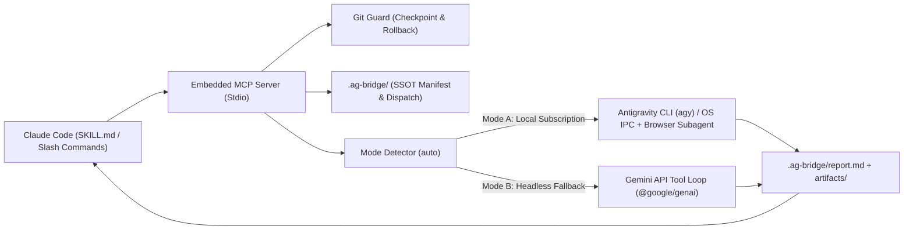

# `claude-antigravity-plugin`

[](https://github.com/xzawed/claude-antigravity-plugin/actions/workflows/ci.yml)
[](https://nodejs.org/)
[](https://www.typescriptlang.org/)
[](https://modelcontextprotocol.io/)
[](#dual-execution-modes)
[](./docs/05-verification/verification-report.md)
[](#security--safety-guarantees)
[](./.claude-plugin/plugin.json)

> **An MCP-based dual-engine delegation plugin that connects Claude Code (main orchestrator) with Antigravity (local Subscription CLI/App or Gemini API worker) for frontend UI implementation, multi-file refactoring, and real-browser E2E visual verification.**
>
> **Language:** [English](#overview) · [한국어 보조 가이드 (Korean Guide)](#한국어-가이드-korean-guide)

---

## Overview

`claude-antigravity-plugin` (MCP server: `antigravity-delegate`) enables **Claude Code** to safely offload UI-heavy implementation, multi-file frontend scaffolding, and browser-based E2E visual QA to **Antigravity**, while keeping Claude Code focused on architecture, backend logic, and final review.



---

## Dual Execution Modes

The plugin defaults to `execution_mode: "auto"`, automatically selecting the optimal engine for your machine:

| Mode | Trigger Condition | Execution Engine | Verification Capability | Cost Model |
| :--- | :--- | :--- | :--- | :--- |
| **`subscription`** *(Primary in `auto`)* | Local Antigravity CLI (`agy`, `antigravity`, `ag`) or Desktop App detected | Official `agy --print --mode accept-edits --sandbox --print-timeout` CLI → OS IPC → Clipboard fallback | Real browser rendering, console/network error checks, screenshots in `.ag-bridge/artifacts/` | Uses your existing Antigravity subscription quota (no extra API billing) |
| **`api`** *(Fallback in `auto`)* | No local Antigravity detected + `GEMINI_API_KEY` configured | Embedded `@google/genai` 4-tool autonomous loop (`read_file`, `write_file`, `list_dir`, `run_command`) | TypeScript & build checks (`npx tsc --noEmit`, `npm run build`) | Pay-per-token Gemini API |

---

## Security & Safety Guarantees

- **Strict `lockedPaths` Write Isolation:** Every agent write is canonicalized via `path.resolve` + `fs.realpathSync` to prevent `../` path traversal and symlink escapes. Writes to `.git/`, `.env*`, `node_modules/`, and `.ag-bridge/config.json` are unconditionally blocked.
- **Lossless Git Guard Checkpoints:** Before delegating, `git stash create` pins a snapshot under `refs/ag-bridge/checkpoints/<taskId>` alongside an `untrackedBaseline` list. Calling `rollback_ag_task` restores tracked, staged, unstaged, and deleted files while preserving pre-existing user untracked files.
- **Atomic `.ag-bridge/` SSOT I/O:** State transitions (`IDLE` → `DISPATCHED` → `RUNNING` → `VERIFIED` | `FAILED`) use `.tmp` + atomic `rename`, single-task locking (`BRIDGE_BUSY`), stale-lock auto-recovery, and idempotent `.gitignore` registration.
- **Command Sandboxing & Secret Redaction:** `run_command` enforces a strict build/typecheck/lint/test allowlist (blocking shell metacharacters & destructive binaries), strips sensitive env keys from child processes, and masks API keys (`[REDACTED]`) across all logs and reports.

---

## Quick Start & Installation

### 1. Build & Verify Locally

Requirements: **Node.js `>= 20.x`**, **Git**

```bash
cd server
npm install
npm run build        # Compile TypeScript -> server/dist/
npm run typecheck    # Strict type check (tsc --noEmit)
npm test             # Run unit, security, integration & Stdio MCP tests (33 tests)
npm run verify       # Live manifest, space-path cli-init & Stdio MCP healthcheck
```

### 2. Mount in Claude Code

Register this repository root as a Claude Code plugin. The following components load automatically:
- **MCP Server (`.mcp.json`):** `node ${CLAUDE_PLUGIN_ROOT}/server/dist/index.js`
- **Session Hook (`hooks/hooks.json`):** Runs `cli-init.js --silent` on `SessionStart` to initialize `.ag-bridge/`, `.gitignore`, and `.agent/workflows/claude-handoff.md`
- **Autonomous Skill (`skills/ag-delegate/SKILL.md`):** Evaluates delegation criteria and mode-specific acceptance criteria
- **Slash Commands (`commands/`):** `/ag-delegate`, `/ag-config`, `/ag-status`

### 3. Configure API Fallback Mode *(Optional — for non-subscribers / headless environments)*

```bash
# macOS / Linux
export GEMINI_API_KEY="your-gemini-api-key"

# Windows PowerShell
$env:GEMINI_API_KEY = "your-gemini-api-key"
```

---

## MCP Tools & Slash Commands

| MCP Tool | Purpose |
| :--- | :--- |
| `delegate_to_antigravity` | Creates a Git checkpoint, writes `.ag-bridge/dispatch.md`, executes Subscription or API engine, and returns `reportMarkdown`, `changedFiles`, and `artifacts`. |
| `check_ag_environment` | Diagnoses resolved execution mode, detected Antigravity CLI/app paths (handles stripped MCP host `PATH`), redacted API key status, Git state, and bridge status (`< 200ms`). |
| `rollback_ag_task` | Restores the workspace to its exact pre-delegation Git checkpoint (`gitCheckpointRef`) while preserving pre-existing dirty/untracked user files. |

| Slash Command | Usage |
| :--- | :--- |
| `/ag-delegate` | Manually delegate a UI/frontend or E2E verification task (`--paths`, `--url`, `--mode`) |
| `/ag-config` | View or update `.ag-bridge/config.json` (`mode`, `model`, `timeout`, `max-turns`, `git-guard`) |
| `/ag-status` | Display a diagnostic table via `check_ag_environment` |

---

## Repository Layout

```text
claude-antigravity-plugin/
├── .claude-plugin/plugin.json     # Claude Code plugin manifest
├── .mcp.json                      # Embedded Stdio MCP server definition
├── .github/workflows/ci.yml       # Cross-platform CI (Ubuntu/Windows/macOS x Node 20/22)
├── hooks/hooks.json               # SessionStart auto-initialization hook
├── skills/ag-delegate/SKILL.md    # Autonomous delegation & review skill
├── commands/                      # /ag-delegate, /ag-config, /ag-status
├── templates/claude-handoff.md    # Antigravity handoff workflow template
├── server/                        # TypeScript MCP server, dual engines, verifier & tests
│   ├── src/
│   │   ├── index.ts               # MCP Stdio server entrypoint (3 tools)
│   │   ├── cli-init.ts            # SessionStart initializer CLI
│   │   ├── types.ts               # State machine, config & error code types
│   │   ├── config.ts              # Config precedence, Zod validation & secret masking
│   │   ├── path-guard.ts          # lockedPaths canonicalization & traversal guard
│   │   ├── bridge-fs.ts           # Atomic .ag-bridge/ I/O, locking & history archive
│   │   ├── git-guard.ts           # Lossless Git checkpoint & rollback
│   │   ├── detector.ts            # Cross-platform agy/antigravity & API key detector
│   │   └── engines/
│   │       ├── base.ts            # ExecutionEngine strategy interface
│   │       ├── subscription.ts    # Local Antigravity CLI/IPC trigger + hybrid watcher
│   │       └── api-worker.ts      # @google/genai 4-tool autonomous loop engine
│   ├── scripts/verify-plugin.mjs  # Live healthcheck & Stdio MCP smoke verifier
│   └── tests/                     # 6 suites / 33 automated tests (unit, security, E2E)
├── AGENTS.md                      # Antigravity workspace rules & PR workflow invariants
└── docs/                          # Antigravity standard documentation hub (00~06)
```

---

## Documentation Hub

All engineering specifications follow the [Antigravity Documentation Standard](./docs/00-standards/documentation-standard.md). See [docs/README.md](./docs/README.md) for the full map:

- **Planning:** [PRD](./docs/01-planning/PRD.md) · [User & Agent Flows](./docs/01-planning/user-flows.md)
- **Architecture:** [System Architecture](./docs/02-architecture/system-architecture.md) · [Bridge Protocol](./docs/02-architecture/bridge-protocol.md) · [Security & Git Guard](./docs/02-architecture/security-and-git-guard.md)
- **Specs:** [MCP Tools API](./docs/03-specs/mcp-tools-api.md) · [Execution Engines](./docs/03-specs/execution-engines.md) · [Prompts & Commands](./docs/03-specs/prompts-and-commands.md)
- **Implementation & Verification:** [Implementation Plan](./docs/04-implementation/implementation-plan.md) · [Task Checklist](./docs/04-implementation/task-checklist.md) · [Test & QA Plan](./docs/05-verification/test-and-qa-plan.md) · [Empirical Verification Report](./docs/05-verification/verification-report.md)
- **ADRs:** [ADR Index](./docs/06-adr/README.md) (`ADR-001` ~ `ADR-003`)

---

## 한국어 가이드 (Korean Guide)

> **요약:** `claude-antigravity-plugin`은 **Claude Code(메인 오케스트레이터)**가 프론트엔드 UI 구현, 다중 파일 리팩토링, 실제 브라우저 E2E 시각적 검증을 **Antigravity(로컬 구독 앱/CLI 또는 Gemini API 워커)**에 안전하게 위임하고 결과 리포트·스크린샷을 회수하는 MCP 기반 협업 플러그인입니다.

### 핵심 기능 요약
1. **듀얼 실행 엔진 (`auto` / `subscription` / `api`)**
   - **구독 모드 (`subscription`):** 로컬에 설치된 `agy` / `antigravity` CLI 또는 데스크톱 앱의 구독 쿼터를 추가 API 과금 없이 사용하며, 내장 Browser Subagent로 렌더링·콘솔 에러·스크린샷 검증을 수행합니다.
   - **API 폴백 모드 (`api`):** Antigravity 미설치 또는 헤드리스 환경에서 `GEMINI_API_KEY`와 `@google/genai` 4-Tool 자율 루프로 코드를 구현하고 `tsc`/빌드 통과를 검증합니다.
2. **안전장치 (`lockedPaths` + Git Guard + `.ag-bridge/` SSOT)**
   - 허용된 `lockedPaths` 범위 외 파일 쓰기 및 Path Traversal/Symlink 탈출, `.git/`·`.env*` 수정을 전면 차단합니다.
   - 위임 전 `git stash create` 스냅샷과 `untrackedBaseline`을 기록해 `rollback_ag_task` 호출 시 위임 전 사용자의 미커밋(staged/unstaged) 및 기존 untracked 파일까지 100% 보존하며 원복합니다.
   - `.ag-bridge/`는 `.gitignore`에 자동 등록되며 모든 상태 파일은 원자적 쓰기(`.tmp` → `rename`)로 갱신됩니다.

### 빠른 실행 명령어
```bash
cd server
npm install
npm run typecheck    # TypeScript strict 타입 검사
npm run build        # server/dist/ 빌드
npm test             # 단위·보안·통합·Stdio MCP 테스트 (33개)
npm run verify       # 실환경 매니페스트·cli-init·라이브 MCP 헬스체크
```

### 협업 및 PR 규칙
- 모든 변경 작업은 `main` 직접 푸시 없이 전용 브랜치(`feat/*`, `fix/*`, `docs/*`, `chore/*`)에서 수행하고 Pull Request 단위로 제출합니다([AGENTS.md](./AGENTS.md)).
- PR 생성 시 [.github/workflows/ci.yml](./.github/workflows/ci.yml)이 Ubuntu / Windows / macOS × Node 20 / 22 매트릭스 빌드·테스트 및 문서 링크 무결성을 자동 검증합니다.
