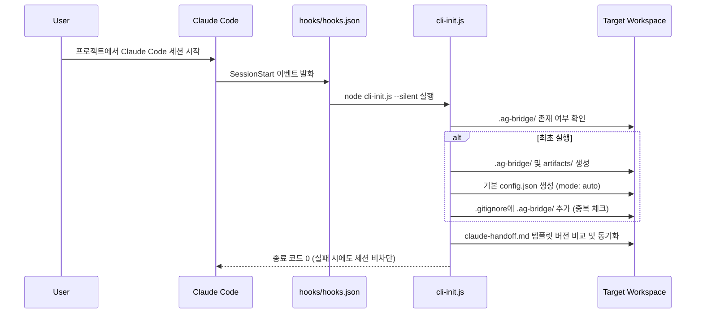
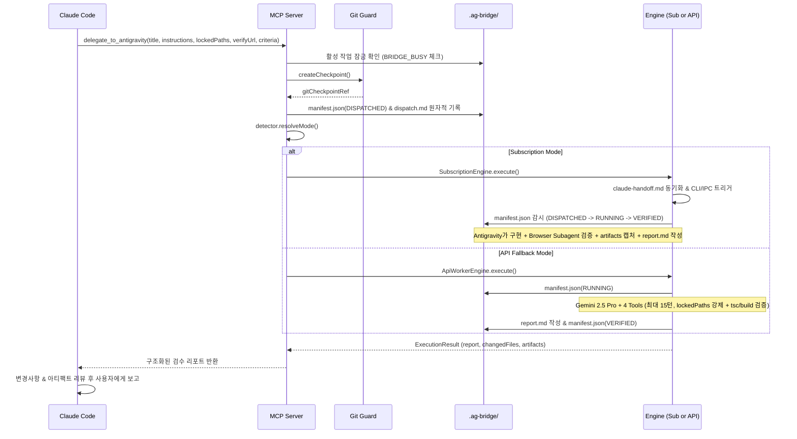

# 사용자 및 에이전트 워크플로우 기획서 (User & Agent Flows)

| 항목 | 내용 |
| :--- | :--- |
| **문서 ID** | `PLN-002` |
| **버전** | `1.0.0` |
| **상태** | `Approved` |
| **최종 수정일** | `2026-11-22` |
| **관련 문서** | [PRD](./PRD.md), [브릿지 프로토콜](../02-architecture/bridge-protocol.md), [프롬프트 & 커맨드 명세](../03-specs/prompts-and-commands.md) |

---

## 1. 핵심 시나리오 개요

본 플러그인은 Claude Code 세션 내에서 다음 6가지 핵심 사용자/에이전트 플로우를 지원한다.

1. **Flow 1:** 세션 시작 및 자동 초기화 (`SessionStart` Hook)
2. **Flow 2:** Claude 자율 판단 기반 위임 (`SKILL.md` → `delegate_to_antigravity`)
3. **Flow 3:** 사용자 명시적 위임 (`/ag-delegate`)
4. **Flow 4:** 상태 진단 및 설정 변경 (`/ag-status`, `/ag-config`)
5. **Flow 5:** 결과 불만족 시 즉시 롤백 (`rollback_ag_task`)
6. **Flow 6:** 예외·타임아웃·프로바이더 미감지 복구 시나리오

---

## 2. Flow 1: 세션 시작 자동 초기화

### 동작 정책
- 워크스페이스가 빈 폴더이거나 `.gitignore`가 없더라도 안전하게 처리한다(`.gitignore`가 없으면 생성하거나 Git 리포지토리인 경우에만 추가).
- 사용자가 `.agent/workflows/claude-handoff.md`를 직접 커스터마이징한 경우(해시 불일치 & 사용자 수정 마커 존재 시) 덮어쓰지 않고 경고만 남긴다.

---

## 3. Flow 2 & 3: 작업 위임 End-to-End 플로우

### 3.1 위임 트리거 분기
- **자율 위임 (`SKILL.md`):** Claude Code가 사용자 요청을 분석하여 아래 조건 중 하나 이상 해당하면 `check_ag_environment`로 모드를 확인한 뒤 `delegate_to_antigravity` 호출을 제안/실행한다.
  1. React/Next.js/Vue/Svelte 등 UI 컴포넌트·스타일링·레이아웃 구현
  2. 로컬 개발 서버(`verifyUrl`)를 띄워 실제 브라우저 렌더링, 콘솔 에러, 클릭/폼 인터랙션 검증이 필요한 작업
  3. 백엔드 API/타입 스펙이 확정된 상태에서 다수의 프론트엔드 화면·상태 코드를 생성하는 작업
- **수동 위임 (`/ag-delegate`):** 사용자가 직접 `/ag-delegate <지시사항>` 형태로 호출하면 Claude가 `lockedPaths`, `verifyUrl`, `acceptanceCriteria`를 구조화하여 `delegate_to_antigravity`를 실행한다.

### 3.2 모드별 실행 시퀀스

---

## 4. Flow 4: 환경 진단 및 설정 변경

### 4.1 `/ag-status` 시나리오
1. 사용자가 `/ag-status` 입력.
2. Claude가 `check_ag_environment({})` 호출.
3. MCP 서버가 다음 정보를 반환하고 Claude가 마크다운 표로 출력:
   - 설정된 모드 (`execution_mode`) 및 실제 해석된 활성 엔진 (`resolvedMode`)
   - 로컬 Antigravity 감지 결과 (바이너리/앱 경로 및 버전)
   - `GEMINI_API_KEY` 설정 여부 (`Configured (env)` / `Not set` — 키 원문 비공개)
   - 현재 `.ag-bridge/manifest.json` 작업 상태 (`IDLE` / `RUNNING` / 마지막 작업 ID 및 상태)
   - Git 저장소 여부 및 마지막 체크포인트 Ref

### 4.2 `/ag-config` 시나리오
- `/ag-config mode auto | subscription | api` → `.ag-bridge/config.json`의 `execution_mode` 갱신
- `/ag-config model <model-name>` → `api.model` 갱신 (예: `gemini-2.5-pro`, `gemini-2.5-flash`)
- `/ag-config timeout <seconds>` → `subscription.timeout_sec` 갱신 (허용 범위: `30` ~ `1800`)
- `/ag-config max-turns <count>` → `api.max_turns` 갱신 (허용 범위: `1` ~ `50`)

---

## 5. Flow 5: 롤백 시나리오 (`rollback_ag_task`)

1. Claude Code가 반환된 `report.md`나 `git diff`를 검수한 결과 품질 미달·요구사항 불일치·예상 외 부작용을 발견한다(또는 사용자가 "방금 위임 작업 취소해 줘" 요청).
2. Claude가 `rollback_ag_task({ taskId })`를 호출한다.
3. `GitGuard.rollback(gitCheckpointRef)`가 위임 시점 이후 변경된 추적 파일과 위임 중 새로 생성된 untracked 파일(사전 스냅샷 기준)을 안전하게 원복한다.
4. `.ag-bridge/manifest.json` 상태를 `IDLE`(또는 롤백 메타데이터 기록)로 정리하고 복구된 파일 목록을 반환한다.

---

## 6. Flow 6: 예외 및 엣지 케이스 처리 매트릭스

| 예외 상황 | 감지 시점 | 시스템 동작 | 사용자/Claude 안내 메시지 |
| :--- | :--- | :--- | :--- |
| **구독 앱·API 키 둘 다 없음** | `detector.resolveMode()` | 작업 시작 전 즉시 중단 (`NO_ANTIGRAVITY_PROVIDER`) | Antigravity 앱/CLI 설치·로그인 또는 `GEMINI_API_KEY` 환경변수 설정 방법 안내 |
| **이미 실행 중인 작업 존재** | `bridge-fs` 잠금 체크 | `RUNNING`/`DISPATCHED` 상태이고 타임아웃 미경과 시 `BRIDGE_BUSY` 반환 | 현재 실행 중인 `taskId`와 경과 시간 표시, 대기 또는 강제 초기화 안내 |
| **이전 작업 비정상 종료 (Stale Lock)** | `bridge-fs` 잠금 체크 | `updatedAt` 기준 `timeout_sec` 초과 시 Stale로 판정하고 `FAILED(STALE_TIMEOUT)` 아카이브 후 새 작업 진행 | 이전 작업이 타임아웃으로 종료되었음을 경고 메타데이터로 포함 |
| **Subscription 모드 타임아웃 (기본 300s)** | `subscription.ts` 감시 루프 | `manifest.json`을 `FAILED`로 갱신, `TASK_TIMEOUT` 에러 반환(체크포인트 유지) | Antigravity 창 확인 또는 `rollback_ag_task` / API 모드 재시도 제안 |
| **CLI 트리거 실패 (GUI 전용 환경)** | `subscription.ts` | 1차 CLI → 2차 OS IPC(AppleScript/PowerShell) → 3차 클립보드 복사 + 데스크톱 알림 폴백 | "클립보드에 `/claude-handoff`가 복사되었습니다. Antigravity 창에 붙여넣어 실행하세요" 안내 |
| **API 워커 `lockedPaths` 위반 시도** | `api-worker.ts` `write_file` | 쓰기 거부 후 Tool 응답으로 `PATH_OUTSIDE_LOCKED_SCOPE` 에러 반환(에이전트가 스스로 수정 기회 획득) | 최종 리포트에 차단된 시도 횟수 기록 |
| **API 워커 `max_turns` 도달** | `api-worker.ts` 루프 | `max_turns - 2` 턴에 마무리 경고 주입, 초과 시 현재 상태 요약으로 `report.md` 강제 생성 및 `FAILED(MAX_TURNS_EXCEEDED)` | 완료된 부분과 미완료 항목 보고, `rollback_ag_task` 선택지 제시 |
| **Git 저장소가 아닌 워크스페이스** | `git-guard.ts` | 기본 정책(`best_effort`) 시 경고와 함께 `gitCheckpointRef: undefined`로 진행(롤백 불가 명시); `required` 설정 시 중단 | "Git 저장소가 아니므로 자동 롤백이 비활성화됩니다" 안내 |
