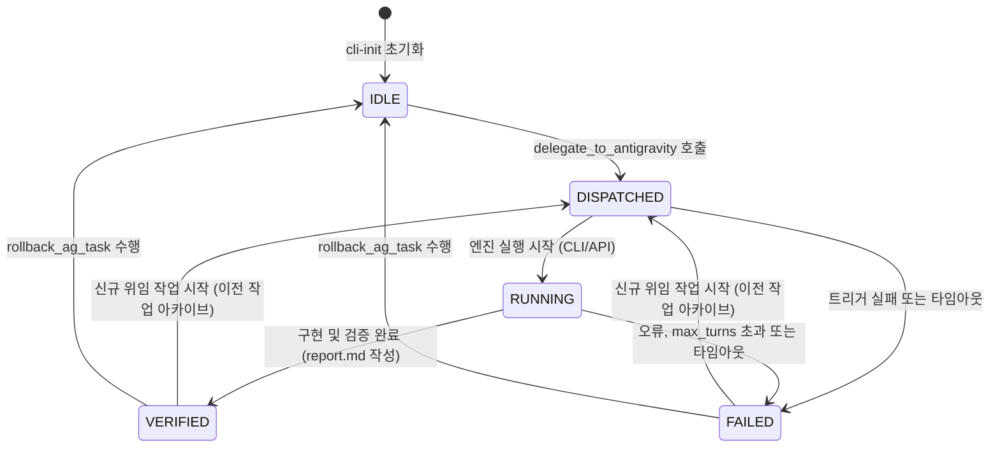

# `.ag-bridge/` 프로토콜 및 상태 머신 설계서 (Bridge Protocol)

| 항목 | 내용 |
| :--- | :--- |
| **문서 ID** | `ARC-002` |
| **버전** | `1.0.0` |
| **상태** | `Approved` |
| **최종 수정일** | `2026-11-22` |
| **관련 문서** | [시스템 아키텍처](./system-architecture.md), [보안 & Git Guard](./security-and-git-guard.md), [ADR-001](../06-adr/ADR-001-file-based-ag-bridge.md) |

---

## 1. 프로토콜 개요

`.ag-bridge/` 디렉터리는 Claude Code(MCP 서버)와 Antigravity(구독 에이전트 또는 API 워커) 사이에서 작업 지시, 진행 상태, 검증 결과, 아티팩트를 주고받는 **파일 기반 단일 진실 공급원(SSOT)**이다.

### 1.1 워크스페이스 내 `.ag-bridge/` 디렉터리 구조

```text
<target-workspace>/
├── .gitignore                  # ".ag-bridge/" 항목 자동 등록
├── .agent/
│   └── workflows/
│       └── claude-handoff.md   # Antigravity 핸드오프 워크플로우 (자동 동기화)
└── .ag-bridge/
    ├── config.json             # 사용자/프로젝트 실행 모드 및 엔진 설정
    ├── manifest.json           # 현재(또는 최근) 위임 작업의 상태 머신 메타데이터
    ├── dispatch.md             # Claude -> Antigravity 작업 지시서
    ├── report.md               # Antigravity -> Claude 완료 및 검증 보고서
    ├── artifacts/              # 브라우저 스크린샷, 콘솔 로그, 빌드 로그
    │   └── <taskId>/
    │       ├── screenshot-01.png
    │       └── console.log
    └── history/                # 이전 완료/실패 작업의 manifest/report 아카이브 (최근 20건 유지)
        └── <taskId>.json
```

---

## 2. 상태 머신 (Task State Machine)

`manifest.json`의 `status` 필드는 다음 5개 상태를 가지며 허용된 전이만 수행한다.



### 2.1 상태별 의미 및 소유자

| 상태 | 의미 | 상태 기록 주체 |
| :--- | :--- | :--- |
| `IDLE` | 활성 위임 작업 없음 (초기화 완료 또는 롤백 완료) | `cli-init.ts`, `bridge-fs.ts` |
| `DISPATCHED` | Git 체크포인트 생성 및 `dispatch.md` 기록 완료, 워커 수신 대기 | `index.ts` → `bridge-fs.ts` |
| `RUNNING` | Antigravity(`claude-handoff.md`) 또는 `api-worker.ts`가 작업 수행 중 | `claude-handoff.md` / `api-worker.ts` |
| `VERIFIED` | 구현·검증·`report.md` 작성 완료 | `claude-handoff.md` / `api-worker.ts` |
| `FAILED` | 트리거 실패, 타임아웃, 검증 실패, `max_turns` 초과 등 비정상 종료 | 엔진 또는 `bridge-fs.ts` |

---

## 3. 데이터 스키마 정의 (`server/src/types.ts`)

### 3.1 `manifest.json` 스키마

```typescript
export type ExecutionMode = 'auto' | 'subscription' | 'api';
export type ResolvedExecutionMode = 'subscription' | 'api';
export type TaskStatus = 'IDLE' | 'DISPATCHED' | 'RUNNING' | 'VERIFIED' | 'FAILED';

export interface BridgeManifest {
  schemaVersion: 1;
  taskId: string;                 // 예: "ag-20261122-201500-a1b2"
  title: string;
  mode: ResolvedExecutionMode;
  status: TaskStatus;
  lockedPaths: string[];          // 워크스페이스 상대 경로 목록 (허용 수정 범위)
  verifyUrl?: string;             // 예: "http://localhost:3000/dashboard"
  createdAt: string;              // ISO 8601 UTC
  updatedAt: string;              // ISO 8601 UTC (Stale 판정 기준)
  gitCheckpointRef?: string;      // Git 커밋/스냅샷 해시
  gitUntrackedBaseline?: string[];// 위임 직전 존재하던 untracked 파일 목록 (롤백 보존용)
  artifacts: string[];            // .ag-bridge/ 기준 상대 경로 목록
  changedFiles?: string[];        // 완료 시 감지된 변경 파일 목록
  errorCode?: string;             // FAILED 시 표준 에러 코드
  error?: string;                 // FAILED 시 사람이 읽을 수 있는 상세 사유
}
```

### 3.2 `config.json` 스키마

```json
{
  "execution_mode": "auto",
  "git_guard": "best_effort",
  "subscription": {
    "app_path": "auto",
    "trigger_method": "cli_or_ipc",
    "timeout_sec": 300,
    "poll_interval_ms": 2000
  },
  "api": {
    "api_key_env": "GEMINI_API_KEY",
    "model": "gemini-2.5-pro",
    "max_turns": 15,
    "command_timeout_sec": 60
  }
}
```

### 3.3 설정 우선순위 (Precedence)
1. **MCP Tool 호출 인자 오버라이드** (해당 필드가 지원되는 경우)
2. **프로젝트 설정 파일** (`.ag-bridge/config.json`)
3. **환경변수** (`AG_DEFAULT_MODE`, `GEMINI_API_KEY`, `AG_MODEL`)
4. **내장 기본값** (`execution_mode: "auto"`, `timeout_sec: 300`, `model: "gemini-2.5-pro"`, `max_turns: 15`)

---

## 4. 마크다운 계약 포맷 (`dispatch.md` & `report.md`)

### 4.1 `.ag-bridge/dispatch.md` 표준 구조
```markdown
# Antigravity Task Dispatch

- **Task ID:** `<taskId>`
- **Title:** `<title>`
- **Mode:** `<subscription | api>`
- **Created At:** `<ISO8601>`
- **Verify URL:** `<verifyUrl 또는 N/A>`

## Locked Paths (수정 허용 범위 — 절대 준수)
- `src/components/Dashboard/`
- `src/pages/DashboardPage.tsx`

## Instructions & Context
<Claude가 전달한 상세 구현 지시, 타입 정의, API 스펙>

## Acceptance Criteria (완료 조건)
- [ ] <조건 1>
- [ ] <조건 2>
```

### 4.2 `.ag-bridge/report.md` 표준 구조
```markdown
# Antigravity Task Report

- **Task ID:** `<taskId>`
- **Status:** `<VERIFIED | FAILED>`
- **Engine:** `<subscription | api>`
- **Completed At:** `<ISO8601>`

## Summary
<구현 내용 요약>

## Modified / Created Files
- `src/components/Dashboard/ChartCard.tsx` (created)
- `src/pages/DashboardPage.tsx` (modified)

## Verification Results
- **Build / Typecheck:** PASS (`npx tsc --noEmit`)
- **Browser E2E / Visual Check:** PASS / SKIPPED (API mode)
- **Console / Network Errors:** 0 errors

## Artifacts
- `.ag-bridge/artifacts/<taskId>/dashboard-desktop.png`

## Notes & Follow-up for Claude
<백엔드 연동 필요 사항, 잔여 이슈 또는 주의사항>
```

---

## 5. 원자적 I/O, 동시성 잠금 및 복구 전략

### 5.1 원자적 쓰기 (Atomic File Write)
- `manifest.json` 및 `config.json` 쓰기 시 직접 덮어쓰지 않고 동일 디렉터리에 `<filename>.<pid>.<rand>.tmp`를 생성한 뒤 `fs.renameSync`로 교체한다.
- **이유:** `fs.watch` 감시자가 JSON이 절반만 쓰인 상태에서 읽어 `SyntaxError`를 유발하는 레이스 컨디션을 원천 차단한다.
- 읽기 측(`bridge-fs.ts`)도 일시적 파일 잠금(Windows `EBUSY`/`EPERM`)에 대비해 최대 3회(50ms 백오프) 재시도를 수행한다.

### 5.2 단일 활성 작업 잠금 & Stale Lock 복구
1. 새 위임 요청 수신 시 기존 `manifest.json`을 읽는다.
2. `status`가 `DISPATCHED` 또는 `RUNNING`인 경우:
   - `Date.now() - Date.parse(manifest.updatedAt) <= timeout_sec * 1000`이면 활성 작업이 진행 중이므로 **`BRIDGE_BUSY`** 에러를 반환한다.
   - `timeout_sec`를 초과한 경우 **Stale Lock**으로 판단하여 기존 `manifest.json`을 `FAILED(STALE_TIMEOUT)`로 마킹하고 `history/<taskId>.json`으로 아카이브한 뒤 새 작업을 수락한다.
3. `status`가 `VERIFIED` 또는 `FAILED`인 경우 기존 메타데이터를 `history/<taskId>.json`에 아카이브하고 새 `manifest.json`을 생성한다.

### 5.3 `.gitignore` 자동 등록 규칙
- `cli-init.ts` 및 `bridge-fs.ts`는 대상 워크스페이스 루트의 `.gitignore`를 확인한다.
- `.ag-bridge` 또는 `.ag-bridge/` 라인이 이미 존재하면 수정하지 않는다(Idempotent).
- 존재하지 않으면 파일 끝에 개행을 보장한 뒤 아래 블록을 추가한다:
  ```gitignore
  # Antigravity Claude Bridge (local session artifacts)
  .ag-bridge/
  ```
