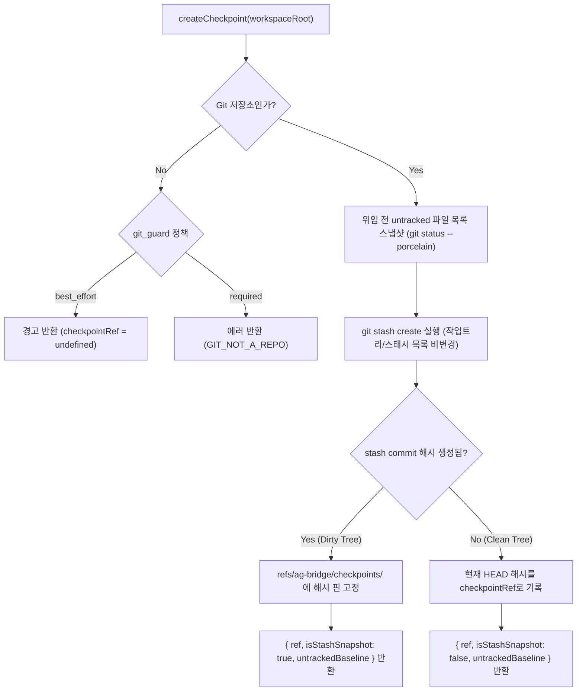

# 보안 모델 및 Git Guard 설계서 (Security & Git Guard)

| 항목 | 내용 |
| :--- | :--- |
| **문서 ID** | `ARC-003` |
| **버전** | `1.0.0` |
| **상태** | `Approved` |
| **최종 수정일** | `2026-11-22` |
| **관련 문서** | [PRD](../01-planning/PRD.md), [브릿지 프로토콜](./bridge-protocol.md), [테스트 & QA 계획](../05-verification/test-and-qa-plan.md) |

---

## 1. 위협 모델 (Threat Model)

외부 에이전트(로컬 Antigravity 또는 Gemini API 루프)에 파일 쓰기 및 셸 명령 실행 권한을 위임할 때 발생할 수 있는 핵심 위협은 다음과 같다.

| 위협 ID | 위협 내용 | 영향 | 완화 계층 |
| :--- | :--- | :--- | :--- |
| `TH-01` | `../` Path Traversal 또는 Symlink를 이용한 워크스페이스 외부/허용 외 파일 덮어쓰기 | 백엔드 코어·시스템 파일 변조 | `path-guard.ts` |
| `TH-02` | `.git/`, `.env`, `.ag-bridge/config.json` 등 민감 파일 변조 | 저장소 오염, 비밀 탈취, 설정 변조 | `path-guard.ts` 금지 목록 |
| `TH-03` | API 워커 `run_command`를 통한 파괴적 명령(`rm -rf`, `git push --force`) 또는 셸 인젝션 | 데이터 손실, 원격 저장소 훼손 | `api-worker.ts` 명령 정책 |
| `TH-04` | `GEMINI_API_KEY`가 로그, `report.md`, `manifest.json`에 노출 | API 키 유출 및 과금 피해 | 로그 마스킹 & `.gitignore` |
| `TH-05` | 위임 작업 실패 또는 저품질 결과로 인한 작업 트리 오염 | 수동 복구 비용 발생 | `git-guard.ts` 체크포인트/롤백 |

---

## 2. `lockedPaths` 경로 격리 설계 (`server/src/path-guard.ts`)

### 2.1 검증 알고리즘 (Strict Path Canonicalization)
`api-worker.ts`의 `write_file(targetPath, content)` 호출 시 반드시 다음 6단계를 순차 수행한다.

1. **빈 경로 및 Null Byte 차단:** `targetPath`에 `\0`이 포함되거나 빈 문자열이면 즉시 거부.
2. **절대 경로 정규화:** `resolvedTarget = path.resolve(workspaceRoot, targetPath)`.
3. **워크스페이스 경계 검증:** `path.relative(workspaceRoot, resolvedTarget)`가 `..`로 시작하거나 절대 경로(`path.isAbsolute`)이면 즉시 거부 (`PATH_TRAVERSAL_BLOCKED`).
4. **Symlink 탈출 검증:** 대상 파일(또는 가장 가까운 기존 상위 디렉터리)에 대해 `fs.realpathSync`를 수행하여 실제 물리 경로도 `workspaceRootReal` 내부인지 확인한다.
5. **절대 금지 경로(Denylist) 차단:** `lockedPaths`에 포함되었더라도 아래 경로는 무조건 거부한다(`PROTECTED_PATH_BLOCKED`):
   - `.git/**`
   - `.env`, `.env.*` (단, `.env.example` 읽기 전용은 허용 가능, 쓰기는 기본 차단)
   - `.ag-bridge/config.json`
   - `node_modules/**`
6. **`lockedPaths` 범위 일치 검사:**
   - 각 `lockedPath`를 정규화(`resolvedScope`)한 뒤, 다음 중 하나를 만족해야 허용한다:
     - 정확히 일치 (`resolvedTarget === resolvedScope`)
     - 디렉터리 접두사 일치 (`resolvedTarget.startsWith(resolvedScope + path.sep)`)
   - Windows 환경에서는 드라이브 문자 및 대소문자 비교를 정규화(`toLowerCase()`)한다.
   - `lockedPaths`가 빈 배열인 경우 쓰기를 전면 차단한다(Fail-Closed).

### 2.2 `read_file` / `list_dir` 경계
- 읽기 작업은 `lockedPaths` 외의 워크스페이스 파일(예: 백엔드 타입 정의, `package.json`, `tsconfig.json`)도 참조할 수 있도록 **워크스페이스 내부 읽기 허용**을 기본으로 하되, 워크스페이스 외부 탈출(`../`) 및 비밀 파일(`.env`, `.env.local`, `.ssh`, `*.pem`, `*.key`) 읽기는 차단한다.

---

## 3. API 워커 셸 명령 샌드박싱 (`run_command`)

`api-worker.ts`가 호출하는 `run_command(command)`는 **빌드·타입체크·린트·단위 테스트 검증 전용**으로 제한한다.

### 3.1 명령 허용/차단 정책
- **기본 허용 패턴 (Allowlist 기반 검증):**
  - 패키지 매니저 스크립트: `npm run <script>`, `pnpm <script>`, `yarn <script>`, `bun run <script>`
  - 타입체크/컴파일/린트/테스트: `npx tsc`, `tsc`, `eslint`, `prettier --check`, `vitest`, `jest`, `next build`, `vite build`
- **절대 차단 패턴 (Denylist — 최우선 차단):**
  - 셸 체이닝/리다이렉션 악용: `;`, `&&`, `||`, `|`, `` ` ``, `$(`, `>`, `<` (단, 안전한 단일 명령 인자만 허용하거나 엄격 파싱)
  - 파괴적·외부 전송 명령: `rm`, `del`, `rmdir`, `git push`, `git reset`, `git checkout`, `curl`, `wget`, `powershell`, `cmd`, `bash -c`, `sh -c`, `sudo`, `chmod`, `chown`
- **실행 제약:**
  - `cwd`는 항상 `workspaceRoot`로 고정
  - 타임아웃: `config.api.command_timeout_sec` (기본 `60s`), 초과 시 프로세스 트리 강제 종료(`SIGKILL` / Windows `taskkill`)
  - 출력 절단: `stdout` + `stderr` 합산 최대 `16 KB` (`tail` 우선 보존 + 앞부분 요약 표시)
  - 환경변수 필터링: 자식 프로세스 `env`에서 `GEMINI_API_KEY`, `ANTHROPIC_API_KEY`, `OPENAI_API_KEY` 등 민감 키 제거 후 전달

---

## 4. 비밀정보 보호 정책

1. **환경변수 우선:** `GEMINI_API_KEY`는 `.ag-bridge/config.json`에 평문 저장하지 않고 환경변수(`api_key_env: "GEMINI_API_KEY"`) 참조를 기본으로 한다.
2. **출력 마스킹 유틸리티 (`maskSecrets`):**
   - `stderr` 로그, `report.md`, MCP Tool 에러 메시지에 `process.env.GEMINI_API_KEY` 원문이나 `AIza[0-9A-Za-z_-]{20,}` 패턴이 포함될 경우 `[REDACTED]`로 치환한다.
3. **`check_ag_environment` 응답:** API 키는 절대 원문을 반환하지 않고 `{ configured: boolean, source: "env" | "config" | "none" }`만 반환한다.

---

## 5. Git Guard 설계 (`server/src/git-guard.ts`)

### 5.1 설계 목표
- 사용자가 작업 중이던 **미커밋 변경사항(Dirty Working Tree)을 절대 덮어쓰거나 날리지 않고** 안전하게 체크포인트를 만든다.
- 사용자의 `HEAD` 커밋 히스토리나 `git stash list`를 불필요하게 오염시키지 않는다.
- 롤백 시 위임 이전의 미커밋 상태까지 정확히 복원하고, 위임 중 새로 생성된 untracked 파일만 선별 삭제한다.

### 5.2 체크포인트 생성 전략 (`createCheckpoint`)

> [!IMPORTANT]
> `git stash create`는 임시 커밋 객체(dangling commit)를 생성하지만 **작업 트리를 변경하지 않고 `git stash list`에도 쌓이지 않는다.** 단, `git gc`에 의해 수거되지 않도록 `git update-ref refs/ag-bridge/checkpoints/<taskId> <hash>`로 로컬 ref를 핀 고정한다.

### 5.3 안전 롤백 전략 (`rollback(manifest)`)
1. `manifest.gitCheckpointRef` 유효성 확인 (없으면 `ROLLBACK_NO_CHECKPOINT` 반환).
2. 추적 파일 복원:
   - **Clean 기준(`isStashSnapshot === false`):** `git reset --hard <ref>` 대신 `git checkout <ref> -- .` 또는 `git restore --source=<ref> --staged --worktree .` 수행.
   - **Dirty 기준(`isStashSnapshot === true`):** `git checkout HEAD -- .` 후 `git stash apply --index <ref>`(또는 스냅샷 트리 복원 `git read-tree` + `git checkout-index`)로 위임 직전의 미커밋 상태까지 원복.
3. 신규 Untracked 파일 정리:
   - 현재 untracked 파일 목록(`git ls-files --others --exclude-standard`)에서 `manifest.gitUntrackedBaseline`에 **없던 파일**만 선별 삭제(위임 전부터 사용자가 갖고 있던 untracked 파일은 100% 보존).
4. 정리 완료 후 해당 `refs/ag-bridge/checkpoints/<taskId>` ref 삭제(또는 롤백 완료 마킹) 및 복구된 파일 목록 반환.
