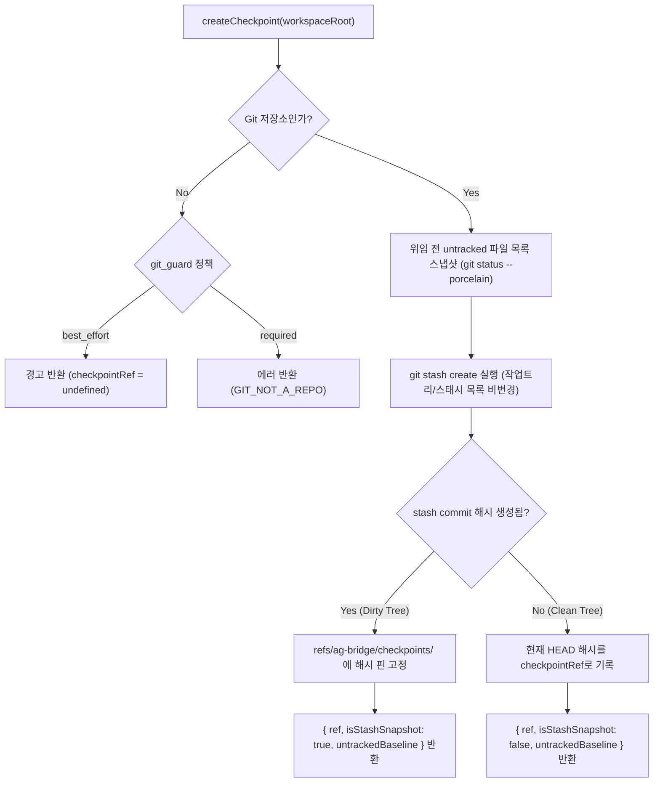

# 보안 모델 및 Git Guard 설계서 (Security & Git Guard)

| 항목 | 내용 |
| :--- | :--- |
| **문서 ID** | `ARC-003` |
| **버전** | `1.4.0` |
| **상태** | `Approved` |
| **최종 수정일** | `2026-11-24` |
| **관련 문서** | [PRD](../01-planning/PRD.md), [브릿지 프로토콜](./bridge-protocol.md), [테스트 & QA 계획](../05-verification/test-and-qa-plan.md) |

---

## 1. 위협 모델 (Threat Model)

외부 에이전트(로컬 Antigravity 또는 Gemini API 루프)에 파일 쓰기 및 셸 명령 실행 권한을 위임할 때 발생할 수 있는 핵심 위협은 다음과 같다.

| 위협 ID | 위협 내용 | 영향 | 완화 계층 |
| :--- | :--- | :--- | :--- |
| `TH-01` | `../` Path Traversal 또는 Symlink를 이용한 워크스페이스 외부/허용 외 파일 덮어쓰기 | 백엔드 코어·시스템 파일 변조 | `path-guard.ts` |
| `TH-02` | `.git/`, `.env`, `.ag-bridge/config.json` 등 민감 파일 변조 | 저장소 오염, 비밀 탈취, 설정 변조 | `path-guard.ts` 금지 목록 |
| `TH-03` | API 워커 `run_command`를 통한 파괴적 명령(`rm -rf`, `git push --force`) 또는 셸 인젝션 | 데이터 손실, 원격 저장소 훼손 | `api-worker.ts` 명령 정책 |
| `TH-04` | `GEMINI_API_KEY`가 로그, `report.md`, `manifest.json`에 노출 | API 키 유출 및 과금 피해 | 로그 마스킹 & git 무시 등록(`.git/info/exclude` / `.gitignore`) |
| `TH-06` | 플러그인이 자동 실행되는 SessionStart 훅에서 워크스페이스가 심어 둔 프로그램을 실행하거나, 링크로 바깥 파일에 쓰게 만듦 | 폴더를 여는 것만으로 코드 실행 / 임의 위치 쓰기 | `bridge-fs.ts` — 훅 경로는 프로세스를 띄우지 않고 링크를 따라 쓰지 않음([ADR-005](../06-adr/ADR-005-local-git-exclude.md), `TC-S08`~`TC-S11`) |
| `TH-05` | 위임 작업 실패 또는 저품질 결과로 인한 작업 트리 오염 | 수동 복구 비용 발생 | `git-guard.ts` 체크포인트/롤백 |
| `TH-07` | 복제한 저장소가 `git.exe`·`agy`·`taskkill.exe` 같은 이름의 프로그램을 넣어 두고, `PATH`의 상대 경로 항목(`.`, `bin`, `node_modules\.bin`)이 그것을 가리킴 | 위임·롤백·작업 취소 때 저장소가 넣은 코드 실행 | `exec-path.ts` — 완전한 절대 경로 항목만 검색 (§6, `TC-S12`~`TC-S16`) |
| `TH-08` | 복제한 저장소가 `.ag-bridge/config.json`을 커밋해 실행할 프로그램(`app_path`)·비밀·권한 완화(`agy_dangerously_skip_permissions` 등)를 정함 | 위임 때 저장소가 고른 프로그램 실행, 승인 없는 에이전트 동작 | `config.ts` — 저장소가 넣었을 수 있는 설정 파일의 민감 키는 무시 (§7, `TC-S17`~`TC-S19d`) |
| `TH-09` | `.git/`째로 전달된 저장소(압축본·공유 폴더)의 `core.fsmonitor`·훅·전송 명령(부분 클론의 지연 fetch → `core.sshCommand`)을 Git Guard의 git 호출이 실행 | 상태 확인·체크포인트·롤백 때 저장소가 넣은 프로그램 실행 | `git-guard.ts` — 내부 git 호출은 저장소 정의 명령과 전송을 끈 채 실행 (§8, `TC-S20`~`TC-S20c`) |

---

## 2. `lockedPaths` 경로 격리 설계 (`server/src/path-guard.ts`)

### 2.1 검증 알고리즘 (Strict Path Canonicalization)
`api-worker.ts`의 `write_file(targetPath, content)` 호출 시 반드시 다음 6단계를 순차 수행한다.

1. **빈 경로 및 Null Byte 차단:** `targetPath`에 `\0`이 포함되거나 빈 문자열이면 즉시 거부.
2. **절대 경로 정규화:** `resolvedTarget = path.resolve(workspaceRoot, targetPath)`.
3. **워크스페이스 경계 검증:** `path.relative(workspaceRoot, resolvedTarget)`가 `..`로 시작하거나 절대 경로(`path.isAbsolute`)이면 즉시 거부 (`PATH_TRAVERSAL_BLOCKED`).
4. **Symlink 탈출 검증:** 대상 파일(또는 가장 가까운 기존 상위 디렉터리)에 대해 `fs.realpathSync`를 수행하여 실제 물리 경로도 `workspaceRootReal` 내부인지 확인한다.
5. **절대 금지 경로(Denylist) 차단:** `lockedPaths`에 포함되었더라도 아래 경로는 무조건 거부한다(`PROTECTED_PATH_BLOCKED`):
   - `.git/**`
   - `.env`, `.env.*` (단, `.env.example` 읽기 전용은 허용 가능, 쓰기는 기본 차단)
   - `.ag-bridge/config.json`
   - `node_modules/**`
6. **`lockedPaths` 범위 일치 검사:**
   - 각 `lockedPath`를 정규화(`resolvedScope`)한 뒤, 다음 중 하나를 만족해야 허용한다:
     - 정확히 일치 (`resolvedTarget === resolvedScope`)
     - 디렉터리 접두사 일치 (`resolvedTarget.startsWith(resolvedScope + path.sep)`)
   - Windows 환경에서는 드라이브 문자 및 대소문자 비교를 정규화(`toLowerCase()`)한다.
   - `lockedPaths`가 빈 배열인 경우 쓰기를 전면 차단한다(Fail-Closed).

### 2.2 `read_file` / `list_dir` 경계
- 읽기 작업은 `lockedPaths` 외의 워크스페이스 파일(예: 백엔드 타입 정의, `package.json`, `tsconfig.json`)도 참조할 수 있도록 **워크스페이스 내부 읽기 허용**을 기본으로 하되, 워크스페이스 외부 탈출(`../`) 및 비밀 파일(`.env`, `.env.local`, `.ssh`, `*.pem`, `*.key`) 읽기는 차단한다.

---

## 3. API 워커 셸 명령 샌드박싱 (`run_command`)

`api-worker.ts`가 호출하는 `run_command(command)`는 **빌드·타입체크·린트·단위 테스트 검증 전용**으로 제한한다.

### 3.1 명령 허용/차단 정책
- **기본 허용 패턴 (Allowlist 기반 검증):**
  - 패키지 매니저 스크립트: `npm run <script>`, `pnpm <script>`, `yarn <script>`, `bun run <script>`
  - 타입체크/컴파일/린트/테스트: `npx tsc`, `tsc`, `eslint`, `prettier --check`, `vitest`, `jest`, `next build`, `vite build`
- **절대 차단 패턴 (Denylist — 최우선 차단):**
  - 셸 체이닝/리다이렉션 악용: `;`, `&&`, `||`, `|`, `` ` ``, `$(`, `>`, `<` (단, 안전한 단일 명령 인자만 허용하거나 엄격 파싱)
  - 파괴적·외부 전송 명령: `rm`, `del`, `rmdir`, `git push`, `git reset`, `git checkout`, `curl`, `wget`, `powershell`, `cmd`, `bash -c`, `sh -c`, `sudo`, `chmod`, `chown`
- **실행 제약:**
  - `cwd`는 항상 `workspaceRoot`로 고정
  - 타임아웃: `config.api.command_timeout_sec` (기본 `60s`), 초과 시 프로세스 트리 강제 종료(`SIGKILL` / Windows `taskkill`)
  - 출력 절단: `stdout` + `stderr` 합산 최대 `16 KB` (`tail` 우선 보존 + 앞부분 요약 표시)
  - 환경변수 필터링: 자식 프로세스 `env`에서 `GEMINI_API_KEY`, `ANTHROPIC_API_KEY`, `OPENAI_API_KEY` 등 민감 키 제거 후 전달

---

## 4. 비밀정보 보호 정책

1. **환경변수 우선:** `GEMINI_API_KEY`는 `.ag-bridge/config.json`에 평문 저장하지 않고 환경변수(`api_key_env: "GEMINI_API_KEY"`) 참조를 기본으로 한다.
2. **출력 마스킹 유틸리티 (`maskSecrets`):**
   - `stderr` 로그, `report.md`, MCP Tool 에러 메시지에 `process.env.GEMINI_API_KEY` 원문이나 `AIza[0-9A-Za-z_-]{20,}` 패턴이 포함될 경우 `[REDACTED]`로 치환한다.
3. **`check_ag_environment` 응답:** API 키는 절대 원문을 반환하지 않고 `{ configured: boolean, source: "env" | "config" | "none" }`만 반환한다.

---

## 5. Git Guard 설계 (`server/src/git-guard.ts`)

### 5.1 설계 목표
- 사용자가 작업 중이던 **미커밋 변경사항(Dirty Working Tree)을 절대 덮어쓰거나 날리지 않고** 안전하게 체크포인트를 만든다.
- 사용자의 `HEAD` 커밋 히스토리나 `git stash list`를 불필요하게 오염시키지 않는다.
- 롤백 시 위임 이전의 미커밋 상태까지 정확히 복원하고, 위임 중 새로 생성된 untracked 파일만 선별 삭제한다.

### 5.2 체크포인트 생성 전략 (`createCheckpoint`)

> [!IMPORTANT]
> `git stash create`는 임시 커밋 객체(dangling commit)를 생성하지만 **작업 트리를 변경하지 않고 `git stash list`에도 쌓이지 않는다.** 단, `git gc`에 의해 수거되지 않도록 `git update-ref refs/ag-bridge/checkpoints/<taskId> <hash>`로 로컬 ref를 핀 고정한다.

### 5.3 안전 롤백 전략 (`rollback(manifest)`)
1. `manifest.gitCheckpointRef` 유효성 확인 (없으면 `ROLLBACK_NO_CHECKPOINT` 반환).
2. 추적 파일 복원:
   - **Clean 기준(`isStashSnapshot === false`):** `git reset --hard <ref>` 대신 `git checkout <ref> -- .` 또는 `git restore --source=<ref> --staged --worktree .` 수행.
   - **Dirty 기준(`isStashSnapshot === true`):** `git checkout HEAD -- .` 후 `git stash apply --index <ref>`(또는 스냅샷 트리 복원 `git read-tree` + `git checkout-index`)로 위임 직전의 미커밋 상태까지 원복.
3. 신규 Untracked 파일 정리:
   - 현재 untracked 파일 목록(`git ls-files --others --exclude-standard`)에서 `manifest.gitUntrackedBaseline`에 **없던 파일**만 선별 삭제(위임 전부터 사용자가 갖고 있던 untracked 파일은 100% 보존).
4. 정리 완료 후 해당 `refs/ag-bridge/checkpoints/<taskId>` ref 삭제(또는 롤백 완료 마킹) 및 복구된 파일 목록 반환.

---

## 6. 프로그램 실행 경로 (`server/src/exec-path.ts`)

**규칙:** 플러그인이 띄우는 프로그램(`git`, `taskkill`, 클립보드·알림 도구, `powershell`, `osascript`, `.cmd` 래퍼 셸)은 모두 `requireExecutable`/`resolveExecutable`/`windowsShell`로 얻은 **절대 경로**로 실행한다. 프로그램 이름을 `spawn`/`execFileSync`에 그대로 넘기지 않고 `shell: true`를 쓰지 않는다. `agy`/`antigravity` 탐지(`detector.ts`의 `findBinaryInPath`)도 같은 경로 목록을 쓴다.

**왜:** 이름만 넘기면 `PATH`를 검색하는데, 상대 경로 항목(`.`, `bin`, `node_modules\.bin`, 드라이브 상대 `C:tools`, 루트 상대 `\tools`, POSIX의 빈 항목)은 자식 프로세스의 cwd — 곧 사용자가 연 워크스페이스 — 를 기준으로 풀린다. MCP 서버 자신의 cwd도 워크스페이스다. 실측(Windows 11, Node 22.18, libuv 1.51): 기본 `PATH`에서는 진짜 Git이 돌고, 앞에 `.`을 넣으면 워크스페이스에 둔 `git.exe`가 돈다.

**검색 규칙:**
- 완전한 절대 경로 항목만 본다 — Windows는 `X:\…` 또는 `\\server\share\…`, POSIX는 `/`로 시작하는 항목. POSIX에서 `PATH`가 아예 없으면 `execvp`처럼 `/usr/bin:/bin`을 보고, 비어 있으면(= cwd) 아무것도 보지 않는다.
- Windows는 `name.com`·`name.exe`만 후보다. libuv가 이름에 붙여 보는 확장자가 이 둘이고, `.cmd`/`.bat`는 셸 없이 띄울 수 없다(Node 20.12부터 `EINVAL`).
- POSIX는 실행 비트가 있는 일반 파일만 후보다. `execvp`처럼 실행할 수 없는 파일은 건너뛰고 다음 항목을 본다.
- Windows 셸은 `%ComSpec%`가 완전한 절대 경로일 때 그것을 쓰고, 아니면 `%SystemRoot%\System32\cmd.exe`(SystemRoot도 쓸 수 없으면 `C:\Windows`)를 쓴다.
- 못 찾으면 `requireExecutable`이 예외를 던진다. 이름으로 실행했다면 `ENOENT`가 났을 자리라 기존 `catch`가 그대로 처리하고, 이름으로 되돌아가지 않는다(`TC-S14c`).

**알려진 한계:** App Execution Alias(`%LOCALAPPDATA%\Microsoft\WindowsApps\*.exe`, 예: `winget`)는 `fs.statSync`가 `EACCES`를 내서 후보에서 빠진다(실측). 이름으로 실행하면 libuv가 찾아 띄우는 파일이다. 지금 띄우는 프로그램 중 alias는 없으니, 새 프로그램을 추가할 때 확인한다.

**의도한 예외:** API 워커 `run_command`의 허용 목록 도구(`npm`, `tsc`, `eslint` …)는 이름 그대로 실행한다. 이 도구들은 워크스페이스의 스크립트·설정을 실행하는 것이 목적이라, 같은 저장소가 심은 바이너리가 더 얻는 것이 없다(§3).

**검증:** `TC-S12`(해석기: 상대 항목·확장자·디렉터리·실행 비트), `TC-S13`(agy 탐지), `TC-S14`~`TC-S14c`(워크스페이스에 심은 `git` + `PATH`의 `.`, 서버 cwd = 워크스페이스로 재현), `TC-S15`(Windows 셸 경로), `TC-S16`(`src/`에 이름 리터럴 실행·`shell: true`·`'cmd.exe'` 값 0건).

---

## 7. 워크스페이스 설정 신뢰 (`server/src/config.ts`)

**왜:** `.ag-bridge/config.json`은 워크스페이스 안에 있으므로, 저장소가 `git add -f`로 커밋해 함께 내려보낼 수 있다. 이 파일이 실행할 프로그램이나 비밀을 고르거나 안전 기본값을 풀면, 저장소를 열고 위임하는 것만으로 저장소의 선택이 사용자의 선택처럼 실행된다.

**민감 키 (`TRUST_SENSITIVE`):** 프로그램·비밀을 고르거나 안전 기본값을 푸는 값이다.
- `subscription.app_path` (`auto`가 아닌 값)
- `subscription.agy_dangerously_skip_permissions=true`
- `subscription.agy_sandbox=false`
- `subscription.agy_mode=auto`
- `subscription.agy_settings` (값이 있으면)
- `subscription.agy_remote_agent=true`
- `api.apiKey` (값이 있으면)
- `api.api_key_env` (`GEMINI_API_KEY`가 아닌 값)

기본값을 조이는 값(예: `agy_mode=plan`, `agy_sandbox=true`)은 언제나 따른다.

**규칙:**
1. 설정 파일이 사용자 자신의 것이 아닐 수 있으면, 민감 키를 환경변수·기본값으로 되돌린다.
   - 사용자 자신의 것이 아닐 수 있는 경우는 둘이다.
     - git이 `.ag-bridge/` 아래 무엇이든 추적하는 경우. 서브모듈 항목도 포함하며, 대소문자를 무시하는 `:(icase).ag-bridge` 경로 지정으로 확인한다. 상위 저장소의 `git ls-files`는 서브모듈 안의 파일을 나열하지 않는다(`TC-S18f`). Windows·macOS는 `.AG-BRIDGE/CONFIG.JSON`을 이 파일로 읽는다(`TC-S18d`).
     - `.ag-bridge/`나 `config.json`이 링크인 경우(`TC-S18e`).
   - 플러그인이 `.ag-bridge/`를 git에서 빼 두므로, `/ag-config`가 고친 사용자 자신의 설정 파일은 추적되지 않고 그대로 동작한다(`TC-S18b`).
   - 환경변수로 켠 설정(`AG_DANGEROUSLY_SKIP_PERMISSIONS`)은 사용자의 선택이므로 유지한다(`TC-S18c`).
   - git은 민감 값이 실제로 있을 때만 실행하므로, 보통의 설정 파일에서는 프로세스를 띄우지 않는다.
2. 설정 파일의 출처와 무관하게, `app_path`는 워크스페이스 밖에 있는 완전한 절대 경로일 때만 따른다(`TC-S17`, `TC-S17b`, `TC-S17c`).
   - 비교에는 링크를 따라간 OS 기준 실경로(`fs.realpathSync.native`)를 쓴다.
   - Node의 JS `realpath`는 Windows의 `\\?\C:\…`와 8.3 짧은 이름(`PROBE-~1`)을 적힌 그대로 두지만, OS 실경로는 둘 다 긴 `C:\…` 경로로 정규화한다(실측).
3. 무시한 키와 해결 방법(`git rm --cached .ag-bridge/config.json`, 호출 단위 옵션)은 `check_ag_environment` 권고와 `delegate_to_antigravity`·`start_ag_task`·`ag_session` 경고로 알린다(`TC-S19`~`TC-S19d`).

**알려진 한계:**
- git 기록 없이 압축 파일로 받은 폴더에서는 추적 여부를 알 수 없다. 이때도 규칙 2의 `app_path` 검사는 적용된다.
- 저장소가 넣은 다른 파일을 agy가 지시로 읽는 일은 이 규칙의 범위 밖이다. 예를 들어 저장소가 고쳐 둔 `.agent/workflows/claude-handoff.md`는 사용자 수정본으로 보고 덮어쓰지 않는다. 이런 지시를 다루는 것은 설정 신뢰가 아니라 에이전트의 프롬프트 주입 방어다.

---

## 8. Git Guard의 git 호출은 저장소 정의 명령을 실행하지 않는다 (`server/src/git-guard.ts`)

**왜:** 저장소가 `.git/`째로 오면(압축본·공유 폴더 — `git clone`은 `.git/config`·훅을 옮기지 않는다) git이 스스로 실행하는 명령을 저장소가 정할 수 있다. 실측(Windows, git 2.45.1):
- `git status`·`git stash create`는 저장소 설정의 `core.fsmonitor` 프로그램을 실행했다.
- `git update-ref`는 저장소의 `reference-transaction` 훅을 실행했다.
- 부분 클론(`--filter=blob:none`)에서는 롤백의 `git reset --hard <ref>`가 없는 blob을 promisor 원격에서 가져오려 했다. 그 원격이 저장소 설정의 `ssh://` 주소이면 `core.sshCommand` 프로그램이 실행됐다. fsmonitor·훅을 끈 뒤에도 실행됐다.

**규칙:**
- 모든 내부 git 호출은 `runGit`이 앞에 `-c core.fsmonitor=false -c core.hooksPath=/dev/null -c protocol.allow=never`를 붙여 실행한다(`TC-S20`~`TC-S20c`).
  - `-c`는 저장소 설정보다 우선한다.
  - `/dev/null` 형태도 Windows에서 동작함을 실측했다.
  - Git Guard는 네트워크가 필요 없으므로 모든 전송을 막는다. 없는 blob이 필요한 롤백은 실패로 끝난다(fail-closed).
- git은 `git-guard.ts` 밖에서 실행하지 않는다. `TC-S16`이 다른 파일의 `requireExecutable('git')`를 잡는다.

**의도적으로 남긴 것:**
- clean/smudge/process 필터는 켜 둔다. 체크포인트가 실제 내용(Git LFS)을 담아야 하기 때문이다.
- 저장소의 merge driver(`.gitattributes`의 `merge=<name>`과 `merge.<name>.driver`)도 남는다. 실측으로는 체크포인트 이후 HEAD가 그대로면 롤백의 `stash apply`가 driver를 실행하지 않았고, HEAD가 움직여 같은 파일이 바뀐 경우에는 실행했다. 막으려면 속성 자체를 꺼야 하는데, 그러면 LFS 필터도 함께 꺼진다.
- 두 경로 모두 저장소가 `.git/config`까지 가진 경우에만 열린다. 그런 폴더에서는 Claude Code 자신도 세션 시작 때 `git status`를 실행한다.
