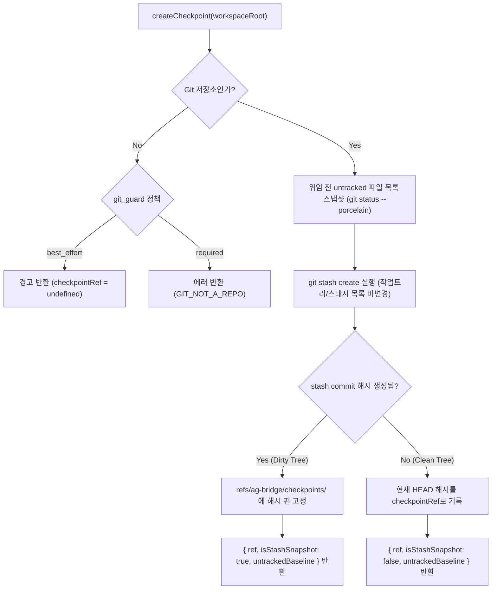

# 보안 모델 및 Git Guard 설계서 (Security & Git Guard)

| 항목 | 내용 |
| :--- | :--- |
| **문서 ID** | `ARC-003` |
| **버전** | `1.13.0` |
| **상태** | `Approved` |
| **최종 수정일** | `2026-11-25` |
| **관련 문서** | [PRD](../01-planning/PRD.md), [브릿지 프로토콜](./bridge-protocol.md), [테스트 & QA 계획](../05-verification/test-and-qa-plan.md) |

---

## 1. 위협 모델 (Threat Model)

외부 에이전트(로컬 Antigravity 또는 Gemini API 루프)에 파일 쓰기 및 셸 명령 실행 권한을 위임할 때 발생할 수 있는 핵심 위협은 다음과 같다.

| 위협 ID | 위협 내용 | 영향 | 완화 계층 |
| :--- | :--- | :--- | :--- |
| `TH-01` | `../` Path Traversal, Symlink, Windows 경로 별칭(8.3 이름·대체 데이터 스트림·끝 점/공백)을 이용한 워크스페이스 외부/허용 외/금지 파일 접근 | 백엔드 코어·시스템 파일 변조, 비밀 노출 | `path-guard.ts` (§2.1, `TC-S01`~`TC-S03`, `TC-S21`~`TC-S21c`) |
| `TH-02` | `.git/`, `.env`, `.ag-bridge/config.json` 등 민감 파일 변조 | 저장소 오염, 비밀 탈취, 설정 변조 | `path-guard.ts` 금지 목록 |
| `TH-03` | API 워커 `run_command`를 통한 파괴적 명령(`rm -rf`, `git push --force`) 또는 셸 인젝션 | 데이터 손실, 원격 저장소 훼손 | `api-worker.ts` 명령 정책 |
| `TH-04` | `GEMINI_API_KEY`가 로그, `report.md`, `manifest.json`에 노출 | API 키 유출 및 과금 피해 | 로그 마스킹 & git 무시 등록(`.git/info/exclude` / `.gitignore`) |
| `TH-06` | 플러그인이 자동 실행되는 SessionStart 훅에서 워크스페이스가 심어 둔 프로그램을 실행하거나, 링크로 바깥 파일에 쓰게 만듦 | 폴더를 여는 것만으로 코드 실행 / 임의 위치 쓰기 | `bridge-fs.ts` — 훅 경로는 프로세스를 띄우지 않고 링크를 따라 쓰지 않음([ADR-005](../06-adr/ADR-005-local-git-exclude.md), `TC-S08`~`TC-S11`) |
| `TH-05` | 위임 작업 실패 또는 저품질 결과로 인한 작업 트리 오염 | 수동 복구 비용 발생 | `git-guard.ts` 체크포인트/롤백 |
| `TH-07` | 복제한 저장소가 `git.exe`·`agy`·`taskkill.exe` 같은 이름의 프로그램을 넣어 두고, `PATH`의 상대 경로 항목(`.`, `bin`, `node_modules\.bin`)이 그것을 가리킴 | 위임·롤백·작업 취소 때 저장소가 넣은 코드 실행 | `exec-path.ts` — 완전한 절대 경로 항목만 검색 (§6, `TC-S12`~`TC-S16`) |
| `TH-08` | 복제한 저장소가 `.ag-bridge/config.json`을 커밋해 실행할 프로그램(`app_path`)·비밀·권한 완화(`agy_dangerously_skip_permissions` 등)를 정함 | 위임 때 저장소가 고른 프로그램 실행, 승인 없는 에이전트 동작 | `config.ts` — 저장소가 넣었을 수 있는 설정 파일의 민감 키는 무시 (§7, `TC-S17`~`TC-S19d`) |
| `TH-09` | `.git/`째로 전달된 저장소(압축본·공유 폴더)의 `core.fsmonitor`·훅·전송 명령(부분 클론의 지연 fetch → `core.sshCommand`)을 Git Guard의 git 호출이 실행 | 상태 확인·체크포인트·롤백 때 저장소가 넣은 프로그램 실행 | `git-guard.ts` — 내부 git 호출은 저장소 정의 명령과 전송을 끈 채 실행 (§8, `TC-S20`~`TC-S20c`) |

---

## 2. `lockedPaths` 경로 격리 설계 (`server/src/path-guard.ts`)

### 2.1 검증 알고리즘 (Strict Path Canonicalization)
`api-worker.ts`의 `write_file(targetPath, content)` 호출 시 반드시 다음 6단계를 순차 수행한다.

1. **빈 경로 및 Null Byte 차단:** `targetPath`에 `\0`이 포함되거나 빈 문자열이면 즉시 거부.
2. **절대 경로 정규화:** `resolvedTarget = path.resolve(workspaceRoot, targetPath)`.
3. **워크스페이스 경계 검증:** `path.relative(workspaceRoot, resolvedTarget)`가 `..`로 시작하거나 절대 경로(`path.isAbsolute`)이면 즉시 거부 (`PATH_TRAVERSAL_BLOCKED`).
4. **Symlink 탈출 검증과 별칭 정규화:** 워크스페이스 루트와 대상 파일(또는 가장 가까운 기존 상위 디렉터리)의 **OS 기준 실경로**(`fs.realpathSync.native`)를 구하고, 실제 물리 경로도 `workspaceRootReal` 내부인지 확인한다. 이후의 금지 목록·`lockedPaths` 판정은 모두 이 정규 경로로 하고, 실제 읽기·쓰기도 이 경로로 한다.
   - **Windows 별칭:** 한 파일이 여러 철자로 열리기 때문에 문자열 검사로는 놓친다. 실측으로 확인한 우회는 다음과 같다(`TC-S21`~`TC-S21c`).
     - JS `realpath`는 8.3 짧은 이름을 그대로 둔다. 그래서 `ENV~1`·`.env::$DATA`로 `.env`가 읽혔다.
     - `src/NODE_M~1/x.js`로 `node_modules`에 쓸 수 있었다.
     - `GIT~1`·`.git.`이 `lockedPaths`로 받아들여졌다.
   - **대응:** OS 실경로는 8.3 이름을 긴 이름으로 펼친다. 경로 조각에 `:`(대체 데이터 스트림)가 있거나 조각이 점·공백으로 끝나면 Windows에서 즉시 거부한다.
   - **알려진 한계:** 하드 링크는 어느 쪽 이름도 "실경로"라서 경로로는 가릴 수 없다. git은 하드 링크를 옮기지 않으므로, 압축본으로 받은 폴더에만 해당한다. 검사와 사용 사이에 다른 프로세스가 링크를 바꿔치기하는 경우(TOCTOU)도 범위 밖이다. 그런 프로세스가 이미 돌고 있다면 이 검사가 지킬 것이 없다.
5. **절대 금지 경로(Denylist) 차단:** `lockedPaths`에 포함되었더라도 아래 경로는 무조건 거부한다(`PROTECTED_PATH_BLOCKED`):
   - `.git/**`
   - `.env`, `.env.*` (단, `.env.example` 읽기 전용은 허용 가능, 쓰기는 기본 차단)
   - `.ag-bridge/config.json`
   - `node_modules/**`
6. **`lockedPaths` 범위 일치 검사:**
   - 각 `lockedPath`를 정규화(`resolvedScope`)한 뒤, 다음 중 하나를 만족해야 허용한다:
     - 정확히 일치 (`resolvedTarget === resolvedScope`)
     - 디렉터리 접두사 일치 (`resolvedTarget.startsWith(resolvedScope + path.sep)`)
   - Windows 환경에서는 드라이브 문자 및 대소문자 비교를 정규화(`toLowerCase()`)한다.
   - `lockedPaths`가 빈 배열인 경우 쓰기를 전면 차단한다(Fail-Closed).

### 2.2 `read_file` / `list_dir` 경계
- 읽기 작업은 `lockedPaths` 외의 워크스페이스 파일(예: 백엔드 타입 정의, `package.json`, `tsconfig.json`)도 참조할 수 있도록 **워크스페이스 내부 읽기 허용**을 기본으로 하되, 워크스페이스 외부 탈출(`../`) 및 비밀 파일(`.env`, `.env.local`, `.ssh`, `*.pem`, `*.key`) 읽기는 차단한다.

---

## 3. API 워커 셸 명령 샌드박싱 (`run_command`)

`api-worker.ts`가 호출하는 `run_command(command)`는 **빌드·타입체크·린트·단위 테스트 검증 전용**으로 제한한다.

### 3.1 명령 허용/차단 정책
- **기본 허용 패턴 (Allowlist 기반 검증):**
  - 패키지 매니저 스크립트: `npm run <script>`, `pnpm <script>`, `yarn <script>`, `bun run <script>`
  - 타입체크/컴파일/린트/테스트: `npx tsc`, `tsc`, `eslint`, `prettier --check`, `vitest`, `jest`, `next build`, `vite build`
- **절대 차단 패턴 (Denylist — 최우선 차단):**
  - 셸 체이닝/리다이렉션 악용: `;`, `&&`, `||`, `|`, `` ` ``, `$(`, `>`, `<` (단, 안전한 단일 명령 인자만 허용하거나 엄격 파싱)
  - 파괴적·외부 전송 명령: `rm`, `del`, `rmdir`, `git push`, `git reset`, `git checkout`, `curl`, `wget`, `powershell`, `cmd`, `bash -c`, `sh -c`, `sudo`, `chmod`, `chown`
- **실행 제약:**
  - `cwd`는 항상 `workspaceRoot`로 고정
  - 타임아웃: `config.api.command_timeout_sec` (기본 `60s`), 초과 시 프로세스 트리 강제 종료(`SIGKILL` / Windows `taskkill`)
  - 출력 절단: `stdout` + `stderr` 합산 최대 `16 KB` (`tail` 우선 보존 + 앞부분 요약 표시)
  - 환경변수 필터링: 자식 프로세스 `env`에서 `GEMINI_API_KEY`, `ANTHROPIC_API_KEY`, `OPENAI_API_KEY` 등 민감 키 제거 후 전달

---

## 4. 비밀정보 보호 정책

1. **환경변수 우선:** `GEMINI_API_KEY`는 `.ag-bridge/config.json`에 평문 저장하지 않고 환경변수(`api_key_env: "GEMINI_API_KEY"`) 참조를 기본으로 한다.
2. **출력 마스킹 유틸리티 (`maskSecrets`):**
   - `stderr` 로그, `report.md`, MCP Tool 에러 메시지에 `process.env.GEMINI_API_KEY` 원문이나 `AIza[0-9A-Za-z_-]{20,}` 패턴이 포함될 경우 `[REDACTED]`로 치환한다.
3. **`check_ag_environment` 응답:** API 키는 절대 원문을 반환하지 않고 `{ configured: boolean, source: "env" | "config" | "none" }`만 반환한다.

---

## 5. Git Guard 설계 (`server/src/git-guard.ts`)

### 5.1 설계 목표
- 사용자가 작업 중이던 **미커밋 변경사항(Dirty Working Tree)을 절대 덮어쓰거나 날리지 않고** 안전하게 체크포인트를 만든다.
- 사용자의 `HEAD` 커밋 히스토리나 `git stash list`를 불필요하게 오염시키지 않는다.
- 롤백 시 위임 이전의 미커밋 상태까지 정확히 복원하고, 위임 중 새로 생성된 untracked 파일만 선별 삭제한다.

### 5.2 체크포인트 생성 전략 (`createCheckpoint`)

> [!IMPORTANT]
> `git stash create`는 임시 커밋 객체(dangling commit)를 생성하지만 **작업 트리를 변경하지 않고 `git stash list`에도 쌓이지 않는다.** 단, `git gc`에 의해 수거되지 않도록 `git update-ref refs/ag-bridge/checkpoints/<taskId> <hash>`로 로컬 ref를 핀 고정한다.

### 5.3 안전 롤백 전략 (`rollback(manifest)`)
에이전트는 git을 직접 실행할 수 있다(`git add -A`, 커밋, 브랜치 전환). 롤백은 그런 뒤에도 위임 직전 상태로 돌아가야 한다. 아래 결함은 모두 이전 번들에서 실측했다(Grok 레그 지적 포함).

1. `manifest.gitCheckpointRef` 유효성 확인 (없으면 `ROLLBACK_NO_CHECKPOINT` 반환).
2. **브랜치 확인:**
   - 체크포인트는 HEAD가 가리키던 ref(`refs/heads/<branch>`, 분리 상태면 `HEAD`)를 `gitCheckpointHeadRef`로 기록한다.
   - 롤백 때 HEAD가 다른 곳을 가리키면 **아무것도 바꾸지 않고 거부**한다(`GIT_CHECKPOINT_FAILED`, 돌아갈 명령 `git switch <branch>` 안내).
   - `reset --hard`는 지금 체크아웃된 브랜치를 옮긴다. 그래서 에이전트가 사용자의 `dev`로 옮겨 간 뒤 롤백하면, `dev`를 `main`의 커밋으로 옮겨 사용자 커밋을 브랜치에서 떼어냈다(`TC-S23d`).
3. **롤백 직전 상태를 기록한다(§5.5):** HEAD 커밋과, 미커밋 추적 변경이 있으면 그 `git stash create`를 `refs/ag-bridge/pre-rollback/<taskId>`에 남긴다. 기록하지 못하면 아무것도 바꾸지 않고 거부한다.
4. **체크포인트 이후 인덱스에 들어온 것을 인덱스에서 꺼낸다:**
   - 대상은 `git diff --cached --name-only -z --no-renames --diff-filter=A <ref>`로 고른다. 지금 인덱스에는 있지만 체크포인트에는 없는 것이다. 이것들을 `git update-index -z --force-remove --stdin`으로 인덱스에서 뺀다.
   - 이 안에는 두 종류가 있다.
     - 사용자의 untracked 파일 가운데 에이전트가 스테이징하거나 커밋한 것. `reset --hard`가 추적 파일로 보고 지웠다(깨끗한 체크포인트, 깨끗한 체크포인트 + 커밋, 더러운 체크포인트 모두 실측, `TC-S23`, `TC-S23b`).
     - 에이전트가 만들어 스테이징하거나 커밋한 파일. `reset --hard`가 영영 지웠다. 이제는 작업 트리에 남아 6번에서 복구 폴더로 옮겨진다(`TC-S24b`).
5. **되돌릴 파일 보고:**
   - `revertedTrackedFiles`는 4번 다음에 `git diff --name-only -z --no-renames <ref>`로 계산한다. 추적 파일 가운데 체크포인트와 다른 것이며, 에이전트의 커밋도 포함한다.
   - 에이전트가 추가한 파일은 여기 들지 않는다. 옮겨지므로 `removedUntrackedFiles`에 든다. 이름 바꾸기도 옛 이름은 되돌림이고, 새 이름은 제거(복구 폴더)다(`TC-U36b`). 추가된 경로가 인덱스를 떠나므로 이 diff에서는 이름 바꾸기 짝이 생기지 않는다.
   - 예전에는 `git status`에서 얻었다. 그래서 손대지 않은 사용자 untracked 파일을 "되돌림"으로 보고했고, 에이전트가 커밋한 파일은 빠뜨렸다(`TC-U36`).
6. 추적 파일 복원:
   - **Clean 기준(`isStashSnapshot === false`):** `git reset --hard <ref>`.
   - **Dirty 기준(`isStashSnapshot === true`):**
     - 스냅샷이 만들어진 커밋(`<ref>^1`)으로 `git reset --hard`한 뒤 `git stash apply --index <ref>`(실패하면 `--index` 없이)를 실행한다.
     - 스냅샷이 자기 기준 위에 적용되므로 병합이 없다. 예전처럼 현재 HEAD에 적용하면, 에이전트가 커밋한 뒤에는 충돌 표시를 남기고 실패했고 저장소의 merge driver도 실행했다(실측 ran=true → 이제 ran=false, `TC-S23c`).
     - `gitCheckpointHeadRef`가 없는 이전 매니페스트는 기존대로 현재 HEAD로 되돌린다.
7. 신규 Untracked 파일 정리:
   - 현재 untracked 파일 목록(`git ls-files -z --others --exclude-standard`)에서 `manifest.gitUntrackedBaseline`에 **없던 파일**만 골라 **복구 폴더로 옮긴다**(§5.5, 지우지 않는다). 위임 전부터 사용자가 갖고 있던 untracked 파일은 그대로 둔다. 에이전트가 그 내용을 고치거나 지웠으면 8번에서 되돌린다.
   - `-z`로 읽는다. 그러지 않으면 git이 한글 같은 비ASCII 이름을 `"\354\202\254…"`처럼 인용한다. 그래서 그 이름이 어떤 파일도 가리키지 못하고, 에이전트가 만든 `에이전트결과.txt`가 남았다(실측, `TC-U35`).
   - **기준선을 모르면 지우지 않는다.**
     - 목록을 얻지 못하면(오류·시간 초과·출력 초과) `listUntrackedFiles`는 "없음"(`[]`)이 아니라 "모름"(`undefined`)을 돌려준다(`TC-S22b`). 체크포인트 생성 때 모르면 체크포인트를 만들지 않는다.
     - 매니페스트에 기준선이 없으면(이전 버전) untracked 파일을 하나도 지우지 않고 경고한다(`TC-S22`).
     - 예전에는 "모름"을 "없음"으로 다뤘다. 그래서 체크포인트 때 목록이 실패하면 롤백이 모든 untracked 파일을 지울 수 있었다. 실측으로는 untracked 2만 개(경로 1.3MB)에서 이전 목록이 출력 한도(1MiB)를 넘겨 0개를 돌려줬다.
   - **Windows·macOS에서는 `-c core.ignorecase=true`로 센다.** 저장소 설정이 `core.ignorecase=false`(리눅스에서 가져온 저장소 등)이면, git은 디스크에서 대소문자만 바뀐 추적 파일(`Foo.txt` → `foo.txt`)을 untracked로 내놓는다. 그러면 롤백이 방금 복원한 추적 파일을 지웠다(Antigravity 레그 지적을 실측, `TC-S22c`).
8. **스냅샷에서 사용자 untracked 파일을 되돌린다(§5.5):** 에이전트가 고치거나 지운 것을 체크포인트 때의 사본으로 되돌린다. 에이전트의 판은 `replaced/`로 옮긴다.
9. 정리 완료 후 `refs/ag-bridge/checkpoints/<taskId>`를 지우고, 보관 규칙으로 오래된 복구 폴더를 정리한 뒤 결과를 반환한다.

**알려진 한계 (실측):**
- **위임 도중 사용자가 한 일은 에이전트의 일과 구별되지 않는다.** 같은 폴더에 새로 만든 untracked 파일은 복구 폴더로 옮겨지고, 같은 브랜치에 한 커밋은 되감긴다(reflog와 `preRollbackHead`에 남는다).
- 상한(2,000개·50MB)을 넘는 untracked 파일은 스냅샷되지 않는다. 그때는 에이전트가 고친 내용을 되돌리지 못하고, 체크포인트 결과가 그렇게 경고한다(§5.5).

### 5.5 롤백 복구 (`TC-S24` ~ `TC-S24g`, `TC-U38`)
롤백이 치운 것과 되돌린 것을 다시 꺼낼 수 있게 한다. 세 AI(Claude·Grok·Antigravity)가 실측한 비용을 놓고 두 라운드에 걸쳐 정했다.

- **실측 비용** (Windows NVMe, 데이터셋: 200개×5KB / 2,000개×25KB(49MB) / 20,000개×100B / 1개×200MB):
  - 파일 복사 스냅샷: 0.28초 / 2.5초 / 20.3초 / 0.15초
  - git 객체(임시 인덱스 + `write-tree`): 2.4초 / 18.6초 / 181초 / 1.5초 → 기각
  - 이름 바꾸기(옮기기): 0.31초 / 2.5초 / 28초 / 0.002초
- **복구 폴더:** 롤백이 작업 트리에서 치우는 것은 지우지 않고 `.ag-bridge/recovery/<taskId>/rollback-<시각>/`로 옮긴다(`TC-S24`, `TC-S24b`).
  - `removed/`에는 에이전트가 만든 파일이 간다. 스테이징·커밋한 것도 포함한다.
  - `replaced/`에는 사용자 파일을 덮어쓴 에이전트의 판, 또는 사용자 폴더 자리에 놓인 링크가 간다.
  - 결과의 `quarantineDir`이 이 폴더를 알려 준다.
- **스냅샷:** 체크포인트 때 사용자의 untracked 파일(일반 파일만, 링크 제외)이 2,000개·50MB 이내면 `.ag-bridge/recovery/<taskId>/untracked/`로 복사한다. 매니페스트에는 `gitUntrackedSnapshotDir`로 기록한다. 상한을 넘거나 복사가 실패하면 복사하지 않고 체크포인트 경고로 알린다(`TC-S24d`). 상한은 실측 2,000개×25KB = 2.5초를 기준으로 정했다.
- **되돌리기:** 롤백은 스냅샷과 내용이 다르거나 없어진 사용자 파일을 되돌리고 `restoredUntrackedFiles`로 보고한다(`TC-S24c`). 손대지 않은 파일은 건드리지 않는다.
  - 읽는 곳은 이 작업의 스냅샷 폴더뿐이다. 매니페스트는 에이전트가 고칠 수 있는 데이터라, 다른 폴더를 가리켜도 무시한다(`TC-S24g`).
  - 되돌릴 경로에 있는 폴더가 링크(정션 등)면 먼저 `replaced/`로 옮기고 실제 폴더를 만든다. 그래서 워크스페이스 밖에 쓰지 않는다(`TC-S24f`).
- **링크 뒤는 건드리지 않는다(`TC-S24h`):**
  - Windows git은 정션 대상 폴더 안의 파일까지 untracked로 나열한다. 실측에서 `docs/precious.txt`가 나왔고, 롤백이 그 파일을 바깥 폴더에서 빼냈다. `main`의 `rmSync`는 그 파일을 지웠다(Antigravity 구현 검토 지적, 실측).
  - 이제 가는 길에 링크가 있는 untracked 경로는 옮기지도 지우지도 않는다. 결과 `pathsBehindLinks`와 경고로 알린다.
- **삭제된 경로에 다시 만든 파일:** 에이전트가 `git rm`한 경로에 새로 쓴 파일은 untracked라 `reset --hard`가 사본 없이 덮어썼다(Antigravity 구현 검토 지적, 실측). 리셋 전에 `replaced/`로 옮긴다(`TC-S24i`).
- **사본이 정리된 경우:** 보관 규칙으로 그 작업의 사본이 이미 없으면 `untrackedSnapshotMissing`과 경고로 알린다(`TC-S24j`). 아무것도 되돌리지 못한 사실을 조용히 넘기지 않는다.
- **롤백 되돌리기:** 결과의 `preRollbackHead`(롤백 직전 HEAD)와 `preRollbackRef`(미커밋 추적 변경이 있었을 때의 `stash create`)로 `git reset --hard <preRollbackHead>` 뒤 `git stash apply <preRollbackRef>`를 하면 에이전트의 작업이 돌아온다. 복구 폴더의 파일은 손으로 옮긴다(`TC-S24e`).
- **보관 규칙:** 최근 10개 작업 또는 7일 중 더 적은 쪽을 남기고, 그다음 합계가 250MB를 넘지 않을 때까지 오래된 것부터 지운다. 지금 작업의 폴더는 늘 남긴다. pre-rollback ref도 폴더와 함께 지운다. 체크포인트와 롤백 때 돈다(`TC-U38`).
- **한계:** 복구 폴더는 워크스페이스 안에 있다. 위임 중 에이전트가 그 안을 고칠 수 있고, 그러면 되돌리는 내용도 바뀐다. 그래도 그 파일을 직접 고칠 수 있는 에이전트가 얻는 것은 없다. 상한을 넘는 경우는 §5.3 한계를 따른다.

### 5.4 git 호출 시간 제한
- `execFileSync`는 MCP 서버 전체를 멈춘다. 그런데 저장소의 clean 필터(LFS 때문에 켜 둔다, §8)는 `git status`를 얼마든지 붙잡을 수 있다. 실측(`TC-U34`)에서 16.6초 동안 붙잡았다.
- 그래서 git 명령 하나당 **120초**(환경변수 `AG_GIT_TIMEOUT_MS`로 조정)를 넘기면 끊는다. 결과에는 "저장소 아님"이 아니라 "Git did not answer within N ms"라고 남긴다.
- 출력 버퍼는 64MiB까지 받는다.
- **Windows에서는 런처가 남긴 git까지 끝낸다(`TC-U34b`).**
  - 문제: `git`은 보통 Git for Windows 런처(`cmd\git.exe`, 설치 기본 PATH 항목이자 CI 러너의 것)로 잡힌다. 시간 제한은 그 런처만 죽였다. 실제 `mingw64\bin\git.exe`는 필터를 계속 돌리며 작업 트리를 붙잡았다(실측: 1,010ms에 끊긴 뒤에도 실행 중이었고 6.9초에 끝났으며, 폴더는 7.5초에 풀렸다. `index.lock`도 쥘 수 있다).
  - 지금: `ETIMEDOUT`이면(Windows만) PowerShell 한 번으로 런처 PID에서 `ParentProcessId`를 따라 내려가며 찾은 프로세스를 모두 멈춘다. 런처 PID는 `execFileSync` 오류에 들어 있다.
    - 직계 자식은 런처 시작 1초 전부터 끊긴 시각 0.25초 뒤 사이에 만들어진 것만 따라간다. 더 깊은 것은 부모보다 나중에 만들어진 것만 따라간다. 재사용된 PID를 따라가지 않기 위해서다. 시각은 모두 UTC로 비교한다(현지 시각 비교는 서머타임 종료 때 뒤집힐 수 있다).
    - 멈춘 뒤 한 번 더 프로세스 목록을 읽어, 목록 작성과 멈춤 사이에 찾은 프로세스가 새로 띄운 자식도 멈춘다.
    - 실패해도 예외를 던지지 않는다. `getGitInfo` 오류가 끝낸 수를 알린다.
    - 이 세 가지는 구현 검토 레그의 지적이다(Antigravity는 대조군 통과. Grok은 대조군에 실패했고, 날짜 관련 답이 그 거짓 전제 위에 있어 채택하지 않았다).
  - 실측(런처 모드 4회): 모두 "ended 2 processes"(실제 git과 그 필터)였고, 폴더는 반환 직후 풀렸다. 호출당 약 1.9초였다(CI에서는 PowerShell 시작이 2.5~3초).
  - 기각: 실제 바이너리를 직접 실행하는 방식. 런처의 PATH에서는 sh 필터가 `cannot spawn sh`로 돌지 않는데도 `status`·`stash create`가 0으로 끝났다(필터 안 거친 내용이 체크포인트에 들어간다).
  - **POSIX(macOS·Linux)에서는 격리된 프로세스 그룹을 통째로 끝낸다(`TC-U34d`, `TC-U34e`).**
    - Node.js `spawnSync`는 `detached: true`를 지원하지 않으므로, `tryRunGit`이 POSIX에서 `setsid -- <git> …`(Linux) 또는 `perl -e 'setpgrp(0,0); exec { $ARGV[0] } @ARGV or exit 127' <git> …`(macOS 폴백, 둘 다 `exec-path.ts` 절대 경로로 해석)으로 git을 자기 프로세스 그룹(`PGID = git.pid`) 안에서 in-place 실행한다. git이 띄운 clean/smudge 필터와 하위 셸(`sh`, `sleep`)은 git이 먼저 종료·회수되어 PID 1에 재입양되더라도 같은 PGID를 유지한다.
    - `ETIMEDOUT`이면 `endPosixLeftovers(pid)`가 `ps -eo pid=,pgid=`로 현재 서버 PID가 포함되지 않았음을 확인하고 `process.kill(-pid, 0)`으로 잔존 그룹을 확인한 뒤 `process.kill(-pid, 'SIGKILL')`로 일괄 종료(2차 훑기 포함)하며 `getGitInfo` 오류에 끝낸 수를 보고한다. `setsid`·`perl`이 모두 없는 환경에서는 git을 직접 실행하고 프로세스 그룹 시그널을 보내지 않는다(자기 프로세스 그룹 보호).
  - 한계:
    - Windows에서 재사용 PID 방지 조건과 두 번째 훑기는 테스트로 재현할 수 없다. 그 조건을 지운 변이가 살아남는다.
    - Windows 측정 트리는 두 단계(git → sh)다. MSYS의 `sleep`은 Windows 부모로 연결되지 않았다. 그래서 깊이 탐색과 두 번째 훑기 중 하나만 있어도 `TC-U34b`는 통과하고, 깊이 탐색을 지운 변이가 살아남는다. 둘 다 둔다.

---

## 6. 프로그램 실행 경로 (`server/src/exec-path.ts`)

**규칙:** 플러그인이 띄우는 프로그램(`git`, `taskkill`, 클립보드·알림 도구, `powershell`, `osascript`, `.cmd` 래퍼 셸)은 모두 `requireExecutable`/`resolveExecutable`/`windowsShell`로 얻은 **절대 경로**로 실행한다. 프로그램 이름을 `spawn`/`execFileSync`에 그대로 넘기지 않고 `shell: true`를 쓰지 않는다. `agy`/`antigravity` 탐지(`detector.ts`의 `findBinaryInPath`)도 같은 경로 목록을 쓴다.

**왜:** 이름만 넘기면 `PATH`를 검색하는데, 상대 경로 항목(`.`, `bin`, `node_modules\.bin`, 드라이브 상대 `C:tools`, 루트 상대 `\tools`, POSIX의 빈 항목)은 자식 프로세스의 cwd — 곧 사용자가 연 워크스페이스 — 를 기준으로 풀린다. MCP 서버 자신의 cwd도 워크스페이스다. 실측(Windows 11, Node 22.18, libuv 1.51): 기본 `PATH`에서는 진짜 Git이 돌고, 앞에 `.`을 넣으면 워크스페이스에 둔 `git.exe`가 돈다.

**검색 규칙:**
- 완전한 절대 경로 항목만 본다 — Windows는 `X:\…` 또는 `\\server\share\…`, POSIX는 `/`로 시작하는 항목. POSIX에서 `PATH`가 아예 없으면 `execvp`처럼 `/usr/bin:/bin`을 보고, 비어 있으면(= cwd) 아무것도 보지 않는다.
- Windows는 `name.com`·`name.exe`만 후보다. libuv가 이름에 붙여 보는 확장자가 이 둘이고, `.cmd`/`.bat`는 셸 없이 띄울 수 없다(Node 20.12부터 `EINVAL`).
- POSIX는 실행 비트가 있는 일반 파일만 후보다. `execvp`처럼 실행할 수 없는 파일은 건너뛰고 다음 항목을 본다.
- Windows 셸은 `%ComSpec%`가 완전한 절대 경로일 때 그것을 쓰고, 아니면 `%SystemRoot%\System32\cmd.exe`(SystemRoot도 쓸 수 없으면 `C:\Windows`)를 쓴다.
- 못 찾으면 `requireExecutable`이 예외를 던진다. 이름으로 실행했다면 `ENOENT`가 났을 자리라 기존 `catch`가 그대로 처리하고, 이름으로 되돌아가지 않는다(`TC-S14c`).

**알려진 한계:** App Execution Alias(`%LOCALAPPDATA%\Microsoft\WindowsApps\*.exe`, 예: `winget`)는 `fs.statSync`가 `EACCES`를 내서 후보에서 빠진다(실측). 이름으로 실행하면 libuv가 찾아 띄우는 파일이다. 지금 띄우는 프로그램 중 alias는 없으니, 새 프로그램을 추가할 때 확인한다.

**의도한 예외:** API 워커 `run_command`의 허용 목록 도구(`npm`, `tsc`, `eslint` …)는 이름 그대로 실행한다. 이 도구들은 워크스페이스의 스크립트·설정을 실행하는 것이 목적이라, 같은 저장소가 심은 바이너리가 더 얻는 것이 없다(§3).

**검증:** `TC-S12`(해석기: 상대 항목·확장자·디렉터리·실행 비트), `TC-S13`(agy 탐지), `TC-S14`~`TC-S14c`(워크스페이스에 심은 `git` + `PATH`의 `.`, 서버 cwd = 워크스페이스로 재현), `TC-S15`(Windows 셸 경로), `TC-S16`(`src/`에 이름 리터럴 실행·`shell: true`·`'cmd.exe'` 값 0건).

---

## 7. 워크스페이스 설정 신뢰 (`server/src/config.ts`)

**왜:** `.ag-bridge/config.json`은 워크스페이스 안에 있으므로, 저장소가 `git add -f`로 커밋해 함께 내려보낼 수 있다. 이 파일이 실행할 프로그램이나 비밀을 고르거나 안전 기본값을 풀면, 저장소를 열고 위임하는 것만으로 저장소의 선택이 사용자의 선택처럼 실행된다.

**민감 키 (`TRUST_SENSITIVE`):** 프로그램·비밀을 고르거나 안전 기본값을 푸는 값이다.
- `subscription.app_path` (`auto`가 아닌 값)
- `subscription.agy_dangerously_skip_permissions=true`
- `subscription.agy_sandbox=false`
- `subscription.agy_mode=auto`
- `subscription.agy_settings` (값이 있으면)
- `subscription.agy_remote_agent=true`
- `subscription.agy_agent` (값이 있으면)
  - agy는 워크스페이스가 `.agents/agents/`에 정의한 에이전트를 그대로 실행한다. 그 에이전트는 자기 프롬프트와 도구 정책(`commandExecutionPolicy`), 훅을 갖는다.
  - 실측: `.agents/agents/probe-ws-agent.md`가 있는 새 폴더에서 헤드리스 `agy -p … --agent no-such-agent-xyz`는 `(available: probe-ws-agent)`로 답했다. 파일이 없는 대조 폴더에서는 `(no custom agents are available)`였다.
  - 저장소가 에이전트와 `agy_agent`를 함께 커밋하면, 모든 위임이 사용자가 고른 것처럼 그 에이전트로 돈다.
- `subscription.agy_project` (값이 있으면)
  - `--project`는 그 agy 프로젝트의 폴더를 세션에 끌어들인다. 그 폴더의 `.agents/` 에이전트가 로드되고 훅이 실행된다.
  - 실측(사용자 확인을 받아 만든 로컬 테스트 프로젝트 `f1`, 폴더 F1): 폴더 W에서 `agy -p … --agent no-such-agent-xyz`는 `(no custom agents are available)`로 답했다. 같은 명령에 `--project f1`을 붙이면 `(available: f1-only-agent)`였다. W에서 `--project` 없이 돌리면 F1의 `SessionStart` 훅이 실행되지 않았고, `--project`를 붙이면 실행됐다.
  - 프로젝트 이름의 기본값은 폴더 이름이라 짐작하기 쉽다. 저장소가 커밋한 설정이 사용자의 다른 프로젝트를 위임에 끌어들일 수 있다.
- `api.apiKey` (값이 있으면)
- `api.api_key_env` (`GEMINI_API_KEY`가 아닌 값)

기본값을 조이는 값(예: `agy_mode=plan`, `agy_sandbox=true`)은 언제나 따른다.

민감 키가 아닌 것:
- `subscription.trigger_method`. `clipboard`는 프롬프트를 클립보드에 넣고 알림만 띄운다(`defaultSubscriptionTrigger`). 실행은 사용자가 자기 Antigravity 세션에 붙여 넣을 때뿐이다.

**규칙:**
1. 설정 파일이 사용자 자신의 것이 아닐 수 있으면, 민감 키를 환경변수·기본값으로 되돌린다.
   - 사용자 자신의 것이 아닐 수 있는 경우는 셋이다.
     - git이 `.ag-bridge/` 아래 무엇이든 추적하는 경우. 서브모듈 항목도 포함하며, 대소문자를 무시하는 `:(icase).ag-bridge` 경로 지정으로 확인한다. 상위 저장소의 `git ls-files`는 서브모듈 안의 파일을 나열하지 않는다(`TC-S18f`). Windows·macOS는 `.AG-BRIDGE/CONFIG.JSON`을 이 파일로 읽는다(`TC-S18d`).
     - `.ag-bridge/`나 `config.json`이 링크인 경우(`TC-S18e`).
     - git 작업 트리 안에 있는데 git으로 추적 여부를 확인할 수 없는 경우(예: `git` 바이너리 부재, 타임아웃, `dubious ownership` 등). fail-closed 원칙으로 민감 키를 무시한다(`TC-S18g`).
   - 플러그인이 `.ag-bridge/`를 git에서 빼 두므로, `/ag-config`가 고친 사용자 자신의 설정 파일은 추적되지 않고 그대로 동작한다(`TC-S18b`).
   - 환경변수로 켠 설정(`AG_DANGEROUSLY_SKIP_PERMISSIONS`)은 사용자의 선택이므로 유지한다(`TC-S18c`).
   - git은 민감 값이 실제로 있을 때만 실행하므로, 보통의 설정 파일에서는 프로세스를 띄우지 않는다.
2. 설정 파일의 출처와 무관하게, `app_path`는 워크스페이스 밖에 있는 완전한 절대 경로일 때만 따른다(`TC-S17`, `TC-S17b`, `TC-S17c`).
   - 비교에는 링크를 따라간 OS 기준 실경로(`fs.realpathSync.native`)를 쓴다.
   - Node의 JS `realpath`는 Windows의 `\\?\C:\…`와 8.3 짧은 이름(`PROBE-~1`)을 적힌 그대로 두지만, OS 실경로는 둘 다 긴 `C:\…` 경로로 정규화한다(실측).
3. 무시한 키와 해결 방법(`git rm --cached .ag-bridge/config.json`, 호출 단위 옵션)은 `check_ag_environment` 권고와 `delegate_to_antigravity`·`start_ag_task`·`ag_session` 경고로 알린다(`TC-S19`~`TC-S19d`).

**알려진 한계:**
- git 기록 없이 압축 파일로 받은 폴더에서는 추적 여부를 알 수 없다. 이때도 규칙 2의 `app_path` 검사는 적용된다.
- agy는 `--agent`가 없어도 워크스페이스의 `.agents/`(skills·rules·agents 매니페스트)를 자체 규칙대로 읽는다(agy 변경 기록). 이 규칙이 막는 것은 저장소의 설정이 에이전트를 *고르는* 일뿐이다.
- 저장소가 넣은 다른 파일을 agy가 지시로 읽는 일은 이 규칙의 범위 밖이다. 예를 들어 저장소가 고쳐 둔 `.agent/workflows/claude-handoff.md`는 사용자 수정본으로 보고 덮어쓰지 않는다. 이런 지시를 다루는 것은 설정 신뢰가 아니라 에이전트의 프롬프트 주입 방어다.

---

## 8. Git Guard의 git 호출은 저장소 정의 명령을 실행하지 않는다 (`server/src/git-guard.ts`)

**왜:** 저장소가 `.git/`째로 오면(압축본·공유 폴더 — `git clone`은 `.git/config`·훅을 옮기지 않는다) git이 스스로 실행하는 명령을 저장소가 정할 수 있다. 실측(Windows, git 2.45.1):
- `git status`·`git stash create`는 저장소 설정의 `core.fsmonitor` 프로그램을 실행했다.
- `git update-ref`는 저장소의 `reference-transaction` 훅을 실행했다.
- 부분 클론(`--filter=blob:none`)에서는 롤백의 `git reset --hard <ref>`가 없는 blob을 promisor 원격에서 가져오려 했다. 그 원격이 저장소 설정의 `ssh://` 주소이면 `core.sshCommand` 프로그램이 실행됐다. fsmonitor·훅을 끈 뒤에도 실행됐다.

**규칙:**
- 모든 내부 git 호출은 `runGit`이 앞에 `-c core.fsmonitor=false -c core.hooksPath=/dev/null -c protocol.allow=never`를 붙여 실행한다(`TC-S20`~`TC-S20c`).
  - `-c`는 저장소 설정보다 우선한다.
  - `/dev/null` 형태도 Windows에서 동작함을 실측했다.
  - Git Guard는 네트워크가 필요 없으므로 모든 전송을 막는다. 없는 blob이 필요한 롤백은 실패로 끝난다(fail-closed).
- git은 `git-guard.ts` 밖에서 실행하지 않는다. `TC-S16`이 다른 파일의 `requireExecutable('git')`를 잡는다.

**의도적으로 남긴 것:**
- clean/smudge/process 필터는 켜 둔다. 체크포인트가 실제 내용(Git LFS)을 담아야 하기 때문이다.
- 저장소의 merge driver(`.gitattributes`의 `merge=<name>`과 `merge.<name>.driver`)는 설정으로는 끄지 않는다. 막으려면 속성 자체를 꺼야 하는데, 그러면 LFS 필터도 함께 꺼진다.
  - 대신 롤백이 병합을 하지 않는다. 더러운 스냅샷은 자기 기준 커밋(`<ref>^1`) 위에 적용된다(§5.3).
  - 실측: HEAD가 움직여 같은 파일이 바뀐 경우 이전 롤백은 driver를 실행했고(ran=true), 지금은 실행하지 않는다(ran=false).
  - 기록된 브랜치가 없는 이전 매니페스트만 예전 경로(현재 HEAD 위에 적용)를 탄다.
- 필터 경로는 저장소가 `.git/config`까지 가진 경우에만 열린다. 그런 폴더에서는 Claude Code 자신도 세션 시작 때 `git status`를 실행한다.
