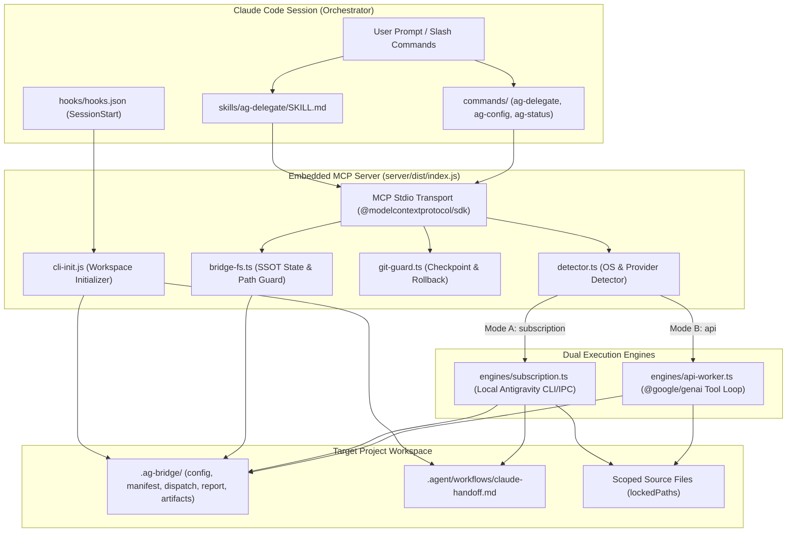
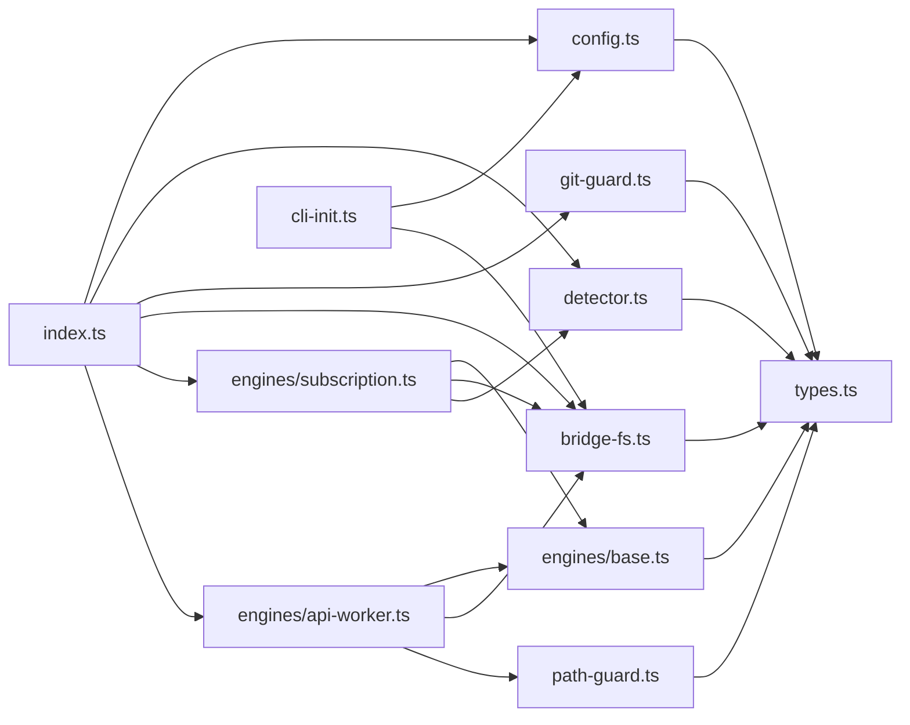

# 시스템 아키텍처 설계서 (System Architecture)

| 항목 | 내용 |
| :--- | :--- |
| **문서 ID** | `ARC-001` |
| **버전** | `1.0.0` |
| **상태** | `Approved` |
| **최종 수정일** | `2026-11-22` |
| **관련 문서** | [PRD](../01-planning/PRD.md), [브릿지 프로토콜](./bridge-protocol.md), [보안 & Git Guard](./security-and-git-guard.md), [ADR-002](../06-adr/ADR-002-dual-execution-engine.md) |

---

## 1. 아키텍처 개요

`claude-antigravity-plugin`은 **Claude Code 플러그인 레이어**(매니페스트, 훅, 스킬, 슬래시 커맨드)와 **내장 MCP 서버 레이어**(TypeScript/Node.js)로 구성된다. 두 에이전트는 대상 워크스페이스의 `.ag-bridge/` 디렉터리를 매개로 비동기·투명하게 협업한다.



---

## 2. 저장소 전체 디렉터리 구조

구현이 완료되었을 때의 전체 저장소 구조는 **플러그인 런타임 영역**과 **표준 개발 문서 영역(`docs/`)**이 명확히 분리된다.

```text
claude-antigravity-plugin/
├── AGENTS.md                       # Antigravity 워크스페이스 규칙 & 문서 네비게이션
├── README.md                       # 프로젝트 설치·사용 및 문서 개요
├── docs/                           # Antigravity 표준 개발 문서 (00~06)
├── .claude-plugin/
│   └── plugin.json                 # Claude Code 플러그인 매니페스트
├── .mcp.json                       # 내장 MCP 서버 실행 정의
├── hooks/
│   └── hooks.json                  # SessionStart 자동 초기화 훅
├── skills/
│   └── ag-delegate/
│       └── SKILL.md                # 자율 위임 판단 및 검수 스킬
├── commands/
│   ├── ag-delegate.md              # /ag-delegate 수동 위임 커맨드
│   ├── ag-config.md                # /ag-config 실행 모드·모델 설정 커맨드
│   └── ag-status.md                # /ag-status 환경 진단 커맨드
├── templates/
│   └── claude-handoff.md           # 대상 프로젝트로 동기화되는 Antigravity 핸드오프 템플릿
└── server/                         # 내장 MCP 서버 및 듀얼 엔진 (TypeScript)
    ├── package.json
    ├── tsconfig.json
    ├── src/
    │   ├── index.ts                # MCP Server 엔트리포인트 및 3개 Tool 핸들러
    │   ├── cli-init.ts             # SessionStart 훅 실행 초기화 CLI
    │   ├── types.ts                # 공통 타입, 상태 머신, 에러 코드 정의
    │   ├── config.ts               # 설정 로더 및 우선순위 해석 (env + config.json)
    │   ├── detector.ts             # OS별 Antigravity CLI/앱 및 API Key 감지기
    │   ├── path-guard.ts           # lockedPaths 정규화·Path Traversal 차단 유틸리티
    │   ├── git-guard.ts            # Git 체크포인트 생성 및 안전 롤백 유틸리티
    │   ├── bridge-fs.ts            # .ag-bridge/ 원자적 I/O, 잠금, 아카이브 관리
    │   └── engines/
    │       ├── base.ts             # ExecutionEngine 공통 인터페이스
    │       ├── subscription.ts     # 구독자용 로컬 Antigravity 트리거 + 감시 엔진
    │       └── api-worker.ts       # 비구독자용 Gemini API Tool-calling 루프 엔진
    └── tests/                      # 단위 및 Mock 통합 테스트 (node:test 또는 vitest)
```

> [!NOTE]
> 원본 명세(`claude_antigravity_plugin_spec_md.md`)의 핵심 파일 구성을 100% 유지하면서, 단일 책임 원칙(SRP)과 테스트 용이성을 위해 `config.ts`, `path-guard.ts`, `engines/base.ts`를 보조 모듈로 분리한다.

---

## 3. 모듈 의존성 그래프 및 계층 규칙

의존성은 반드시 **상위 오케스트레이션 → 도메인 서비스 → 인프라 유틸리티** 단방향을 유지한다(순환 참조 금지).



### 계층별 책임
1. **Entrypoint Layer (`index.ts`, `cli-init.ts`):** 외부 프로세스 입력(MCP Stdio, CLI 플래그) 파싱, Zod 스키마 검증, 최상위 에러 포맷팅.
2. **Engine Layer (`engines/subscription.ts`, `engines/api-worker.ts`):** 위임 실행 전략 구현. `ExecutionEngine` 인터페이스를 통해 교체 가능.
3. **Core Service Layer (`detector.ts`, `git-guard.ts`, `bridge-fs.ts`, `config.ts`):** 환경 감지, 체크포인트/롤백, 파일 브릿지 상태 관리, 설정 병합.
4. **Foundation Layer (`types.ts`, `path-guard.ts`):** 순수 타입 정의, 에러 클래스, 경로 보안 검증(외부 I/O 최소화).

---

## 4. 기술 스택 및 런타임 제약

| 영역 | 선택 기술 | 선정 사유 |
| :--- | :--- | :--- |
| **언어 / 컴파일러** | TypeScript `>= 5.5` (`strict: true`, `module: NodeNext`) | 스키마·상태 머신 컴파일 타임 안정성 보장 |
| **런타임** | Node.js `>= 20.x` (LTS) | 내장 `fs.watch`, `fetch`, `crypto.randomUUID`, `node:test` 활용 |
| **MCP SDK** | `@modelcontextprotocol/sdk` | Claude Code 표준 Stdio MCP 프로토콜 구현 |
| **스키마 검증** | `zod` | MCP Tool 입력 및 `config.json`/`manifest.json` 런타임 검증 |
| **Gemini SDK** | `@google/genai` | API 폴백 모드 Function Calling 에이전트 루프 구현 |
| **테스트 러너** | `vitest` (또는 Node 내장 `node:test`) | TypeScript 네이티브 지원, 빠른 단위/모킹 테스트 실행 |

---

## 5. 크로스플랫폼 설계 전략 (Windows / macOS / Linux)

| 관심사 | macOS | Windows | Linux |
| :--- | :--- | :--- | :--- |
| **CLI 탐색** | `which agy` / `antigravity` / `ag` | `where agy` / `antigravity` / `ag` | `which agy` / `antigravity` / `ag` |
| **앱 기본 경로** | `/Applications/Antigravity.app`, `~/Applications/Antigravity.app` | `%LOCALAPPDATA%\Programs\Antigravity\Antigravity.exe` | `/usr/bin/antigravity`, `~/.local/bin/antigravity` |
| **GUI IPC 폴백** | `osascript` (AppleScript) | PowerShell (`WScript.Shell` / `Set-Clipboard`) | `xdotool` / `xclip` / `wl-copy` + `notify-send` |
| **경로 정규화** | 대소문자 구분 가능, `/` 구분자 | 드라이브 문자·대소문자 무시 비교 필요, `\` 구분자 | 대소문자 구분, `/` 구분자 |
| **Hook 실행** | `node "${CLAUDE_PLUGIN_ROOT}/server/dist/cli-init.js" --silent` | 공백 포함 경로 대응을 위해 경로 큰따옴표 필수 | 동일 |
| **프로세스 실행** | `child_process.spawn` (`shell: false`) | `.cmd`/`.bat` 실행 시 안전 래핑, 인젝션 방지 | `child_process.spawn` (`shell: false`) |
