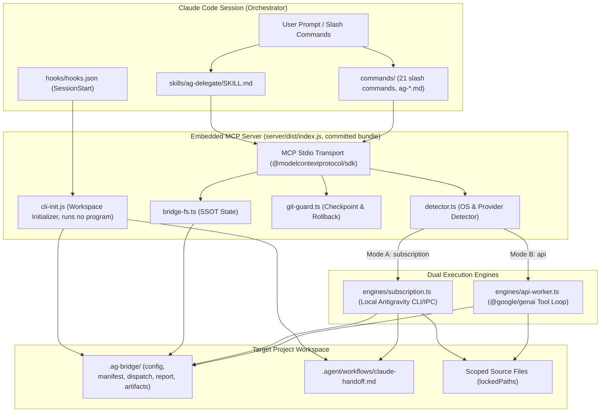
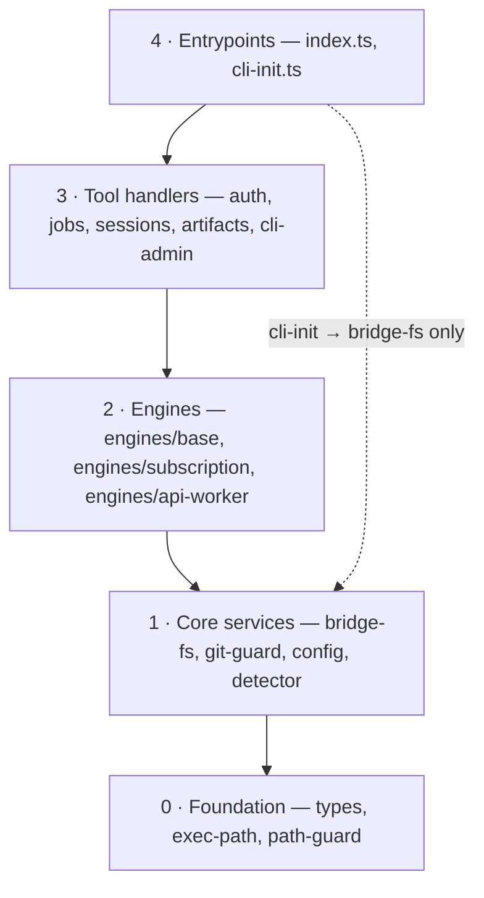

# 시스템 아키텍처 설계서 (System Architecture)

| 항목 | 내용 |
| :--- | :--- |
| **문서 ID** | `ARC-001` |
| **버전** | `1.1.0` |
| **상태** | `Approved` |
| **최종 수정일** | `2026-11-24` |
| **관련 문서** | [PRD](../01-planning/PRD.md), [브릿지 프로토콜](./bridge-protocol.md), [보안 & Git Guard](./security-and-git-guard.md), [ADR-002](../06-adr/ADR-002-dual-execution-engine.md) |

---

## 1. 아키텍처 개요

`claude-antigravity-plugin`은 **Claude Code 플러그인 레이어**(매니페스트, 훅, 스킬, 슬래시 커맨드)와 **내장 MCP 서버 레이어**(TypeScript/Node.js)로 구성된다. 두 에이전트는 대상 워크스페이스의 `.ag-bridge/` 디렉터리를 매개로 비동기·투명하게 협업한다.



---

## 2. 저장소 전체 디렉터리 구조

저장소는 **플러그인 런타임 영역**과 **표준 개발 문서 영역(`docs/`)**으로 나뉜다. 아래는 각 파일의 역할이다. 개수나 버전처럼 원천에서 뽑을 수 있는 사실은 원천이 말한다. 커맨드 수는 `commands/`, Tool 수는 `server.tool(` 등록 수를 보면 되고, 이 문서의 수량은 CI의 G7이 대조한다.

```text
claude-antigravity-plugin/
├── AGENTS.md                       # 에이전트 작업 규칙(절대 불변 규칙) & 문서 네비게이션
├── README.md / README.ko.md        # 설치·사용 가이드 (영·한)
├── SECURITY.md / CONTRIBUTING.md   # 보안 정책 · 기여 절차
├── docs/                           # Antigravity 표준 개발 문서 (00~06)
├── assets/                         # README 다이어그램 SVG
├── .claude-plugin/plugin.json      # Claude Code 플러그인 매니페스트 (+ marketplace.json)
├── .mcp.json                       # 내장 MCP 서버 실행 정의 (server/dist/index.js)
├── hooks/hooks.json                # SessionStart 자동 초기화 훅 (server/dist/cli-init.js)
├── skills/ag-delegate/SKILL.md     # 자율 위임 판단 및 검수 스킬
├── commands/                       # 슬래시 커맨드 21종 (ag-*.md)
├── templates/claude-handoff.md     # 대상 프로젝트로 동기화되는 Antigravity 핸드오프 템플릿
└── server/                         # 내장 MCP 서버 및 듀얼 엔진 (TypeScript)
    ├── build.mjs                   # esbuild — 자체완결 번들 두 개를 만든다 (ADR-004)
    ├── dist/index.js, cli-init.js  # 커밋되는 번들 (마켓플레이스 설치는 빌드하지 않는다)
    ├── scripts/                    # smoke-bundle(G5) · bundle-scan · check-doc-counts(G7) · verify-plugin
    ├── src/
    │   ├── index.ts                # MCP 서버 엔트리포인트, MCP Tool 12종 등록
    │   ├── cli-init.ts             # SessionStart 훅 초기화 CLI — 프로그램을 실행하지 않는다
    │   ├── types.ts                # 공통 타입, 상태 머신, 에러 코드
    │   ├── exec-path.ts            # 실행할 프로그램을 절대 경로로만 해석 (ARC-003 §6)
    │   ├── path-guard.ts           # lockedPaths 정규화·Path Traversal 차단
    │   ├── bridge-fs.ts            # .ag-bridge/ 원자적 I/O, 잠금, 아카이브, git 무시 등록
    │   ├── config.ts               # 설정 로더·우선순위, 저장소가 넣은 설정의 민감 키 무시 (ARC-003 §7)
    │   ├── detector.ts             # OS별 Antigravity CLI/앱·API Key 감지
    │   ├── git-guard.ts            # 체크포인트·롤백 — 저장소 정의 명령을 끈 git 실행 (ARC-003 §8)
    │   ├── auth.ts                 # /ag-login — agy OAuth 로그인 세션
    │   ├── jobs.ts                 # 백그라운드 작업 (start_ag_task / get_ag_job / cancel_ag_job)
    │   ├── sessions.ts             # 지속 stream-json 세션 (ag_session)
    │   ├── artifacts.ts            # 아티팩트 뷰어 (list_ag_artifacts)
    │   ├── cli-admin.ts            # agy CLI 관리 (ag_cli_admin)
    │   └── engines/
    │       ├── base.ts             # ExecutionEngine 공통 인터페이스
    │       ├── subscription.ts     # 구독자용 로컬 Antigravity 트리거 + 감시 엔진
    │       └── api-worker.ts       # 비구독자용 Gemini API Tool-calling 루프 엔진
    └── tests/                      # vitest 스위트 (`npm --prefix server test`)
```

---

## 3. 모듈 의존성 그래프 및 계층 규칙

**규칙:**
- import는 **같은 계층이나 아래 계층**만 가리킨다. 순환 참조는 없다.
- SessionStart 훅의 진입점 `cli-init.ts`는 `bridge-fs.ts`만 가져온다. 그래야 훅 번들에 `git-guard`·`exec-path`가 섞이지 않고, 모든 폴더에서 자동 실행되는 훅이 프로그램을 실행하지 않는다(`TC-S08`).
- 세 규칙(계층 방향·순환 없음·훅 고립)은 `TC-U33`(`server/tests/architecture.test.ts`)이 검사하고, 새 모듈은 그 테스트의 계층표에 넣어야 통과한다.
- 파일 단위 의존 관계는 코드가 원천이라 여기 옮기지 않는다(`grep "from './" server/src`).



### 계층별 책임
1. **Entrypoints (`index.ts`, `cli-init.ts`):** 외부 입력(MCP Stdio, CLI 플래그) 파싱, Zod 스키마 검증, 최상위 에러 포맷팅.
2. **Tool handlers (`auth`, `jobs`, `sessions`, `artifacts`, `cli-admin`):** MCP Tool 하나 또는 한 묶음의 요청 처리 — 로그인 세션, 백그라운드 작업, 지속 세션, 아티팩트, CLI 관리.
3. **Engines (`engines/*`):** 위임 실행 전략. `ExecutionEngine` 인터페이스로 교체 가능.
4. **Core services (`bridge-fs`, `git-guard`, `config`, `detector`):** 브릿지 상태, 체크포인트·롤백, 설정 병합과 신뢰 판정, 환경 감지.
5. **Foundation (`types`, `exec-path`, `path-guard`):** 타입·에러, 프로그램 경로 해석, 경로 보안 검증 — 로컬 모듈에 의존하지 않거나 `types`만 쓴다.

---

## 4. 기술 스택 및 런타임 제약

| 영역 | 선택 기술 | 선정 사유 |
| :--- | :--- | :--- |
| **언어 / 컴파일러** | TypeScript (`strict: true`, `module: NodeNext`) | 스키마·상태 머신 컴파일 타임 안정성 보장 |
| **런타임** | Node.js — 하한은 `server/package.json`의 `engines` | 내장 `fs.watch`, `fetch`, `crypto.randomUUID` 활용 |
| **번들러** | `esbuild` (`server/build.mjs`) | 마켓플레이스 설치는 빌드를 돌리지 않으므로 의존성까지 묶은 번들 두 개를 커밋 ([ADR-004](../06-adr/ADR-004-prebuilt-server-bundle.md)) |
| **MCP SDK** | `@modelcontextprotocol/sdk` | Claude Code 표준 Stdio MCP 프로토콜 구현 |
| **스키마 검증** | `zod` | MCP Tool 입력 및 `config.json`/`manifest.json` 런타임 검증 |
| **Gemini SDK** | `@google/genai` | API 폴백 모드 Function Calling 에이전트 루프 구현 |
| **테스트 러너** | `vitest` | TypeScript 네이티브 지원, 빠른 단위/모킹 테스트 — 러너 자체의 Node 하한이 플러그인보다 높아 CI의 Node 20 실행은 리포터 shim으로 유지(CONTRIBUTING) |

버전은 `server/package.json`·`package-lock.json`이 원천이라 여기 적지 않는다.

---

## 5. 크로스플랫폼 설계 전략 (Windows / macOS / Linux)

| 관심사 | macOS | Windows | Linux |
| :--- | :--- | :--- | :--- |
| **CLI 탐색** | `agy` → `antigravity` → `ag`를 순수 JS로 `PATH`의 완전한 절대 경로 항목에서만 탐색, 없으면 표준 설치 경로 폴백 ([ARC-003 §6](./security-and-git-guard.md)) | 동일 (`PATHEXT` 확장자 포함) | 동일 |
| **앱 기본 경로** | `/Applications/Antigravity.app`, `~/Applications/Antigravity.app` | `%LOCALAPPDATA%\Programs\Antigravity\Antigravity.exe` | `/usr/bin/antigravity`, `~/.local/bin/antigravity` |
| **GUI IPC 폴백** | `pbcopy` + `osascript` (AppleScript) | `clip` + PowerShell (`WScript.Shell.AppActivate`) | `xclip` / `wl-copy` + `notify-send` |
| **경로 정규화** | 대소문자 구분 가능, `/` 구분자 | 드라이브 문자·대소문자 무시 비교 필요, `\` 구분자 | 대소문자 구분, `/` 구분자 |
| **Hook 실행** | `node "${CLAUDE_PLUGIN_ROOT}/server/dist/cli-init.js" --silent` | 공백 포함 경로 대응을 위해 경로 큰따옴표 필수 | 동일 |
| **프로세스 실행** | `child_process.spawn` (`shell: false`), 프로그램은 `exec-path.ts`가 해석한 절대 경로로 | `.cmd`/`.bat`는 절대 경로 셸(`%ComSpec%`)의 `/d /s /c`로 인용해 래핑 | macOS와 동일 |
