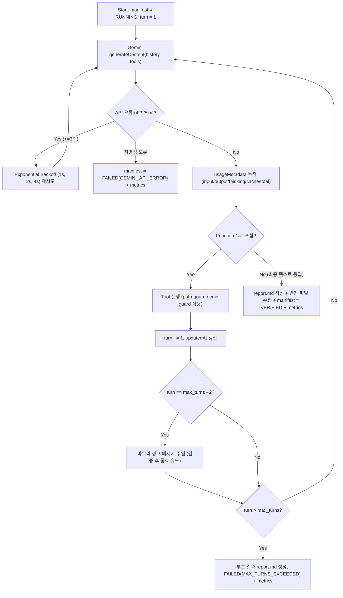

# 듀얼 실행 엔진 및 환경 감지기 상세 명세서 (Execution Engines)

| 항목 | 내용 |
| :--- | :--- |
| **문서 ID** | `SPC-002` |
| **버전** | `1.5.0` |
| **상태** | `Approved` |
| **최종 수정일** | `2026-11-24` |
| **관련 문서** | [시스템 아키텍처](../02-architecture/system-architecture.md), [MCP API 명세](./mcp-tools-api.md), [ADR-002](../06-adr/ADR-002-dual-execution-engine.md), [ADR-003](../06-adr/ADR-003-antigravity-cli-and-paths.md) |

---

## 1. 공통 엔진 인터페이스 (`server/src/engines/base.ts`)

두 실행 엔진은 동일한 전략 인터페이스를 구현하여 `index.ts`가 실행 모드 세부 구현에 결합되지 않도록 한다.

```typescript
export interface ExecutionProgressEvent {
  progress: number;
  total?: number;
  message: string;
}

export type ProgressCallback = (event: ExecutionProgressEvent) => void;

export interface ExecutionContext {
  workspaceRoot: string;
  pluginRoot: string;
  manifest: BridgeManifest;
  config: BridgeConfig;
  instructions: string;
  acceptanceCriteria: string[];
  detection: EnvironmentDetectionResult;
  agyOptions?: AgyCliOptions;
  timeoutSecOverride?: number;
  abortSignal?: AbortSignal;
  onProgress?: ProgressCallback;
}

export interface ExecutionResult {
  status: 'VERIFIED' | 'FAILED';
  reportMarkdown: string;
  changedFiles: string[];
  artifacts: string[];
  metrics?: ExecutionMetrics;
  warnings: string[];
  errorCode?: AgErrorCode;
  errorMessage?: string;
}

export interface ExecutionEngine {
  readonly mode: 'subscription' | 'api';
  execute(ctx: ExecutionContext): Promise<ExecutionResult>;
}
```

---

## 2. 환경 감지기 (`server/src/detector.ts`)

### 2.1 감지 우선순위 (`execution_mode === 'auto'`)
1. **Subscription Provider 감지 (`detectSubscriptionApp`):**
   - **사용자 지정 경로 최우선:** `config.subscription.app_path !== 'auto'`이면 해당 경로 존재 여부(`fs.existsSync`)를 확인하고 바이너리 타입(`agy` / `antigravity` / `ag`)을 자동 추론한다. 단, `loadConfig`는 두 경우에 이 값을 `auto`로 되돌린다. 하나는 워크스페이스 밖의 절대 경로가 아닌 값이고, 다른 하나는 저장소가 넣었을 수 있는 설정 파일의 값이다([ARC-003 §7](../02-architecture/security-and-git-guard.md)).
   - **CLI 바이너리 탐색 순서:** `agy` → `antigravity` → `ag`. 순수 JS `PATH` 탐색은 완전한 절대 경로 항목만 보고([ARC-003 §6](../02-architecture/security-and-git-guard.md)), MCP 호스트가 `PATH`를 축소한 경우 OS 표준 설치 경로로 폴백한다.
   - **데스크톱 앱 기본 경로 탐색:**
     - macOS: `/Applications/Antigravity.app`, `~/Applications/Antigravity.app`
     - Windows: `%LOCALAPPDATA%\agy\bin\agy.exe`, `%LOCALAPPDATA%\Programs\Antigravity\Antigravity.exe`, `%ProgramFiles%\Antigravity\Antigravity.exe`
     - Linux: `/usr/bin/agy`, `~/.local/bin/agy`, `/usr/bin/antigravity`, `~/.local/bin/antigravity`, `/opt/Antigravity/antigravity`
   - 하나 이상 감지되면 `subscription.detected = true` 반환.
2. **API Fallback 감지 (`detectApiKey`):**
   - `process.env[config.api.api_key_env]` (기본 `GEMINI_API_KEY`)가 비어있지 않으면 `{ configured: true, source: 'env' }`.
   - 없으면 `config.api.apiKey` 존재 시 `{ configured: true, source: 'config' }` (사용 시 보안 경고 추가).
3. **환경변수 오버라이드 (`config.ts`):**
   - `AG_DEFAULT_MODE` (`auto` | `subscription` | `api`)
   - `AG_DANGEROUSLY_SKIP_PERMISSIONS` (`1` | `true` | `yes` | `0` | `false` | `no`)
   - `AG_GIT_TIMEOUT_MS` (`git-guard.ts`): Git Guard가 git 명령 하나를 기다리는 상한(밀리초, 기본 `120000`) — 아주 큰 저장소에서 올린다([ARC-003 §5.4](../02-architecture/security-and-git-guard.md))
4. **모드 결정 로직:**
   - `auto`: `subscription.detected` → `'subscription'`, else `api.configured` → `'api'`, else `'unavailable'` (`NO_ANTIGRAVITY_PROVIDER`).
   - `subscription`: 미감지 시 즉시 `SUBSCRIPTION_UNAVAILABLE`.
   - `api`: 키 미설정 시 즉시 `API_KEY_MISSING`.

---

## 3. Engine A: Subscription Engine (`server/src/engines/subscription.ts`)

### 3.1 실행 파이프라인 (5단계)
1. **워크플로우 템플릿 동기화:**
   - 플러그인 `templates/claude-handoff.md`와 대상 프로젝트 `.agent/workflows/claude-handoff.md`의 버전 헤더(`<!-- ag-plugin-template-version: 1.0.0 -->`)를 비교하여 없거나 구버전이면 동기화한다.
   - 필요 시 `.agents/workflows/claude-handoff.md` 호환성 여부도 확인한다([ADR-003](../06-adr/ADR-003-antigravity-cli-and-paths.md) 참조).
2. **디스패치 기록 완료 검증:**
   - `.ag-bridge/dispatch.md`와 `.ag-bridge/manifest.json`(`DISPATCHED`)이 디스크에 완전히 플러시되었는지 확인.
3. **로컬 Antigravity 트리거 (3단계 폴백 체인 & 전체 `agy` CLI 패리티):**
   - **1차 (CLI 트리거 — 권장):** `buildCliInvocationArgs(ctx)`가 `agy` 공식 비대화형 인자를 조립한다:
     - 기본 인자: `--print <prompt> --print-timeout <timeoutSec>s`
     - 권한 제어:
       - `dangerouslySkipPermissions` (`agyOptions.dangerouslySkipPermissions ?? config.subscription.agy_dangerously_skip_permissions`)가 `true`이면 `--dangerously-skip-permissions`를 전달하고, 명시적 `agyOptions.agyMode`가 없는 한 기본 `--mode` 플래그를 생략하여 `agy`의 `permission_mode: "always-proceed"` 동작을 보존한다. 실행 시 안전 경고 문구를 `warnings`에 자동 추가한다.
       - `false`이면 `--mode <agyMode>` (기본 `accept-edits`, 또는 `auto` | `plan`)를 전달한다.
     - 샌드박스: `sandbox === true` → `--sandbox`, `sandbox === false` → `--no-sandbox`
     - 선택적 패리티 플래그: `--model`, `--effort`, `--agent`, 반복 `--add-dir`, `--conversation` / `--continue`, `--project`, `--new-project`, `--remote-agent`, `--json-schema`, `--disable-slash-commands`, `--settings`
     - 스트림 모니터링: `agy_stream_heartbeat === true`이면 `--output-format stream-json` 추가.
   - **실시간 NDJSON 파싱, 토큰 사용량 수집 및 자동 완료 (`attachStreamJsonHeartbeat`):**
     - `event === "init"`: `conversation_id`, `init.model`, `init.permission_mode` 수집.
     - `event === "step_update"`: 진행 이벤트마다 `manifest.json`을 `RUNNING` + 최신 `updatedAt` 하트비트로 갱신(Stale Lock 방지)하고 중간 `usage` 캡처.
     - `event === "result"`: 최종 `result.usage` (`input_tokens`, `output_tokens`, `thinking_tokens`, `cache_read_tokens`, `total_tokens`), `duration_seconds`, `num_turns`, `conversation_id`, `status`, `response`를 추출한다.
     - `autoFinalizeOnResult === true`이고 `/claude-handoff`가 아직 `manifest.json`을 `VERIFIED`/`FAILED`로 종료하지 않은 경우(예: 일반 질의·분석 또는 `--disable-slash-commands` 호출), `result` 이벤트 수신 시 `.ag-bridge/report.md`(응답 본문 + `Execution Metrics & Token Usage` 표)와 `manifest.json`(`VERIFIED`/`FAILED` + `metrics`)을 원자적으로 자동 확정한다. 이미 종료된 `manifest.json`에도 `metrics`가 누락되어 있으면 자동 병합한다.
   - **Windows `.cmd`/`.bat` 안전 스폰 (`buildCliSpawnSpec`):** Node 20.12+/24 `EINVAL` 방지를 위해 `.cmd`/`.bat`는 `cmd.exe /d /s /c` + `windowsVerbatimArguments: true`로 안전 래핑한다.
   - **실시간 기능 조회 (`queryAgyCapabilities`):** `agy models`와 `agy agents`를 `Promise.all`로 병렬 비동기 실행하여 사용 가능한 모델·에이전트 목록을 파싱한다.
     - `agy agents`는 출력이 터미널이 아니면(파이프·파일) 아무것도 출력하지 않는다(실측 0바이트, `agy agent`도 같음).
     - 그래서 `list_ag_capabilities`는 워크스페이스를 cwd로 하여, 없는 이름으로 에이전트를 요청하는 탐침을 함께 돌린다. 인자는 `agy -p … --agent __ag_bridge_agent_probe_<무작위>__ --mode plan --output-format stream-json --print-timeout 10s`이다.
     - agy는 세션을 시작하기 전에 `unknown agent "…" (available: a, b)` 또는 `(no custom agents are available)`로 답하고 종료 코드 1로 끝난다. 실측으로 `conversation_id`는 비어 있었고, 토큰은 0이었으며, 워크스페이스 훅은 돌지 않았다.
     - `agy agents`가 무엇이든 출력하면 그쪽을 쓴다. 세션이 시작된 응답(`num_turns` > 0, 대화 ID 있음, SUCCESS)은 목록으로 읽지 않는다. `ag_auth`의 상태 확인(모델만 필요)은 탐침을 돌리지 않는다. 쉼표+공백(`, `)이 든 에이전트 이름은 구분할 수 없다. 답이 실측한 형식과 정확히 같을 때만 읽는다. 뒤에 덧붙은 문구나 괄호가 든 이름이 있으면 읽지 않고 경고한다. 욕심 많은 정규식이 `(available: a, b) (hint)`를 `["a", "b) (hint"]`로 읽었다는 구현 검토 레그 둘의 지적이다(`parseAgyAgentProbe`, `TC-U37d`).
   - **2차 (OS IPC / 창 포커스 폴백)** 및 **3차 (클립보드 + 데스크톱 알림 폴백):** CLI 미감지 또는 즉시 오류 종료 시 기존 폴백 체인 유지.
4. **하이브리드 완료 감시 (`watchForCompletion`):**
   - `fs.watch(.ag-bridge/)` 이벤트 리스너 + `poll_interval_ms`(기본 `2000ms`) 주기 폴링 병행.
   - `manifest.json`의 `taskId === ctx.manifest.taskId`이고 `status`가 `'VERIFIED'` 또는 `'FAILED'`가 되면 즉시 종료.
   - `timeoutSecOverride ?? config.subscription.timeout_sec`(기본 `300s`) 초과 시 `FAILED(TASK_TIMEOUT)` 갱신.
5. **결과 수집:**
   - `.ag-bridge/report.md` 읽기, `.ag-bridge/artifacts/<taskId>/` 스캔, `git status --porcelain` 변경 파일 수집, 캡처된 `metrics`와 함께 `ExecutionResult` 반환.

---

## 4. Engine B: API Fallback Engine (`server/src/engines/api-worker.ts`)

`claude-grok-build-plugin`과 동일한 경량 자율 Tool-calling 에이전트 루프를 `@google/genai` SDK로 구현한다.

### 4.1 초기화 및 시스템 프롬프트
- 모델: `ctx.agyOptions?.model ?? config.api.model` (기본 `gemini-2.5-pro`)
- 시작 즉시 `manifest.json`을 `RUNNING`으로 갱신한다.
- 매 턴 응답의 `response.usageMetadata` (`promptTokenCount`, `candidatesTokenCount`, `thoughtsTokenCount`, `cachedContentTokenCount`, `totalTokenCount`)를 누적 집계하고, 종료 시 `durationSeconds`, `numTurns`, `model`, `usage`를 `manifest.json.metrics`와 `report.md`의 `## Execution Metrics & Token Usage` 섹션에 기록한다.
- 시스템 프롬프트에 `lockedPaths` 규칙, 작업 절차(`list_dir`/`read_file` → `write_file` → `run_command` → 최종 리포트), 빌드·타입체크 필수 검증을 주입한다.

### 4.2 Function Calling Tools (4종)

| Tool 이름 | 인자 스키마 | 동작 및 안전장치 |
| :--- | :--- | :--- |
| `read_file` | `{ path: string, startLine?: number, endLine?: number }` | 워크스페이스 내부 파일 읽기(`.env*`/비밀 파일 차단, 최대 `64 KB` 절단) |
| `write_file` | `{ path: string, content: string }` | `path-guard.ts`로 `lockedPaths` 검증 후 부모 디렉터리 자동 생성 및 파일 쓰기. 위반 시 예외를 던지지 않고 `{ error: "PATH_OUTSIDE_LOCKED_SCOPE", ... }`를 Tool 결과로 반환해 모델이 스스로 수정하도록 유도 |
| `list_dir` | `{ path?: string, maxDepth?: number }` | 워크스페이스 내 디렉터리 트리 조회 (`node_modules`, `.git`, `.ag-bridge` 자동 제외, 최대 200항목) |
| `run_command` | `{ command: string }` | 허용된 빌드/타입체크/린트/테스트 명령만 실행, 타임아웃 `60s`(프로세스 트리 종료 `killProcessTree`), 출력 `16 KB` 절단, 민감 환경변수 제거 |

### 4.3 에이전트 루프 제어 및 장애 복구


### 4.4 빌드 검증 강제 체크
- 모델이 `run_command`를 한 번도 실행하지 않고 완료 텍스트를 반환하려는 경우, 남은 턴이 `>= 2`이면 "최종 완료 전 `tsc --noEmit` 또는 프로젝트 빌드 명령으로 검증하세요" 안내를 1회 자동 주입한다(프로젝트에 `package.json`이 존재할 때).
