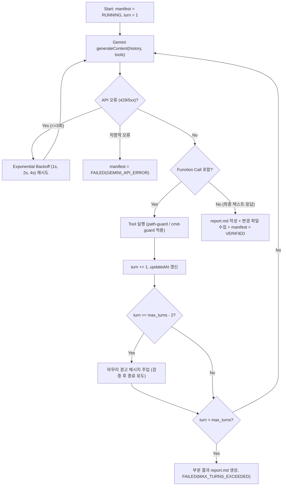

# 듀얼 실행 엔진 및 환경 감지기 상세 명세서 (Execution Engines)

| 항목 | 내용 |
| :--- | :--- |
| **문서 ID** | `SPC-002` |
| **버전** | `1.0.0` |
| **상태** | `Approved` |
| **최종 수정일** | `2026-11-22` |
| **관련 문서** | [시스템 아키텍처](../02-architecture/system-architecture.md), [MCP API 명세](./mcp-tools-api.md), [ADR-002](../06-adr/ADR-002-dual-execution-engine.md), [ADR-003](../06-adr/ADR-003-antigravity-cli-and-paths.md) |

---

## 1. 공통 엔진 인터페이스 (`server/src/engines/base.ts`)

두 실행 엔진은 동일한 전략 인터페이스를 구현하여 `index.ts`가 실행 모드 세부 구현에 결합되지 않도록 한다.

```typescript
export interface ExecutionContext {
  workspaceRoot: string;
  manifest: BridgeManifest;
  config: BridgeConfig;
  instructions: string;
  acceptanceCriteria: string[];
  detection: EnvironmentDetectionResult;
}

export interface ExecutionResult {
  status: 'VERIFIED' | 'FAILED';
  reportMarkdown: string;
  changedFiles: string[];
  artifacts: string[];
  warnings: string[];
  errorCode?: AgErrorCode;
  errorMessage?: string;
}

export interface ExecutionEngine {
  readonly mode: 'subscription' | 'api';
  execute(ctx: ExecutionContext): Promise<ExecutionResult>;
}
```

---

## 2. 환경 감지기 (`server/src/detector.ts`)

### 2.1 감지 우선순위 (`execution_mode === 'auto'`)
1. **Subscription Provider 감지 (`detectSubscriptionApp`):**
   - **사용자 지정 경로 최우선:** `config.subscription.app_path !== 'auto'`이면 해당 경로 존재 여부(`fs.existsSync`) 확인.
   - **CLI 바이너리 탐색 순서:** `agy` → `antigravity` → `ag` (macOS/Linux는 `which`, Windows는 `where` 사용, 타임아웃 2초).
   - **데스크톱 앱 기본 경로 탐색:**
     - macOS: `/Applications/Antigravity.app`, `~/Applications/Antigravity.app`
     - Windows: `%LOCALAPPDATA%\Programs\Antigravity\Antigravity.exe`, `%ProgramFiles%\Antigravity\Antigravity.exe`
     - Linux: `/usr/bin/antigravity`, `~/.local/bin/antigravity`, `/opt/Antigravity/antigravity`
   - 하나 이상 감지되면 `subscription.detected = true` 반환.
2. **API Fallback 감지 (`detectApiKey`):**
   - `process.env[config.api.api_key_env]` (기본 `GEMINI_API_KEY`)가 비어있지 않으면 `{ configured: true, source: 'env' }`.
   - 없으면 `config.api.apiKey` 존재 시 `{ configured: true, source: 'config' }` (사용 시 보안 경고 추가).
3. **모드 결정 로직:**
   - `auto`: `subscription.detected` → `'subscription'`, else `api.configured` → `'api'`, else `'unavailable'` (`NO_ANTIGRAVITY_PROVIDER`).
   - `subscription`: 미감지 시 즉시 `SUBSCRIPTION_UNAVAILABLE`.
   - `api`: 키 미설정 시 즉시 `API_KEY_MISSING`.

---

## 3. Engine A: Subscription Engine (`server/src/engines/subscription.ts`)

### 3.1 실행 파이프라인 (5단계)
1. **워크플로우 템플릿 동기화:**
   - 플러그인 `templates/claude-handoff.md`와 대상 프로젝트 `.agent/workflows/claude-handoff.md`의 버전 헤더(`<!-- ag-plugin-template-version: 1.0.0 -->`)를 비교하여 없거나 구버전이면 동기화한다.
   - 필요 시 `.agents/workflows/claude-handoff.md` 호환성 여부도 확인한다([ADR-003](../06-adr/ADR-003-antigravity-cli-and-paths.md) 참조).
2. **디스패치 기록 완료 검증:**
   - `.ag-bridge/dispatch.md`와 `.ag-bridge/manifest.json`(`DISPATCHED`)이 디스크에 완전히 플러시되었는지 확인.
3. **로컬 Antigravity 트리거 (3단계 폴백 체인):**
   - **1차 (CLI 트리거 — 권장):** 감지된 CLI(`agy` 또는 `antigravity`)를 비동기 실행하여 대상 워크스페이스에서 `/claude-handoff` 지시를 전달한다.
     - `agy` 공식 비대화형 인자: `agy --print "<handoff prompt>" --mode <agy_mode> --print-timeout <timeout_sec>s [--sandbox] [--output-format stream-json]` (기본 `agy_mode: "accept-edits"`, `agy_sandbox: true`, `agy_stream_heartbeat: true`)
     - `agy_stream_heartbeat` 활성 시 `stdout` NDJSON 스트림을 파싱(`attachStreamJsonHeartbeat`)해 진행 이벤트마다 `manifest.json`을 `RUNNING` + 최신 `updatedAt` 하트비트로 자동 갱신(장기 실행 작업의 오탐 Stale Lock 방지, `VERIFIED`/`FAILED` 종료 상태는 절대 덮어쓰지 않음).
     - 레거시 `antigravity` / `ag`: `run --workflow claude-handoff`
     - 실행 로그는 민감 키 마스킹 후 `.ag-bridge/artifacts/<taskId>/agy-cli.log`에 기록하여 디버깅 가시성을 확보한다.
     - CLI가 인자 오류로 즉시 비정상 종료(exit code != 0)하면 2차로 자동 폴백한다.
   - **2차 (OS IPC / 창 포커스 폴백):**
     - `trigger_method`가 `cli_or_ipc`일 때 OS별 스크립트로 Antigravity 앱 활성화 및 프롬프트 주입 시도.
   - **3차 (클립보드 + 데스크톱 알림 폴백):**
     - `/claude-handoff` 실행 프롬프트를 시스템 클립보드에 복사하고 OS 알림을 발송하며 `warnings`에 안내 문구를 기록한다(감시 루프는 계속 대기하여 사용자가 붙여넣기 실행 시 자동 회수).
4. **하이브리드 완료 감시 (`watchForCompletion`):**
   - `fs.watch(.ag-bridge/)` 이벤트 리스너 + `poll_interval_ms`(기본 `2000ms`) 주기 폴링을 병행한다(OS별 `fs.watch` 이벤트 누락 보완).
   - `manifest.json`의 `taskId === ctx.manifest.taskId`이고 `status`가 `'VERIFIED'` 또는 `'FAILED'`가 되면 즉시 종료한다.
   - `timeout_sec`(기본 `300s`) 초과 시 감시를 중단하고 `manifest.json`을 `FAILED(TASK_TIMEOUT)`으로 갱신한다.
5. **결과 수집:**
   - `.ag-bridge/report.md` 읽기(누락 시 기본 요약 생성), `.ag-bridge/artifacts/<taskId>/` 내 파일 스캔, `git status --porcelain`으로 실제 변경 파일 목록 수집 후 `ExecutionResult` 반환.

---

## 4. Engine B: API Fallback Engine (`server/src/engines/api-worker.ts`)

`claude-grok-build-plugin`과 동일한 경량 자율 Tool-calling 에이전트 루프를 `@google/genai` SDK로 구현한다.

### 4.1 초기화 및 시스템 프롬프트
- 모델: `config.api.model` (기본 `gemini-2.5-pro`)
- 시작 즉시 `manifest.json`을 `RUNNING`으로 갱신한다.
- 시스템 프롬프트에 다음 핵심 지침을 주입한다:
  - 역할: Claude Code로부터 UI/프론트엔드 구현 작업을 위임받은 자율 엔지니어링 워커.
  - `lockedPaths` 목록과 수정 금지 규칙 명시.
  - 작업 절차: 1) 기존 파일 및 타입/패키지 구조 파악(`list_dir`, `read_file`) → 2) 코드 구현(`write_file`) → 3) 타입체크/빌드 검증(`run_command`) → 4) 최종 마크다운 리포트 반환.
  - 브라우저 시각적 검증은 API 모드에서 불가하므로, 빌드·타입체크·린트 통과를 필수 완료 기준으로 강제한다.

### 4.2 Function Calling Tools (4종)

| Tool 이름 | 인자 스키마 | 동작 및 안전장치 |
| :--- | :--- | :--- |
| `read_file` | `{ path: string, startLine?: number, endLine?: number }` | 워크스페이스 내부 파일 읽기(`.env*`/비밀 파일 차단, 최대 `64 KB` 절단) |
| `write_file` | `{ path: string, content: string }` | `path-guard.ts`로 `lockedPaths` 검증 후 부모 디렉터리 자동 생성 및 파일 쓰기. 위반 시 예외를 던지지 않고 `{ error: "PATH_OUTSIDE_LOCKED_SCOPE", ... }`를 Tool 결과로 반환해 모델이 스스로 수정하도록 유도 |
| `list_dir` | `{ path?: string, maxDepth?: number }` | 워크스페이스 내 디렉터리 트리 조회 (`node_modules`, `.git`, `.ag-bridge` 자동 제외, 최대 200항목) |
| `run_command` | `{ command: string }` | 허용된 빌드/타입체크/린트/테스트 명령만 실행, 타임아웃 `60s`, 출력 `16 KB` 절단, 민감 환경변수 제거 |

### 4.3 에이전트 루프 제어 및 장애 복구


### 4.4 빌드 검증 강제 체크
- 모델이 `run_command`를 한 번도 실행하지 않고 완료 텍스트를 반환하려는 경우, 남은 턴이 `>= 2`이면 "최종 완료 전 `tsc --noEmit` 또는 프로젝트 빌드 명령으로 검증하세요" 안내를 1회 자동 주입한다(프로젝트에 `package.json`이 존재할 때).
