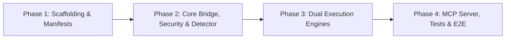

# 구현 마스터 플랜 및 WBS (Implementation Plan)

| 항목 | 내용 |
| :--- | :--- |
| **문서 ID** | `IMP-001` |
| **버전** | `1.0.0` |
| **상태** | `Approved` |
| **최종 수정일** | `2026-11-22` |
| **관련 문서** | [작업 체크리스트](./task-checklist.md), [테스트 & QA 계획](../05-verification/test-and-qa-plan.md), [시스템 아키텍처](../02-architecture/system-architecture.md) |

---

## 1. 구현 로드맵 (Phase 1 ~ Phase 4)

전체 구현은 원본 명세의 4단계 마일스톤을 따르며, 각 단계 종료 시 명확한 검증 게이트(Exit Gate)를 통과해야 다음 단계로 진입한다.

---

## 2. 단계별 WBS (Work Breakdown Structure)

### Phase 1: Project Scaffolding, Manifests & Prompts
**목표:** Claude Code 플러그인 메타파일, TypeScript 프로젝트 설정, 스킬/커맨드/워크플로우 템플릿을 완성한다.

| 태스크 ID | 산출물 | 상세 구현 내용 | 참조 문서 |
| :--- | :--- | :--- | :--- |
| `T-101` | `.claude-plugin/plugin.json`, `.mcp.json`, `hooks/hooks.json` | 플러그인 매니페스트, Stdio MCP 정의, `SessionStart` 훅(경로 큰따옴표 적용) 생성 | `ARC-001`, `SPC-001` |
| `T-102` | `server/package.json`, `server/tsconfig.json` | Node 20+ ESM(`NodeNext`), TypeScript `strict: true`, `@modelcontextprotocol/sdk`, `@google/genai`, `zod`, 테스트 러너 구성 | `ARC-001` |
| `T-103` | `skills/ag-delegate/SKILL.md` | 자율 위임 기준, `check_ag_environment` 선행 점검, 모드별 완료 조건 분기, 롤백 기준 작성 | `SPC-003` |
| `T-104` | `commands/ag-delegate.md`, `ag-config.md`, `ag-status.md` | 수동 위임, 설정 변경, 상태 진단 슬래시 커맨드 작성 | `SPC-003` |
| `T-105` | `templates/claude-handoff.md` | 버전 헤더 포함 Antigravity 6단계 핸드오프 워크플로우 작성 | `SPC-003` |

- **Phase 1 Exit Gate:** 모든 JSON 파일 문법 유효성 검증 완료, `cd server && npm install` 성공.

---

### Phase 2: Core Bridge, Security Guard, Git Guard & Detector
**목표:** 외부 엔진에 독립적인 핵심 인프라 계층을 구현하고 단위 테스트로 무결성을 보장한다.

| 태스크 ID | 산출물 | 상세 구현 내용 | 참조 문서 |
| :--- | :--- | :--- | :--- |
| `T-201` | `server/src/types.ts` | `BridgeManifest`, `BridgeConfig`, `TaskStatus`, `AgErrorCode`, `AgPluginError` 정의 | `ARC-002`, `SPC-001` |
| `T-202` | `server/src/config.ts` | 설정 우선순위(Tool > `config.json` > env > default), Zod 스키마 검증, 비밀 마스킹(`maskSecrets`) | `ARC-002`, `ARC-003` |
| `T-203` | `server/src/path-guard.ts` | `lockedPaths` 정규화, Path Traversal(`../`) 및 Symlink 탈출 차단, `.git/`·`.env*` 금지 목록 | `ARC-003` |
| `T-204` | `server/src/bridge-fs.ts` | `.ag-bridge/` 초기화, `.gitignore` 중복 없는 등록, 원자적 write-rename, 잠금/Stale Lock 복구, `dispatch.md`/`report.md` 헬퍼, 아카이브 | `ARC-002` |
| `T-205` | `server/src/git-guard.ts` | `git stash create` + `refs/ag-bridge/checkpoints/<taskId>` 체크포인트, untracked 기준선 저장, 안전 롤백, non-git 처리 | `ARC-003` |
| `T-206` | `server/src/detector.ts` | OS별 `agy`/`antigravity`/`ag` CLI 및 데스크톱 앱 탐색, API Key 판별, `auto`/`subscription`/`api` 모드 해석 | `SPC-002`, `ADR-003` |
| `T-207` | `server/src/cli-init.ts` | `--silent`, `--workspace`, `--force-template` 지원, `.ag-bridge/` 및 `claude-handoff.md` 버전 비교 동기화 | `SPC-001`, `PLN-002` |

- **Phase 2 Exit Gate:** `npm run typecheck` 통과 + `path-guard`, `bridge-fs`, `git-guard`, `detector` 단위 테스트 100% 통과.

---

### Phase 3: Dual Execution Engines
**목표:** 로컬 구독 모드 엔진과 Gemini API 폴백 엔진을 `ExecutionEngine` 인터페이스로 구현한다.

| 태스크 ID | 산출물 | 상세 구현 내용 | 참조 문서 |
| :--- | :--- | :--- | :--- |
| `T-301` | `server/src/engines/base.ts` | `ExecutionEngine`, `ExecutionContext`, `ExecutionResult` 인터페이스 정의 | `SPC-002` |
| `T-302` | `server/src/engines/subscription.ts` | 템플릿 동기화, 3단계 트리거(CLI → OS IPC → 클립보드/알림), `fs.watch` + 2초 폴링 하이브리드 감시, 타임아웃 처리, 아티팩트 수집 | `SPC-002`, `ADR-003` |
| `T-303` | `server/src/engines/api-worker.ts` | `@google/genai` 초기화, 4개 Tool(`read_file`, `write_file`, `list_dir`, `run_command`) 바인딩, 명령 허용/차단 정책, `max_turns` 경고/제한, 429/5xx 백오프 재시도, 빌드 검증 유도, `report.md` 생성 | `SPC-002`, `ARC-003` |

- **Phase 3 Exit Gate:** Mock FS 감시 테스트(`subscription.ts`) 및 Mock `@google/genai` 테스트(`api-worker.ts`) 통과.

---

### Phase 4: MCP Server Integration, Build & QA Verification
**목표:** 3개 MCP Tool을 서버에 연결하고 End-to-End 파이프라인 및 패키징을 검증한다.

| 태스크 ID | 산출물 | 상세 구현 내용 | 참조 문서 |
| :--- | :--- | :--- | :--- |
| `T-401` | `server/src/index.ts` | Stdio MCP 서버 초기화, `delegate_to_antigravity`, `check_ag_environment`, `rollback_ag_task` 핸들러 및 Zod 입력 검증 연결 | `SPC-001` |
| `T-402` | `server/tests/*` | 단위/통합/보안 테스트 스위트 완성 (Mock MCP Client 포함) | `VER-001` |
| `T-403` | `server/dist/*` | `npm run build` 클린 빌드, `cli-init.js` 및 `index.js` 실행 스모크 테스트 | `VER-001` |
| `T-404` | `README.md`, `docs/04-implementation/task-checklist.md` | 실제 설치·사용법 최종 업데이트 및 체크리스트 완료 마킹 | `STD-001` |

- **Phase 4 Exit Gate:** `npm run typecheck && npm run build && npm test` 전원 통과, `stdout` 오염 0건 확인.

---

## 3. 주요 기술 리스크 및 완화 전략

| 리스크 | 발생 가능성 | 영향도 | 완화 전략 |
| :--- | :---: | :---: | :--- |
| OS별 Antigravity CLI 인자 규격 변동 (`agy` vs `antigravity`) | 높음 | 중 | CLI 탐지 우선순위 설정 + 실패 시 OS IPC/클립보드 폴백 체인 구성([ADR-003](../06-adr/ADR-003-antigravity-cli-and-paths.md)) |
| Windows에서 `fs.watch` 중복/누락 이벤트 및 파일 잠금(`EBUSY`) | 중 | 높음 | `fs.watch` + 2초 폴링 병행, 원자적 write-rename 및 읽기 3회 재시도 적용 |
| API 워커가 `lockedPaths` 밖 파일 수정 또는 무한 루프 진입 | 중 | 높음 | `path-guard.ts` 강제 차단, `max_turns - 2` 마무리 경고 주입, 명령 타임아웃 `60s` 적용 |
| `git rollback` 시 사용자의 기존 미커밋 작업 손실 | 낮음 | 매우 높음 | `git stash create` + `untrackedBaseline` 스냅샷으로 위임 이전 상태 100% 보존 |
